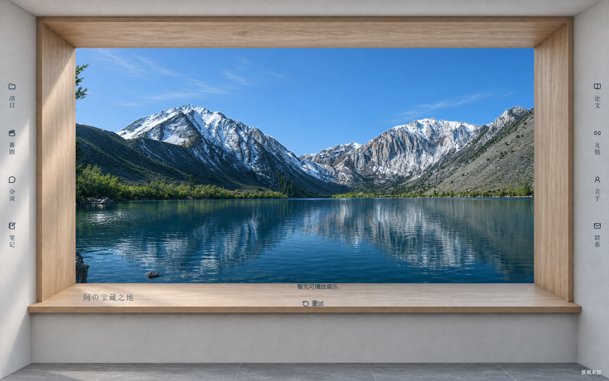
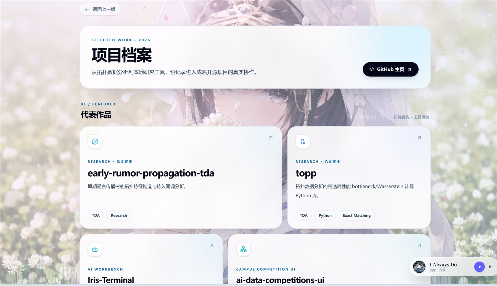
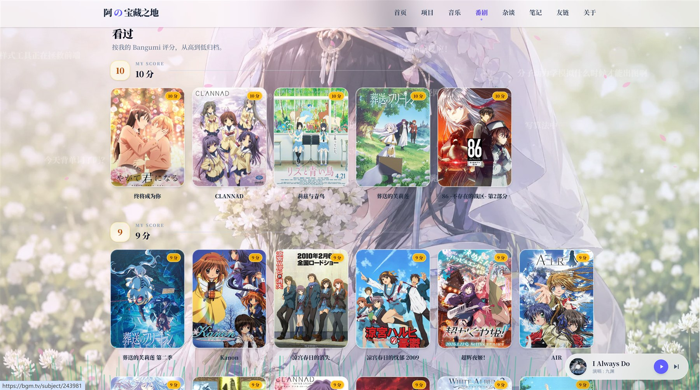
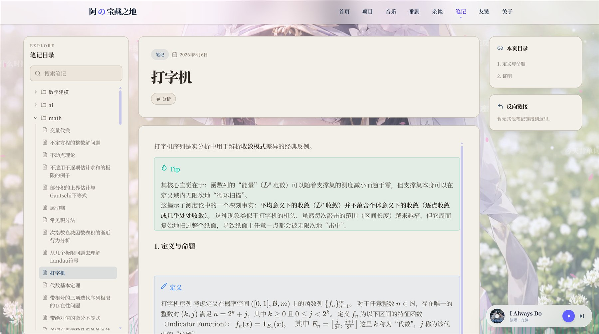
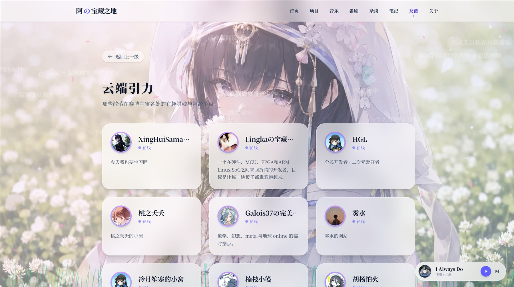

# 阿の宝藏之地

<p align="center">
  <strong>把研究、项目、笔记与兴趣收藏放进同一座持续生长的个人站点。</strong>
</p>

<p align="center">
  <a href="https://nothing-new.cn"></a>
  
  
  
  <a href="./LICENSE.txt"></a>
</p>

<p align="center">
  
</p>

## 关于这个站点

“阿の宝藏之地”不是单一用途的博客模板，而是一套围绕个人内容建立的长期归档系统：项目与开源经历有独立展柜，番剧、杂谈与数学笔记共享同一套视觉语言，首页提供桌面沉浸式场景、两侧预览导航和窗台音乐控制。

站点由 **Next.js 主站**与经过本地化改造的 **Quartz 内容管线**共同组成。Markdown 仍是内容源，构建时会生成可供主站读取的文章、目录、搜索索引、反向链接和静态资源；Obsidian 只是可选的写作入口，并不是运行依赖。

## 页面与能力

| 页面 | 路径                                                      | 主要内容                                                 |
| ---- | --------------------------------------------------------- | -------------------------------------------------------- |
| 首页 | [<code>/</code>](https://nothing-new.cn/)                 | 桌面山湖观景窗、左右各四入口与窗台音乐；移动访问进入笔记 |
| 项目 | [<code>/projects</code>](https://nothing-new.cn/projects) | 研究工作、AI 工具、竞赛项目与开源贡献                    |
| 番剧 | [<code>/anime</code>](https://nothing-new.cn/anime)       | 从 Bangumi 同步收藏，并按观看状态与评分归档              |
| 杂谈 | [<code>/chatter</code>](https://nothing-new.cn/chatter)   | 杂谈卡片与项目文件夹按最后修改时间混排展示               |
| 笔记 | [<code>/blog</code>](https://nothing-new.cn/blog)         | Quartz 增强的目录、全文搜索、KaTeX、代码高亮与反向链接   |
| 论文 | [<code>/papers</code>](https://nothing-new.cn/papers)     | Zotero 书目、阅读状态、公开笔记关联与 TDA 历期周报       |
| 友链 | [<code>/friends</code>](https://nothing-new.cn/friends)   | 朋友站点与独立博客入口                                   |
| 关于 | [<code>/about</code>](https://nothing-new.cn/about)       | 个人介绍、技术足迹与站点信息                             |

## 页面预览

<table>
  <tr>
    <td width="50%"><strong>项目档案</strong><br></td>
    <td width="50%"><strong>首页改造前预览</strong><br></td>
  </tr>
  <tr>
    <td width="50%"><strong>番剧收藏</strong><br></td>
    <td width="50%"><strong>杂谈</strong><br></td>
  </tr>
  <tr>
    <td width="50%"><strong>Quartz 笔记</strong><br></td>
    <td width="50%"><strong>友链</strong><br></td>
  </tr>
</table>

## 核心实现

- **桌面观景窗首页**：连续日景、完整室内窗洞、局部水面谱场响应、指针观察位移、侧栏预览及窗台音乐，见[首页实现与集中验证](docs/project/home-scene.md)和[v2 设计规范](docs/project/Nothing_New_首页重构_设计与开发规范_v2_2026-11-17.md)。当前动态版本已在本地生产构建检查，待人工视觉审阅，尚未部署。移动设备仍进入笔记。

- **友链首页预览**：按需加载首页快照，支持键盘与移动端操作，见[友链说明](docs/project/friends-preview.md)。
- **按入口启动**：桌面首页以约 2.4 秒的山湖线稿图版交叉淡入日间窗景，图片解码或三维首绘后交接；慢加载、跳过、减少动态和 hydration 失败均有兜底。内页与移动入口保留原有分流，侧栏资源并行预热。职责、独立超时预算与历史记录见[全站启动与导航](docs/project/site-startup.md)。
- **关于页三个章节**：网站介绍、工程身份与研究身份独立维护 Markdown，共用章节索引和滚动定位，见[关于页结构](docs/project/about-restructure.md)。
- **统一的页面外壳**：每页仅维护一套固定外观，首页为日间动态观景窗，内页保留默认浅色；响应式导航、全站背景、动态场景和播放器状态在不同页面间保持一致，不提供昼夜或主题切换。
- **全站组件色卡**：蓝色主基调，搭配玫红、紫色和青绿；中性阅读面禁用米黄、奶油白和浅琥珀底色，素材保留原色，见[全站配色规范](docs/project/blue-theme.md)。
- **桌面文字可读性**：清理重复标签、常驻操作教程和技术错误详情，逐组件改善字号与局部阅读面；文章、个人介绍、项目描述及素材保留原样。笔记目录的自动摘要复用构建后的公式渲染，显式作者摘要与旧产物保持兼容，见[文字与文案约定](docs/project/blue-theme.md#桌面文字与文案2026-11-16)。
- **界面与场景**：不按时间、系统配色或历史缓存切换外观；首页默认用单一 WebGL2 合成器处理水面局部采样，减少动态或无 WebGL 时回退完整静态房间。当前约定见[全站配色规范](docs/project/blue-theme.md)，旧天体与显示开关仅保留[历史设计记录](docs/project/home-mode-panels.md)。
- **导航与侧栏**：首页左右各四入口，六个页面入口支持点击文字或截图直接跳转，悬停展开当前页面预览；论文和联系保留点击固定，论文保留两层阅读。标签固定，预览向内展开；内页导航及手机圆盘见[导航视觉更新与验收](docs/project/navigation-renewal.md)。
- **论文库与 TDA 文献雷达**：`/papers` 默认展示周报，已读论文按 Zotero 文件夹关系图与目录浏览，并在详情中展示关联公开笔记，支持搜索与历期阅读。图谱来源及索引流程见[论文系统](docs/project/paper-library.md)。首页论文封面直达论文库，监控仓库继续动态推送，无需每周重新部署，配置见[周报上传说明](docs/project/tda-paper-monitor.md)。
- **首页音乐控制**：播放、切歌和进度常驻下方，歌词位于控件上方。[接口、隔离预览与验证边界](docs/project/home-music-renewal.md)。
- **音乐播放**：桌面首页显示底部控件或首次打开项目页耳机面板时加载歌单，不自动播放；加载后由根 Provider/audio 保留跨页状态，首次加载、空歌单及失败均有反馈，支持重试。
- **同一房间的窗前与桌前视角**：桌面首页保留浅木观景窗与原有环境动态；窗户位于工作间后方，上滑后退到桌前并转身，看向同一张工作台，URL 切换保留场景。模型失败时保留静态图和可读项目目录，详见[室内后退转场](docs/project/projects-room.md#恢复原首页与清空窗前2026-11-24)。项目内容由本地数据维护，番剧页保留快照与 API 回退。
- **杂谈杂志排版**：不对称图版、完整封面标题和搜索导航，见[杂谈验收](docs/project/chatter-magazine.md)。
- **双内容分区**：<code>content/math/</code> 生成笔记，<code>content/misc/</code> 生成普通杂谈卡片，其余公开顶层目录在杂谈页显示为带图片的项目文件夹封面。
- **Quartz 增强渲染**：保留目录、搜索、公式、代码高亮、内部链接、反向链接和附件处理；页面布局由 Next.js 提供，仅保留笔记正文所需的 Quartz 样式。
- **公开图片静态分发**：站点背景、头像、杂谈封面与 Quartz 文章图片直接由构建产物及 CDN 提供。动漫快照、封面和论文周报使用 Cloudflare 内容存储，不上传到外部图片库。
- **可审阅的发布流程**：Obsidian 同步先判断哪些笔记允许公开，再单向写入 <code>content/</code>；杂谈封面会被固定到 frontmatter，保证后续构建稳定。

## 技术栈

| 层级       | 技术                                                      |
| ---------- | --------------------------------------------------------- |
| Web        | Next.js 16、React 19、TypeScript、Tailwind CSS 4          |
| 动效与场景 | Framer Motion、Three.js、WebGL2、Canvas 2D                |
| 内容处理   | Quartz、Markdown、KaTeX、Shiki、FlexSearch                |
| 数据来源   | 本地 TypeScript 数据、Bangumi API、网易云音乐接口         |
| 工程化     | ESLint、Prettier、Node.js Test Runner、Cloudflare Workers |

## 快速开始

### 环境要求

- Node.js <code>22.x</code>（版本见 <code>.node-version</code>）
- npm <code>>= 10.9.2</code>

```bash
git clone https://github.com/proffitteoy/nothing-new.git
cd nothing-new
npm ci
npm run dev
```

打开 <http://localhost:3000>。<code>dev</code> 会先编译 <code>content/</code>，因此首次启动会比普通 Next.js 项目稍慢。

普通 Next.js 本地开发运行静态图片与种子周报，不连接生产内容存储。若要直接读取 Bangumi 番剧收藏，复制环境变量示例并配置：

```powershell
Copy-Item .env.example .env.local
```

```dotenv
BANGUMI_ACCESS_TOKEN=your_token_here
```

Token 只在服务端读取，不要添加 `NEXT_PUBLIC_` 前缀。未配置 Token 时，其余页面仍可正常运行，番剧页会显示配置提示。验证内容读写应使用 Cloudflare Workers 预览与独立测试数据，不要绑定到生产存储。

> Windows PowerShell 如果阻止执行 <code>npm.ps1</code>，请将命令中的 <code>npm</code> 换成 <code>npm.cmd</code>，例如 <code>npm.cmd run dev</code>。

## 常用命令

| 命令                                     | 作用                                       |
| ---------------------------------------- | ------------------------------------------ |
| <code>npm run dev</code>                 | 构建笔记并启动开发服务器                   |
| <code>npm run build</code>               | 构建笔记与 Next.js 生产版本                |
| <code>npm run start</code>               | 启动已经完成构建的生产服务器               |
| <code>npm run lint</code>                | 执行 ESLint 检查                           |
| <code>npm run typecheck</code>           | 生成 Next.js 类型并执行 TypeScript 检查    |
| <code>npm test</code>                    | 运行测试                                   |
| <code>npm run notes:build</code>         | 只生成笔记、搜索索引与静态资源             |
| <code>npm run sync:obsidian:dry</code>   | 预览 Obsidian 同步，不写入文件             |
| <code>npm run sync:obsidian:check</code> | 检查是否存在未同步变化                     |
| <code>npm run sync:zotero</code>         | 同步获批 Collection 的公开书目与阅读标签   |
| <code>npm run sync:zotero:dry</code>     | 预览论文同步，不写快照                     |
| <code>npm run sync:zotero:check</code>   | 检查论文快照是否需要更新                   |
| <code>npm run sync:obsidian</code>       | 审阅并同步获准公开的内容，同时补全杂谈封面 |
| <code>npm run covers:check</code>        | 检查杂谈封面分配是否稳定                   |

## 内容维护

### 站点配置

- <code>siteConfig.ts</code>：站点标题、头像、背景、歌单、社交链接与视觉开关。
- <code>app/projects/projects.ts</code>：项目档案与物件映射；模型重建与验收见 [窗边研究小屋](docs/project/projects-room.md)。
- <code>data/friends.ts</code>：友链数据。
- <code>content/</code>：笔记与杂谈源内容；<code>math/</code> 进入笔记，<code>misc/</code> 进入普通杂谈，其余公开顶层目录作为杂谈项目文件夹。
- <code>app/about/about.md</code>：关于页正文。

笔记当前支持 Markdown、公式、代码高亮、展开的 Obsidian Callout、普通内部链接、目录与搜索。Mermaid 围栏保留可读源码；`[!type]+/-` 仍识别为 Callout，但展开显示全文。当前不提供 Mermaid 图形渲染/扩展对话框或链接悬停预览；构建不生成相应失效交互。

### 搜索引擎索引

站点正式地址为 <https://nothing-new.cn>。根布局的 <code>metadataBase</code> 将各页面的相对 canonical 解析为新域名下的绝对地址。

<code>app/sitemap.ts</code> 通过 <code>getNoteManifest()</code> 读取构建后的内容清单，收录静态页面、公开目录页及 <code>manifest.artifacts</code> 中的文章，排除 <code>manifest.aliases</code> 历史别名和跳转到文章的 <code>/blog</code> 入口，并对路径去重。新增公开 Markdown 文章后，重新构建即可更新 <code>/sitemap.xml</code>；<code>app/robots.ts</code> 生成的 <code>/robots.txt</code> 允许抓取并声明该 Sitemap 地址。

### Obsidian 同步

仓库内置的是单向同步流程：

```text
Obsidian Vault -> 公开内容审阅 -> content/ -> Quartz 构建 -> Next.js
```

默认源目录是作者本机的 <code>E:/math</code>。在其他环境使用时，请先修改 <code>obsidian-sync.config.mjs</code>；不使用 Obsidian 时可以直接维护 <code>content/</code>。完整的 include、exclude、附件与删除规则见[同步说明](./docs/project/obsidian-sync.md)。

### 构建产物

以下目录由构建过程生成，不应手动编辑：

- <code>.quartz-cache/</code>：内容构建 CLI 的转译缓存；不提供独立 Quartz 站点。
- <code>.quartz-cache/next/</code>：供 Next.js 读取的内容清单与文章产物。
- <code>public/quartz-assets/</code>：搜索索引与公开附件。
- <code>.next/</code>：Next.js 构建产物。

内容 emitter 固定写入上述内容与公共资源目录。`notes:build` 不接受旧 `-o/--output` 参数；它不控制 Next 内容或公开附件的输出位置。

## 项目结构

```text
.
├── app/                       # 页面、路由与服务端接口
├── components/                # 通用 UI、动态场景与播放器
├── content/                   # 笔记和杂谈源内容
├── data/                      # 友链等结构化数据
├── docs/project/              # 项目维护与授权说明
├── lib/notes/                 # Next.js 侧的内容读取层
├── public/                    # 公共素材与生成后的笔记资源
├── quartz/                    # 内容解析和产物生成管线
├── scripts/                   # 同步、审阅和封面维护脚本
├── obsidian-sync.config.mjs   # Obsidian 单向同步配置
└── siteConfig.ts              # 全站配置中心
```

## 部署

Cloudflare Workers 使用 Node.js <code>22.x</code>，先运行 <code>npm run cf:build</code>，再运行 <code>npm run cf:deploy</code>。后者发布 Worker；自定义 SQLite 缓存不需要批量预填充 KV。<code>wrangler.jsonc</code> 的 Worker 名称为 <code>nothing-new</code>，KV 命名空间属于当前账号；迁移到其他账号时须先创建新命名空间并替换 ID。Next.js 运行及可变缓存使用 SQLite Durable Objects，无需开通 R2 或 Workers Paid。免费方案仍受每日请求、运行时长和 SQLite 读写额度约束。旧部署退役与存量核验见[迁移记录](docs/project/vercel-origin-transfer-migration.md)。

Workers Builds 执行 <code>npm run build</code> 时，Next.js 生成 <code>standalone</code> 产物，<code>postbuild</code> 随后通过 <code>--skipNextBuild</code> 生成 OpenNext 入口。Wrangler 的正式部署会先委托 OpenNext，因此不能只依赖部署阶段的 build hook；Preview 仍可使用该 hook。OpenNext 自行调用 Next 构建时，<code>NEXT_PRIVATE_STANDALONE</code> 标识会跳过 postbuild 的重复打包，避免递归。非 Workers 构建不会触发此打包。验收须从缺少 OpenNext 产物的状态运行普通构建。分支命令 <code>wrangler preview</code> 使用 <code>previews</code> 中独立的 KV，Durable Objects 由平台按 Preview 隔离。<code>cloudflare-worker.mjs</code> 通过 <code>ctx.exports</code> 为 OpenNext 提供同一部署内的自引用，缓存重验证会留在当前 Preview。其他账号需同时替换正式及预览 KV 的 ID；相关约束见 [Preview 资源与隔离](https://developers.cloudflare.com/workers/previews/resources/)。

Wrangler 将 <code>.quartz-cache/next</code> 中的 JSON 及 <code>app/about</code> 的三份 Markdown 作为文本模块装入虚拟文件系统，支持空缓存渲染及后台再生。旧头像地址 <code>/avatar</code> 由 Worker 入口转交 <code>ASSETS</code> 读取 <code>/avatar.jpg</code>，并保留原缓存头。

Cloudflare 的 <code>SiteRuntime</code> 使用免费 SQLite Durable Object 的每请求 30 秒 CPU 预算处理 Next.js，入口 Worker 负责转发。OpenNext 缓存和内容的新写入通过同一接口落到 SQLite；<code>SITE_CONTENT</code> KV 保留存量周报、番剧与封面作为只读回退，生产及预览隔离，不重复复制全部图片。每个存储键独立定位，2 MiB 分块写入和删除均由事务提交，保留原路径、ETag / 304、不可变快照与失败不发布规则。请求上下文每次新建，写入可见性不会跨请求泄漏。动态路由不依赖旧对象存储，`/anime/blob/**` 保持原 URL。

运行时配置服务端 <code>BANGUMI_USERNAME</code>（如需指定账户），并以 Secrets 配置 <code>BANGUMI_ACCESS_TOKEN</code>、<code>PAPERS_SYNC_SECRET</code>、<code>ANIME_SYNC_SECRET</code> 和 <code>CRON_SECRET</code>。论文监控仓库的 <code>BLOG_SYNC_SECRET</code> 与站点的 <code>PAPERS_SYNC_SECRET</code> 配对，<code>BLOG_SYNC_URL</code> 指向正式 Worker 的 <code>/api/papers</code>。每天 03:00 UTC 的动漫同步由 Worker 的 <code>scheduled</code> 入口调用现有认证接口。

Obsidian 仍从本地 <code>E:/math</code> 按既有审阅规则发布到 <code>content/</code>；Zotero 仍通过本地 API 导出获批书目到 <code>data/paper-library.json</code>。两者随 Git 构建发布，不向 Cloudflare 连接作者电脑，也不需要新增云端访问密钥。

部署前建议运行：

```bash
npm run lint
npm run typecheck
npm test
npm run build
```

## 贡献

欢迎提交 Bug、文档修正和范围明确的体验改进。界面变更请附上截图，并说明验证方式；功能建议与问题可通过 [GitHub Issues](https://github.com/proffitteoy/nothing-new/issues) 提交。

## 许可证与致谢

本仓库整体采用 [GNU General Public License v3.0](./LICENSE.txt)。Quartz、Mineradio 与 XHBlogs 相关改造仍分别保留其原始许可证或署名要求，详见[第三方代码与授权说明](./docs/project/third-party-notices.md)。
