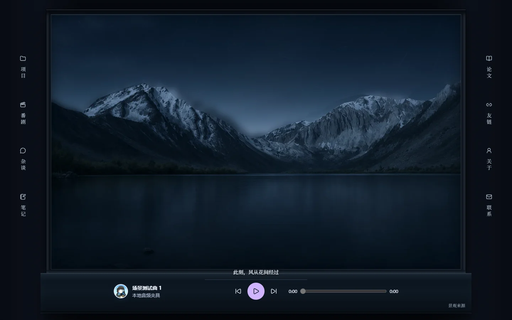

# Nothing New 首页改造：巨幅观景窗 × 谱场夜景

**视觉设计与开发实施文档｜版本 1.1｜2026-11-17**  
**目标仓库：** `proffitteoy/nothing-new`  
**目标分支审阅基线：** `main`，commit `c35fa1360254ef296895c64865b4dc6c5d0259ab`  
**状态：** 已在独立分支完成首版实现与本地生产构建验证；尚有视觉细节待补齐，未合并或执行生产发布。实际素材、技术选择和测量见第 11 节。

**用途：** 供设计复核、开发拆分、Codex 实施和 PR 验收使用。

> 本文区分三类信息：**已验证**（直接检查了源码或作者说明）、**设计决策**（已在讨论中确定）、**待验证**（落地前需要以真实画面、性能、授权或浏览器测试确认）。文中“适配示意”是为 Nothing New 拟定的方案，不冒充开源项目现有实现。

> 第 0–10 节保留实施前的调研与设计记录，其中“尚未取得素材”“尚未运行”等点时描述由第 11 节的实际交付记录更新；不将建议参数冒充当前源码或实测结果。

---

## 0. 执行摘要与已经确定的取舍

首页不再采用“全屏谱场背景 + 两侧卡片按钮 + 底部漂浮播放器”的组织方式。它应是一幅完整的空间画面：**一面无分格的巨大观景窗，窗外是宁静、深邃的山湖夜景；谱场在底层驱动光雾、微光和水面变化；左右窗沿外侧放导航，播放器属于下方窗台。**

本次调研后的决策：

| 项目 | 决定 | 理由 |
| --- | --- | --- |
| Julian Neagu | 借鉴技术路线，不复制网页 | Photoshop 分层资产、2.5D、遮罩局部 Canvas、HTML 内容分离；仅有公开文章与演示，**未取得其可直接复用的工程源码及许可证**。 |
| Late Shift | 重点借鉴鼠标视角运动 | 六个有深度的 camera-mapped 平面、固定投影矩阵、窗口表面锚定、按视口比例控制相机位移；**仓库未见明确 LICENSE，默认只作技术研究**。 |
| Google Magenta / Lo-Fi Player | 排除 | 对当前需求没有可证明的直接复用价值；不再列为实现依赖。 |
| Luminous Lake | 优先借鉴水面和质量分级 | 共用波场函数、法线贴图、反射和夜景调色；MIT。**不移植完整世界**。 |
| Interactive Landscape | 候选地形思路 | Shader 高度场、噪声置换、调色纹理；许可存在非标准限制，不照搬整套。 |
| Tideline | 远期天空/水面技术候选 | 程序化夜空、云、水面波谱与反射；MIT，但完整系统明显超过首页需求。 |
| Night Fox（本轮补充） | 只借鉴窗框前端层次 | React 窗框、玻璃反光、窗台阴影可直接定位源码；MIT。它的多格窗、配色与逐次 `setState` 鼠标 Hook 不适合原样复用。 |

**实现主张：** 优先以分层 2.5D 景观建立可信的美术画面；在保留 Next.js/React/原谱场算法的前提下，从 Late Shift 移植“固定投影 + 相机轻微平移”的设计思想。三维引擎只为景深服务，不构建可自由漫游的世界。由于仓库已经依赖 `three`，不应为了复刻示例而预先引入 `@react-three/fiber`。

---

## 1. 视觉总纲

### 1.1 一句话视觉命题

**“在深夜的室内，透过一面巨幅玻璃，安静观察一个由数学谱场推动的山湖世界。”**

它是一幅会随观察者视线轻微变化的画面，不是科幻控制台、传统二次元动态壁纸，也不是八个菜单围着一张特效背景。

### 1.2 审美关键词及反面约束

| 必须保留的气质 | 必须避免的效果 |
| --- | --- |
| 静谧、低照度、冷色、深空间感 | 霓虹堆叠、强对比扫光、无意义粒子泛滥 |
| 真实“从室内向室外观看”的空间逻辑 | 把窗框当作普通圆角卡片描边 |
| 光来自窗外，窗框仅有克制的边缘反射 | 给导航与播放器各做一层强烈玻璃拟态 |
| 夜空、山体、湖泊在同一透视场景内 | 用几张不匹配色温的图简单叠加 |
| 谱场作为统一的运动规则 | 再加一个完全独立、不相关的极光动画 |
| 默认画面有留白，鼠标移动有轻微观察位移 | 跟着指针大幅摇摆、晃动、自动镜头巡航 |

### 1.3 核心构图及尺寸约束（初始设计参数，非测量结果）

桌面 1440×900 为首个目标画布；**窗户开口居中，大体占可视宽度 76%–84%**；两侧完整保留导航互动带。顶边是较薄的暗色上框，下沿作为略厚的实体窗台。玻璃无横竖分格。

- 建议两侧导航外廊宽度 `clamp(72px, 9vw, 150px)`；**窗框位于外廊内缘，不覆盖按钮**。具体比例按实际构图复核。
- 建议窗框可见厚度约 10–18px；不能只画纯色 1px border，应有内侧倒角、极弱环境光与内阴影。
- 下窗台高于普通边框，但整体不做家具陈列；播放器“嵌入窗台”，不是另一个浮动面板。
- 窗外地平线建议在玻璃开口高度约 58%–66% 一带，湖面位于下部，山峰剪影不遮挡主体光雾。此为美术构图建议，需用选定素材试排。
- 中央景观不添加常驻 slogan、巨大标题或站点 Logo；原有 `h1.sr-only` 继续承担语义标题。

**空间层序（由远及近）：** 夜空底色 → 远云/星点 → 远山 → 中景山岸 → 湖面及局部反射 → 近景暗色剪影/薄雾 → 玻璃微弱反射 → 内侧窗框/窗台 → 两侧 DOM 导航。

### 1.4 色彩与光照规范（待在截图中微调）

- 室内暗部：从现有首页 `#050608` 出发，偏蓝黑而非纯黑；不要大面积纯紫。
- 夜空：深蓝黑至偏灰蓝的垂直渐变，地平线略亮，避免“宇宙深空”式星河占满天空。
- 山体：至少远近两档明度；远山稍灰、近山更暗，以大轮廓而非纹理细节建立深度。
- 湖面：深蓝黑镜面。倒影只在光带对应区域有细微波动，**不出现高亮整片水纹**。
- 谱场光：保留现有蓝/紫/粉三色来源 `[(96,199,255),(185,144,255),(255,133,195)]`，但降低默认可见强度，以蓝紫主导、粉色仅点缀；不能改动六模态的数学参数来“调颜色”。
- 导航：暗部浅灰白文字，获得焦点/悬停时响应冷色边缘光；不要八个高亮胶囊。
- 主光源来自**窗外的光雾**。框内亮度变化应弱且滞后，避免舞台灯效。

### 1.5 动画/互动规则

常态运动极慢，首先要像一幅安静的画；用户需要停留片刻才注意到天空、湖面和少量微光在演化。鼠标移动触发的是**观察点位移**：远景位移小、近景位移大、窗框和侧栏保持稳定。用户停止后相机渐近目标，离开玻璃区域回到中立视角；不应出现弹性回弹和“鼠标吸附”感。

动效在层级上区分：

1. **视角运动**：Late Shift 式指针驱动摄像机轻微平移；与谱场的时间演化独立，但不改变谱场数学定义。
2. **世界运动**：谱场决定微光轨迹、雾场走向以及水面反光的局部扰动。
3. **静态基底**：山体主轮廓、窗框和导航位置基本保持稳定；只有视差，不进行明显变形。
4. **辅助动效**：导航展开/收起、歌词切换，时间尺度与景观分离，绝不影响谱场时钟。

---

## 2. 经过源码检查的参考代码地图

下面各仓库链接均固定到检索时的 commit，以便开发时回溯。链接中给出**文件和具体行段**，不是仅指向项目首页。

### 2.1 Julian Neagu：借鉴架构而非直接复制代码

**出处：** [作者经验文章](https://dev.to/julianneagu/i-rebuilt-my-website-so-people-step-into-it-not-scroll-past-it-5gh9)；[运行站点](https://julianneagu.com/)。

**原文明确使用：** 分层场景图片、普通 HTML 语义内容、滚动位置控制层间运动、以遮罩限定的局部水面 Canvas，以及不在屏幕时停止更新的可见性优化。文章给出一个示意性的 `IntersectionObserver`/Canvas 水面循环，但**没有发现可供整个网站直接移植的公开源仓库**。因此只能把文章作为实现模式参考，不能声明已经获得其生产代码。

**在 Nothing New 中的对应实现：** 景观底图拆分为多张带 Alpha 的纹理/平面；局部湖面渲染区域使用遮罩，谱场渲染不应越过玻璃开口；HTML 导航、播放器留在普通 DOM 中。由于首页是固定视角，**不照搬作者的多场景 scroll-driven 叙事**。

### 2.2 Late Shift：需要挖出的六个核心源码位置

**仓库状态：** `smirnov-artur/webgl`，commit `9948d750c1c82f10cb5a46a8511f4596f00a16ee`；相关真实源码在 `lofi-src/src/`，**不是**部署后 `lofi/` 目录里的打包文件。仓库根目录 README 描述五个平面，而 `lofi-src/README.md` 与当前 `LofiScene.jsx` 的 `LAYERS` 列出**六层**，实施时以源码为准。

| 源码位置 | 实际机制 | 本站怎么用 |
| --- | --- | --- |
| [`LofiScene.jsx` L25–98](https://github.com/smirnov-artur/webgl/blob/9948d750c1c82f10cb5a46a8511f4596f00a16ee/lofi-src/src/LofiScene.jsx#L25-L98) | `FOV`、`TRAVEL`、`shiftFor(aspect)`、不同 Z 深度的 `LAYERS` | 按窗户开口高宽比限制相机运动；重新配置为天空/山/湖/室内框，绝不复制城市素材逻辑。 |
| [`LofiScene.jsx` L118–200](https://github.com/smirnov-artur/webgl/blob/9948d750c1c82f10cb5a46a8511f4596f00a16ee/lofi-src/src/LofiScene.jsx#L118-L200) | 共享 `uniforms`、固定 `projector`、投影矩阵 `uProjector`、ShaderMaterial 平面 | 共享时间与空间参数，避免不同景观层“各有一套时间”。 |
| [`layer.vert.glsl` L1–32](https://github.com/smirnov-artur/webgl/blob/9948d750c1c82f10cb5a46a8511f4596f00a16ee/lofi-src/src/shaders/layer.vert.glsl#L1-L32) | 将世界坐标投影到固定观察视角，逐片元计算 lookup 坐标 | 借鉴**真正的透视映射**而不是仅靠 CSS 速度系数模拟视差。 |
| [`LofiScene.jsx` L365–419](https://github.com/smirnov-artur/webgl/blob/9948d750c1c82f10cb5a46a8511f4596f00a16ee/lofi-src/src/LofiScene.jsx#L365-L419) | `pointermove` 归一化为 [-1,1]，离开归零，响应触摸 | 本站仅对玻璃开口监听；不截获滚轮和触摸页面滚动。 |
| [`LofiScene.jsx` L443–536](https://github.com/smirnov-artur/webgl/blob/9948d750c1c82f10cb5a46a8511f4596f00a16ee/lofi-src/src/LofiScene.jsx#L443-L536) | 帧差平滑摄像机位置、轻微旋转，渲染到离屏目标再合成 | 借鉴 delta-time 缓动；本项目默认不用 beat 推进相机或昼夜循环。 |
| [`scene.glsl` L18–40](https://github.com/smirnov-artur/webgl/blob/9948d750c1c82f10cb5a46a8511f4596f00a16ee/lofi-src/src/shaders/scene.glsl#L18-L40) | `windowMask`/`windowHalfSize` 确定玻璃开口 | 本站窗口形状主要交给 DOM/CSS；若需玻璃内的折射/水滴，使用统一遮罩坐标。 |
| [`composite.frag.glsl` L1–110](https://github.com/smirnov-artur/webgl/blob/9948d750c1c82f10cb5a46a8511f4596f00a16ee/lofi-src/src/shaders/composite.frag.glsl#L1-L110) | 逆视投影重建玻璃平面交点，使水滴锚定在玻璃世界坐标 | **不做雨天为默认效果**；可借鉴“反射/污迹随玻璃而非随屏幕移动”的空间一致性。 |
| [`frame.frag.glsl` L40–64、L120–145](https://github.com/smirnov-artur/webgl/blob/9948d750c1c82f10cb5a46a8511f4596f00a16ee/lofi-src/src/shaders/frame.frag.glsl#L40-L64) | 窗框、窗台、边缘光照的遮罩与色彩处理 | 借鉴光线来自室外、窗台捕捉边缘光的机制；**不照搬中间窗棂、杯子、植物、窗帘**。 |
| [`quality.js` L1–120](https://github.com/smirnov-artur/webgl/blob/9948d750c1c82f10cb5a46a8511f4596f00a16ee/lofi-src/src/quality.js#L1-L120) | 按设备选档、用中位帧耗时降档、改变 DPR/离屏画质/Shader 复杂度 | 直接借鉴“测量后降画质”的原则，适配原谱场已有的降级逻辑。 |

**许可判断：** 2026-11-17 检索时仓库根目录未见明确 `LICENSE` 文件。**源代码可阅读不等于允许复制、修改再分发。** 开发时可独立实现数学机制，若要直接复制原始 Shader 或组件，需要先确认授权。

### 2.3 Luminous Lake：水面/山体/夜景的关键文件

**仓库：** `stas4000/luminous-lake`，commit `d4949bd8981ac8853b105f4402c1e11abd6ab54e`，MIT（保留原版权及许可证）。

| 文件/行段 | 已验证内容 | 可复用判断 |
| --- | --- | --- |
| [`src/sim/waves.js` L1–31](https://github.com/stas4000/luminous-lake/blob/d4949bd8981ac8853b105f4402c1e11abd6ab54e/src/sim/waves.js#L1-L31) | `waveAmplitude`、`waveHeight(x,z,time,calmness,wind)`；确定性正弦波叠加 | **优先研究**：水面几何和其他物体使用同一波函数。与本站的“统一谱场驱动”思想一致。 |
| [`src/world/water.js` L13–53](https://github.com/stas4000/luminous-lake/blob/d4949bd8981ac8853b105f4402c1e11abd6ab54e/src/world/water.js#L13-L53) | `MeshPhysicalMaterial`、`DualScrollNormalMap`、`CubeCamera` | 学习湖面材质；CubeCamera 可能昂贵，不纳入首版必需。 |
| [`src/world/water.js` L63–133](https://github.com/stas4000/luminous-lake/blob/d4949bd8981ac8853b105f4402c1e11abd6ab54e/src/world/water.js#L63-L133) | `update`、`updateReflection`、`setNightLook`、`setCalmLook` | 借鉴夜景调色和水面法线动态；默认选择平静水面。 |
| [`src/world/terrain.js` L11–94](https://github.com/stas4000/luminous-lake/blob/d4949bd8981ac8853b105f4402c1e11abd6ab54e/src/world/terrain.js#L11-L94) | `heightAt` 多尺度噪声塑形、湖盆和地形顶点色 | 候选：生成夜间山体的轮廓/高度贴图；首版无需完整地形网格。 |
| [`src/world/sky.js` L8–76、L112–210](https://github.com/stas4000/luminous-lake/blob/d4949bd8981ac8853b105f4402c1e11abd6ab54e/src/world/sky.js#L8-L76) | 天空纹理、月亮、星点、云、雾和昼夜调色 | 候选：固定夜景配色与层次；不需要完整昼夜循环。 |
| [`src/sim/quality.js` L1–103](https://github.com/stas4000/luminous-lake/blob/d4949bd8981ac8853b105f4402c1e11abd6ab54e/src/sim/quality.js#L1-L103) | `QualityScaler`、`FpsMeter` | 借鉴持续低帧率时的渐进降级和恢复滞回。 |

**切勿整体移植：** 该项目包含动物、船、森林、天气、自由相机与多种水面开销；它是完整三维生态场景，不是网站首页的一片低亮度湖面。

### 2.4 Tideline：只拿夜空/云/水面技术资料

**仓库：** `ProfRino/tideline`，commit `7999581dcd61e158e8277d9b54592b45c790e2b3`，MIT。

- [`src/tideline.js` L18–83](https://github.com/ProfRino/tideline/blob/7999581dcd61e158e8277d9b54592b45c790e2b3/src/tideline.js#L18-L83)：共享波谱配置、逐帧的波分量参数更新，适用于统一“视觉波动状态”。
- [`src/tideline.js` L145–355](https://github.com/ProfRino/tideline/blob/7999581dcd61e158e8277d9b54592b45c790e2b3/src/tideline.js#L145-L355)：基于 Rayleigh/Mie 散射的天空 Shader，夜色、月亮、星点；**可选取其夜景色彩思路，不必引入大气物理全套。**
- [`src/tideline.js` L360–469](https://github.com/ProfRino/tideline/blob/7999581dcd61e158e8277d9b54592b45c790e2b3/src/tideline.js#L360-L469)：云层噪声和光照。它有真实体积采样循环，成本高，只应在外观验证表明明显需要时再加入。

**优先级低于 Luminous Lake。** 本站不是海洋模拟器，也没有雨、雷、海底折射等需求。

### 2.5 Interactive Landscape：可复用的是数学范式，不是画面

**仓库：** `ma77os/InteractiveLandscape`，commit `8d840044b3e14ffb65b39f56527b86b320b7e392`；[作者讲解](https://tympanus.net/codrops/2018/12/20/interactive-animated-landscape/)。

- [`index.html` L32–262](https://github.com/ma77os/InteractiveLandscape/blob/8d840044b3e14ffb65b39f56527b86b320b7e392/index.html#L32-L262)：顶点着色器中的 Perlin 噪声、地形高度位移及周期噪声。
- [`js/demo1.js` L62–96](https://github.com/ma77os/InteractiveLandscape/blob/8d840044b3e14ffb65b39f56527b86b320b7e392/js/demo1.js#L62-L96)：`PlaneBufferGeometry` + `ShaderMaterial` + 高度/时间参数。
- [`js/demo1.js` L137–168](https://github.com/ma77os/InteractiveLandscape/blob/8d840044b3e14ffb65b39f56527b86b320b7e392/js/demo1.js#L137-L168)：将鼠标位置映射为 Shader 参数。

该项目的自然景观造型偏实验性、迷幻色彩，不符合静谧夜景；若要借鉴代码需注意其 README 中**限制原样再分发/插件化销售**的非标准许可声明。它不是替代现有谱场的数学模型。

### 2.6 Night Fox：一个更直接的 React 窗框参考（补充发现）

**仓库：** `jkdevcode/night-fox`，commit `fef09ac4eb24f43ae4a8bf070978febd31d9aeff`，MIT。

- [`WindowFrame.tsx` L1–55](https://github.com/jkdevcode/night-fox/blob/fef09ac4eb24f43ae4a8bf070978febd31d9aeff/src/components/window/WindowFrame.tsx#L1-L55)：外墙暗部、内阴影、框的侧面厚度、玻璃裁切和窗台。结构**可参考**，但实例是竖向小窗且有横窗棂；本站需改成整块巨幅横向玻璃。
- [`GlassReflection.tsx` L1–23](https://github.com/jkdevcode/night-fox/blob/fef09ac4eb24f43ae4a8bf070978febd31d9aeff/src/components/window/GlassReflection.tsx#L1-L23)：半透明反光层的实现；默认动画太明显，需要大幅压低或改为静态。
- [`useParallaxMouse.ts` L1–20](https://github.com/jkdevcode/night-fox/blob/fef09ac4eb24f43ae4a8bf070978febd31d9aeff/src/hooks/useParallaxMouse.ts#L1-L20)：鼠标偏移计算；**不建议原样用**，因为每次 `mousemove` 都 `setState`，更适合用 `ref` + RAF 平滑，避免高频 React 重渲染。

### 2.7 辅助技术文章

[Codrops, *The Sleepers*（2026-07-10）](https://tympanus.net/codrops/2026/07/10/the-sleepers-creating-an-atmospheric-webgl-experience-with-lightweight-techniques/) 给出以 `onBeforeCompile`、世界空间高度和噪声贴图制造**廉价“伪体积雾”**的思路。若最终启用 Three.js 地形，可作为重 Shader 前的低成本雾方案；这不是可直接替换到 Canvas2D 的函数。

---

## 3. 本站代码基线和必须保留的行为

已检查仓库 commit `c35fa1360254ef296895c64865b4dc6c5d0259ab`。现有首页不是空白项目。

| 现有文件/源码 | 已有能力 | 改造边界 |
| --- | --- | --- |
| [`app/page.tsx`](https://github.com/proffitteoy/nothing-new/blob/c35fa1360254ef296895c64865b4dc6c5d0259ab/app/page.tsx) | 提供论文报告与博客入口 | 不改数据供给和路由。 |
| [`HomeDeviceGate.tsx` L9–51](https://github.com/proffitteoy/nothing-new/blob/c35fa1360254ef296895c64865b4dc6c5d0259ab/components/HomeDeviceGate.tsx#L9-L51) | 桌面动态加载首页，移动设备重定向 `/blog` | **首版仅改桌面首页**。移动体验保持当前逻辑；若要移动观景窗另提需求。 |
| [`HomeScene.tsx`](https://github.com/proffitteoy/nothing-new/blob/c35fa1360254ef296895c64865b4dc6c5d0259ab/components/HomeScene.tsx) | 左右各 4 导航，悬停 350ms、展开预览、Escape 与焦点管理；论文、联系特殊面板 | 保留状态机、链接、可访问性，只更换承载位置与视觉结构。 |
| [`HomeScene.module.css`](https://github.com/proffitteoy/nothing-new/blob/c35fa1360254ef296895c64865b4dc6c5d0259ab/components/HomeScene.module.css) | 深夜调色；固定全屏 `scene`；56px 导航；底部播放器 dock | 移除“卡片围绕画布”的视觉布局，重建窗户/内室/外廊关系；样式局限于首页。 |
| [`HomeSpectralCanvas.tsx`](https://github.com/proffitteoy/nothing-new/blob/c35fa1360254ef296895c64865b4dc6c5d0259ab/components/HomeSpectralCanvas.tsx) | Canvas2D 双层粒子流，45 FPS 目标，低帧率降级至 18 FPS，DPR 上限 1.5，页面隐藏暂停 | 保留源谱场与资源回收；将绘制坐标与裁切范围改为**玻璃开口**，避免在窗沿运动；与夜景共享时间。 |
| [`field/SpectralTracerLayer.tsx` L95–133](https://github.com/proffitteoy/nothing-new/blob/c35fa1360254ef296895c64865b4dc6c5d0259ab/components/field/SpectralTracerLayer.tsx#L95-L133) | `spectralDirectionAt`：六模态流函数 `ψ` 的归一化方向场，`V = J∇ψ` | **这是首页轨迹实际使用的流场方向接口**；夜景局部微光/雾运动应以此为共同来源。 |
| [`field/spectralField.ts` L1–119](https://github.com/proffitteoy/nothing-new/blob/c35fa1360254ef296895c64865b4dc6c5d0259ab/components/field/spectralField.ts#L1-L119) | `SPECTRAL_MODES = [2,3,5,7,11,13]`，`SPECTRAL_PLAYBACK_RATE=0.3`；另外提供 `sampleSpectralFamily`/GLSL | **注意：`sampleSpectralFamily` 是另一个谱系采样函数，不与 `spectralDirectionAt` 等同。** 不应混用后宣称“所有景观与首页轨迹受同一场驱动”。 |
| [`lib/home-scene.ts` L54–67](https://github.com/proffitteoy/nothing-new/blob/c35fa1360254ef296895c64865b4dc6c5d0259ab/lib/home-scene.ts#L54-L67) | 可见时间时钟 `createHomeVisitClock`，后台隐藏暂停累计时间 | 沿用作统一时钟。当前文件还留有部分旧版首页图像/300s 叙事逻辑，重构前应确认实际引用，勿无差别删除。 |
| [`CloudPlayer.tsx`](https://github.com/proffitteoy/nothing-new/blob/c35fa1360254ef296895c64865b4dc6c5d0259ab/components/CloudPlayer.tsx) 与 [`HomeMusic.module.css`](https://github.com/proffitteoy/nothing-new/blob/c35fa1360254ef296895c64865b4dc6c5d0259ab/components/HomeMusic.module.css) | 歌曲、播放、上一首/下一首、拖动进度、歌词 | 控制逻辑不重写，只变更 Dock 容器与排版。 |
| [`SplashScreen.tsx`](https://github.com/proffitteoy/nothing-new/blob/c35fa1360254ef296895c64865b4dc6c5d0259ab/components/SplashScreen.tsx) | 按 `data-home-artwork` 判断首页画面准备状态，带启动阶段事件与超时 | 新景观占位图/渲染就绪协议必须兼容；不能因此延长首屏等待时间。 |

**依赖审查：** 本站 `package.json` 已有 Next.js 16.2.1、React 19.2.4、`three ^0.184.0`、Framer Motion；**未安装 `@react-three/fiber`**。因此首选直接复用已有的 `three` 或先做 DOM 2.5D，而非为示例代码无必要地叠加新框架。

**最重要的数学边界：** 若景观需要同步运动方向，应抽取 `spectralDirectionAt(x,y,t,width,height,modeCount)` 的非 UI 计算核心供景观调用，而不是在 Shader 中重新编一套“像谱场的”噪声。新图形层与原粒子层共享 `t`、归一化空间坐标和六模态方向定义。若出于性能必须采用近似，应在注释和文档中明确误差与近似范围。

---

## 4. 推荐实施架构

### 4.1 组件结构（拟新增，非现有代码）

```text
HomeDeviceGate                  # 维持桌面/移动路由策略
└─ HomeScene                     # 维持导航预览 open/pin/keyboard 状态
   ├─ NightWindowShell           # 室内暗部、左右窗沿、顶部框、下窗台（DOM）
   │  ├─ NightWindowViewport     # 有 clip/mask 的真正玻璃开口
   │  │  ├─ NightLandscapeStage   # 2.5D 多层夜景；若需要，使用 THREE 相机映射
   │  │  ├─ SpectralWindowLayer   # 复用 HomeSpectralCanvas/Tracer，不改数学定义
   │  │  └─ GlassReflectionLayer  # 极低强度反射，绑定玻璃坐标
   │  └─ WindowSillPlayer        # 复用 CloudPlayer、LyricBar
   ├─ LeftWindowRail              # 现有 4 个入口移至窗沿外侧
   └─ RightWindowRail             # 现有 4 个入口移至窗沿外侧

runtime:
  HomeVisitClock ─> shared spectral time ─┬─> Tracer field
                                         ├─> subtle light/particle displacement
                                         └─> water reflection disturbance
  ParallaxInput (ref, normalized) ────────> camera / plate transform
  QualityGovernor ────────────────────────> DPR / layer count / effects budget
```

### 4.2 渲染职责隔离

**DOM/CSS 固定负责：** 室内外廊、窗框材质、导航按钮及预览、音乐播放器、可访问性、键盘导航。不要把这些交互元素画进 WebGL，因为那会破坏现有 DOM 行为。

**景观底图负责：** 夜空、山体、湖岸、湖面分层图像，来源要可授权、风格一致。首版可用压缩的静态图层 + 小范围局部动态；无需马上模拟真实气候。

**Three/WebGL（仅有验证必要时）：** 实现 Late Shift 风格 camera mapping、湖面 Shader 或真实玻璃反射。避免同时运行多个全屏 WebGL context；优先一个开口尺寸的渲染目标。

**现有 Canvas2D：** 保留六模态轨迹及渐隐粒子算法，通过容器裁切在玻璃开口内；透明输出叠合在景观正确的深度位置。可先保留 Canvas 作为独立表层，经过视觉验证后再决定是否必须作为纹理映射到 3D 平面。

### 4.3 谱场驱动：从同一个数学源生成不同视觉结果

当前首页 `spectralDirectionAt` 返回归一化方向，并非“亮度”。因此不能直接把方向向量模长当成亮度（其模长几乎恒为 1）。建议建立薄的 `SpectralSceneBridge`：

- 输入 `time`、玻璃开口宽高、固定的网格采样点；所有采样从相同的六模态方向场计算。
- 输出 `flowDirectionGrid`（低分辨率方向纹理或 JS 网格）、由**粒子轨迹密度/曲率**得到的 `lightEnvelope`（定义应公开、稳定，不改谱场本身），和可重用的 `fieldTime`。
- 微光沿 `flowDirectionGrid` 运动；雾层采用低强度的方向偏移；湖面的**反射形变**读取同一时刻的局部方向/密度，而非另启独立极光动画。
- 山体主体不随谱场明显起伏——它提供视觉锚定。对“山体实时变形”的建议在这一轮**撤回为可选实验**，避免破坏观景窗的稳定性。

首版建议使用**低分辨率网格采样（例如 16×9、10–15 Hz）并在渲染侧插值**，不必把每个水面片元的波动全交给 CPU 计算。上述数值只是性能起点，必须基于实际帧耗时调整。

### 4.4 鼠标交互：Late Shift 方案的正确移植边界

使用玻璃开口的 `getBoundingClientRect()` 归一化指针位置；对目标值进行 `requestAnimationFrame` 或 Three render loop 的时间平滑；离开玻璃回零；导航外廊不应该驱动镜头。相机位移幅度按 viewport 半宽、FOV 与最近平面的距离归一化，使 1280px 和 1920px 的“观看手感”一致。

**适配示意，非原项目代码：**

```ts
// 在开口上监听 pointermove；不要每次移动都调用 React setState。
type PointerTarget = { x: number; y: number };
const target: PointerTarget = { x: 0, y: 0 };
const current: PointerTarget = { x: 0, y: 0 };

function onWindowPointerMove(event: PointerEvent, rect: DOMRect) {
  target.x = Math.max(-1, Math.min(1, ((event.clientX - rect.left) / rect.width) * 2 - 1));
  target.y = Math.max(-1, Math.min(1, ((event.clientY - rect.top) / rect.height) * 2 - 1));
}

function updateParallax(dtSeconds: number) {
  const k = 1 - Math.exp(-2.2 * Math.min(dtSeconds, 0.05));
  current.x += (target.x - current.x) * k;
  current.y += (target.y - current.y) * k;
  // 把 current 交给镜头/平面变换；窗框和 DOM 栏位不动。
}
```

**不移植的部分：** Late Shift 的滚轮拦截、触摸拖动控制时间/镜头、音乐 bass 推动相机、昼夜模式切换。这些都不是本站首页当前需求。

### 4.5 两条可验证的技术路径

**A｜优先验证（低风险）：** 分层夜景素材 + DOM/CSS 透视/视差 + 现有谱场 Canvas + 局部湖面 Canvas。优势是性能、可维护、易保持美术一致。缺点是近视角变换的真实透视可能不如 Late Shift。

**B｜在 A 的视觉美术得到确认后使用（更还原 Late Shift）：** 用现有 `three` 建立 4–6 张不同 Z 的带 Alpha 平面，固定原始投影矩阵，将分层图片做 camera-mapped lookup，再随指针移动活动相机。玻璃仍是 DOM 布局，独立贴近前景的反射层。仅在 A 达不到期望视角深度，或者 B 的性能证明合格时采用。优先用已装 `three`；不要未经证据就依赖 R3F。

**明确验收条件：** A/B 由真实截图/视频的视觉差异和帧耗时决定，**不以技术复杂度高低决策**。需要有静止、中等向左移动、中等向右移动三个对照画面。

---

## 5. 具体视觉组件规范

### 5.1 玻璃开口

矩形、无中间分隔、无圆角卡片感。可采用极小的框内边缘暗角、玻璃微弱反射，但默认反射不能挡住山湖轮廓。景观和动态层都必须处于同一 clip/mask 内；禁止横向视差露出图层边缘。纹理/平面须预留 overscan。

### 5.2 夜景层

**天空：** 主色深蓝黑、近地平线有低亮的灰蓝过渡；星点极少、尺寸克制，不使用随机闪耀大星。云雾主要作为纵深与运动载体。

**山体：** 远山轮廓平缓，沿湖岸形成视觉稳定边界；近处只保留几片深色岸线，避免出现大量树木或城市灯火。

**湖泊：** 镜面感、暗色、局部轻微波纹。优先借鉴 Luminous Lake 的共用波函数/法线思路，但不引入动物、船和实时全场反射。仅模拟光雾对应位置的倒影动态。

**谱场光带：** 不是完整显示每一条粒子轨迹，而是保留真实轨迹运动，在显示层降低对比度、混合和局部扩散。只有少量弧线偶尔被看清。低性能模式减少轨迹数量和后期特效，不减少六模态数量作为第一选择。

### 5.3 窗框、窗沿与导航

左右外廊与玻璃有明确材质边界；两组四项入口保持现有 `navigationLinks` 和 `PaperMonitor`/`ProfileActions`。默认态呈现轻量文字和图标，按钮**不能采用 8 块完整实心卡片**。悬停/焦点时可以从各自的外廊展开页面预览，但展开层必须有稳定 stacking context：不压住另一侧、不横跨整幅夜景、不覆盖底部音乐控制。

导航的鼠标触发、点击 pin、键盘焦点、Escape 行为要与现有实现等价。现有 350ms hover open 与 120ms delayed close 可以保留作为交互基线，但应做实际手感测试。

### 5.4 窗台与音乐

播放器不是独立浮动卡片。保留 `CloudPlayer` 的歌词、封面、上一首/播放/下一首、进度/拖动；只重排结构与色彩，让它看起来嵌入下窗台。歌词可以悬于窗台上沿，但必须避免遮住最亮的水面倒影。默认不添加额外声波动画或频谱条，因为谱场已经承担了动态表达。

### 5.5 状态一致性

必须设计并验证：**首次静止帧、鼠标轻移、导航预览展开、播放器就绪/加载失败、后台恢复、低性能降级、reduced-motion**。动态背景失败时仍应保留静态夜景和可用的导航，而不是黑屏。

---

## 6. 资源、版权与性能预算

### 6.1 美术素材获取

**这轮尚未获得最终可用于生产的美术资产。** 不应把商业建筑摄影、AI 示意图或别人的网站截图当作本站背景直接放进仓库。建议先从来源清晰的可授权图片/绘画或自行取得授权的分层资产中挑选。优先使用**同一套构图的分层原画**，而不是拼接不同作者的天空、山、湖图片。

建议每份素材记录：来源 URL、作者、许可证、是否允许衍生/公开发布、归属信息、原始分辨率、导出 WebP/AVIF、是否带 Alpha、是否需要移动端裁切。开发阶段使用临时占位素材必须标记为占位，不应在 PR 中默默变成生产资源。

外部**仅用于审美参照**的摄影：[Pretty Sweet 的湖景室内案例](https://www.prettysweetlighting.com/gallery)、[swissFineLine 观景玻璃案例](https://swissfineline.com/en/inspiration/projects/the-5-elements)。其摄影版权不等于可复用资产。

### 6.2 性能目标（实施验收预算，不是当前测得值）

- 首屏静态夜景**不得依赖 WebGL 初始化成功才能出现**；渲染失败显示静态纹理/渐变，不阻断导航。
- 视觉图层尽量合并与裁切，控制初始图片请求和解码开销。初拟首屏景观纹理压缩合计 **≤ 700 KB**，但应以画质优先、经真实测试调整；不能为追数字出现明显压缩伪影。
- 性能测量必须同时监控**现有三个 Canvas2D 缓冲（surface/back/front）与可能新增的 WebGL RenderTarget**，避免显存/内存峰值失控。
- 桌面普通档争取 ≥45 FPS 的连续观景体验；持续低性能时允许降至 24–30 FPS 或静态；不得通过切断重要导航/播放器功能换取帧率。
- DPR/渲染尺度限制必须共享一个预算。沿用旧的 45→18 FPS 机制时，应将其与新景观的质量等级统一，而不是两个模块各自盲目调档。
- `prefers-reduced-motion: reduce` 下场景保持可看的静态夜景或单帧谱场，停止持续漂移；文档不可见时停止或显著降低动画调度。
- 页面切换和组件销毁时释放 WebGL/Canvas、监听器、ResizeObserver、RAF 与贴图资源；避免 React 19 严格模式下重复挂载造成双循环。

### 6.3 现实技术风险

| 风险 | 可观察症状 | 抑制措施 |
| --- | --- | --- |
| 双渲染循环不同步 | 光带与倒影各自运动，画面“飘” | `createHomeVisitClock` 输出单一 `fieldTime`；以统一 frame orchestration 更新。 |
| 不同谱系数学混用 | 局部雾的方向与真实粒子轨迹不吻合 | 首页绑定 `spectralDirectionAt`；单测验证同一坐标、时间与方向。 |
| 视差越界 | 鼠标向边缘移动露出黑边 | overscan、开口 clip、控制 FOV 与最大位移。 |
| 过重 Three 生态 | 首屏变慢、移动端功耗飙升 | 先 2.5D，3D 作为可比较的 Spike；不引入动物、天气、自由视角。 |
| 导航被帧/玻璃拦截 | hover、click、focus 失效 | Glass/Canvas `pointer-events: none`，DOM 导航保持原状态机。 |
| 启动画面等待扩大 | 首屏长时间停在 Splash | 尽早输出静态封面；新渲染的 ready 状态不挂死旧 Splash 协议。 |
| 版权不清 | 直接拷贝 Late Shift Shader、商业摄影 | 严格区分“阅读机制”与“复制代码/图片”；落实许可台账。 |

---

## 7. 建议的开发拆分与 PR 验收

**PR-0｜美术资产与设计基线（不改业务逻辑）**

交付：固定比例的 1440×900 / 1920×1080 首帧构图参照、玻璃开口/窗沿位置、各分层占位图、授权台账；明确夜景的“天空—山—湖—光”主次关系。验收重点是**静态画面本身足够好看**。没有这一关，不进入复杂 Shader 开发。

**PR-1｜空间骨架与窗沿导航**

交付：`NightWindowShell` / `NightWindowViewport` / `WindowSillPlayer` 的 DOM/CSS 骨架；将左右八项导航移到窗外侧，保留 hover/pin/keyboard/预览功能。无 WebGL 时页面也应完整，音乐功能可用。对比原首页的导航回归截图。

**PR-2｜2.5D 夜景和 Late Shift 鼠标视角 Spike**

交付：分层素材、clip/overscan、指针归一化、平滑/回中。A（CSS 2.5D）和 B（Three camera mapping）至少各有三帧对照截图及浏览器性能记录；按视觉效果与开销选择一种，不必把两套都留在生产代码中。

**PR-3｜统一谱场时钟与景观耦合**

交付：真实六模态轨迹限制在玻璃内；`SpectralSceneBridge` 的数据契约与测试；雾/微光/水面反射至少两项由**同一个**谱场输出驱动。注意画面中谱场不能被全局装饰性噪声盖过。

**PR-4｜夜景材质与画面定稿**

交付：视觉分级、湖面反射表现、窗框真实环境光、动态质量档与静态回退。仅在确实提高画质时，从 Luminous Lake/Tideline 借鉴局部算法；没有清晰收益的 Shader 不进入最终实现。

**PR-5｜回归、可访问性和发布前验收**

交付：运行中/静态/降级/后台恢复、导航预览、论文、联系和音乐功能回归；桌面不同尺寸截图；GPU 失败和 reduced-motion 行为；内存/帧耗时报告。确认移动端仍按原策略重定向 `/blog`，不误把桌面大窗强塞到移动端。

**合并原则：** 每个 PR 可以单独回退；每次添加渲染机制都必须附**可比对的前后截图和最低限度性能数据**；不凭“用了更高级的技术”认定它是改进。

---

## 8. 关键验收表

| 检查项 | 通过标准 |
| --- | --- |
| 第一眼视觉 | 观景窗和窗外景观构成完整的画面；不再呈现“八块面板 + 底部工具栏”拼贴感。 |
| 窗框 | 横向单片玻璃，窗台/窗沿厚度可信；不出现纵横分格。 |
| 鼠标 | 左右上下移动时景深一致、微弱平稳；离开开口回中；窗框/导航不动；无裸露边。 |
| 数学正确性 | 六模态/频率/速度基线未被美术层修改；新增景观运动可追溯到同一方向场与时钟。 |
| 湖面 | 平静、低亮；只在对应光源位置出现受控反射，无通屏高亮波纹。 |
| 导航 | 左右各 4，所有链接/论文/联系预览、点击固定、Escape、键盘焦点无回归。 |
| 音乐 | 保留播放、切歌、进度及歌词；视觉上属于窗台，不压住玻璃主体。 |
| 回退 | WebGL 失败、无谱场或 reduced-motion 时仍有完整可访问的静态夜景。 |
| 性能 | 1440×900、1920×1080、1366×768、1280×720 测量并记录；连续运动和展开预览期间不能出现明显交互卡顿。 |
| 范围 | 不修改其他页面的主题；不重做博客/论文/音乐数据服务；移动端现有 `/blog` 行为保持。 |
| 许可 | 生产图片和第三方代码可追溯；未知许可证的 Late Shift 仅作参考，未经授权不直接复制。 |

---

## 9. 最终设计决定与尚未定案的问题

**已经决定：** 巨幅观景窗、无中间分格、夜景山湖、左右外侧四项导航、下窗台播放器、六模态谱场为底层运动、鼠标视差参考 Late Shift、Julian 的 2.5D 模式、Magenta 排除。

**尚未定案（必须在实际画面中选择，而不是在文字中假装已确定）：** 夜景原画/素材及许可；更偏真实摄影还是数字绘景；湖面反射究竟用局部 Canvas 还是 WebGL；A（CSS 2.5D）与 B（Three camera-mapped 平面）最终哪一个保留；窗框材质细部；各层精确明暗/色值/比例；谱场曲线的可见密度。

**当前最值得推进的下一项工作：** 先选定**一组具有统一光照和明确版权来源的分层夜景美术素材**，做可比较的静态构图，再通过最小 Spike 验证 Late Shift 式指针运动。不要先搬入整套 Luminous Lake 或 Tideline，最后才发现画面并不合适。

---

## 10. 来源索引、仓库版本与许可证

| 来源 | 固定版本或资料 | 许可/用途 |
| --- | --- | --- |
| Nothing New（本项目） | [`c35fa13`](https://github.com/proffitteoy/nothing-new/tree/c35fa1360254ef296895c64865b4dc6c5d0259ab) | 本项目 `package.json` 声明 GPL-3.0-only；当前实现基线。 |
| Julian Neagu | [经验文章](https://dev.to/julianneagu/i-rebuilt-my-website-so-people-step-into-it-not-scroll-past-it-5gh9) | 文章/站点技术思路；未验证工程源码和代码许可。 |
| Late Shift / Smirnov | [`9948d75`](https://github.com/smirnov-artur/webgl/tree/9948d750c1c82f10cb5a46a8511f4596f00a16ee/lofi-src) | 未见明确许可证；阅读与独立实现算法思路。 |
| Luminous Lake | [`d4949bd`](https://github.com/stas4000/luminous-lake/tree/d4949bd8981ac8853b105f4402c1e11abd6ab54e) · [MIT LICENSE](https://github.com/stas4000/luminous-lake/blob/d4949bd8981ac8853b105f4402c1e11abd6ab54e/LICENSE) | 可在保留版权声明与许可的前提下复用。 |
| Tideline | [`7999581`](https://github.com/ProfRino/tideline/tree/7999581dcd61e158e8277d9b54592b45c790e2b3) · [MIT LICENSE](https://github.com/ProfRino/tideline/blob/7999581dcd61e158e8277d9b54592b45c790e2b3/LICENSE) | 备用的天空/水面 Shader 技术。 |
| Interactive Landscape | [`8d84004`](https://github.com/ma77os/InteractiveLandscape/tree/8d840044b3e14ffb65b39f56527b86b320b7e392) · [README 许可](https://github.com/ma77os/InteractiveLandscape/blob/8d840044b3e14ffb65b39f56527b86b320b7e392/README.md) | 非标准许可；技术思路优先。 |
| Night Fox | [`fef09ac`](https://github.com/jkdevcode/night-fox/tree/fef09ac4eb24f43ae4a8bf070978febd31d9aeff) · [MIT LICENSE](https://github.com/jkdevcode/night-fox/blob/fef09ac4eb24f43ae4a8bf070978febd31d9aeff/LICENSE) | 可借鉴窗框 HTML/CSS 的层次与阴影。 |
| Codrops / The Sleepers | [2026-07-10 技术文章](https://tympanus.net/codrops/2026/07/10/the-sleepers-creating-an-atmospheric-webgl-experience-with-lightweight-techniques/) | 低成本雾实现方法论。 |

**调研边界声明：** 上述第 0–10 节记录实施前的静态代码与文章审阅；当时尚未构建、测量或取得夜景素材。该阶段的建议和验收阈值不代表当时的实测结果。以下为后来实际执行的本地实现与验证。

---

## 11. 实际实现与生产验收（2026-11-17）

### 11.1 交付位置与选定方案

- 基于 `main@c35fa13`，分支 `feat/night-window-home-20261117`；独立工作树 `F:/my blog/.worktrees/night-window-home`。原工作区的周报分支、`next-env.d.ts` 改动及未跟踪方案原稿保持原状。
- 采用授权摄影底稿的写实数字绘景。来源 [Convict Lake at night fixed](https://commons.wikimedia.org/wiki/File:Convict_Lake_at_night_fixed.jpg)，原摄影 TheDailyNathan，畸变校正 Hike395，CC BY-SA 3.0。以同一图像为 imagegen 编辑目标，制作低照度午夜绘景；未拼接其他作者的天空、山或水。
- 最终图像 `public/home-window/convict-lake-night.webp` 为 1536×868、54,268 bytes。编辑结果裁去顶部 156px、宽度作 1px 归一化后编码 WebP；源图和未压缩编辑结果保存在忽略证据目录，公开署名在 `NOTICE.txt`，完整提示词见 11.5。图片及衍生作品沿用 CC BY-SA 3.0，源码许可不变。
- 官方 3840px 底稿 SHA-256：`BAA56055A6024840DBA114C6071FBB083C0E29C6533D80150B1B780F49DBDB4C`。最终 WebP：`1D029B9E12874E8C75DE8DF14A832F01C398FD3B81F6C5F1EAFA25E93B34ACD3`。
- 生产保留 CSS 分层：柔化的远景、山湖平面、近岸剪影、Canvas 光雾/倒影与 DOM 玻璃。人工标注的山脊用于 DOM 与 Canvas 共同裁切；24px overscan 覆盖最大 16px 近景位移。Three 固定投影平面只留在测试脚本，未进入生产 bundle，没有新增 R3F。
- 内部接口增加玻璃开口 ref 与低分辨率采样结果；HTTP API、内容与音乐数据契约未改。六模态、频率、相位、种子、积分和倍率保持现有控制器基线。曲率是显示层的有限差分包络，不是谱场能量或额外数学模型。
- 图片解码成功或失败都结束 artwork 等待。减少动态／质量静态档释放三个绘图缓冲；无 Canvas 保留绘景，图片失败显示 CSS 山湖轮廓。音乐失败沿用原 Provider 的无 audio 状态，重试成功后恢复唯一 audio。

### 11.2 真实截图与 A/B 选择

以下为生产页面截图；音乐曲名、歌词和音频使用本地测试夹具，不代表线上音乐服务。



[1920×1080 静态构图](../images/home-window/static-1920.webp)。下表三帧在同一固定谱场时间、同一底稿与指针位置下采集，之后恢复真实时钟单独测量性能：

| 渲染方案 | 中立 | 中等左移 | 中等右移 |
| --- | --- | --- | --- |
| CSS | [居中](../images/home-window/css-center.webp) | [左移](../images/home-window/css-left.webp) | [右移](../images/home-window/css-right.webp) |
| Three 固定投影 | [居中](../images/home-window/three-center.webp) | [左移](../images/home-window/three-left.webp) | [右移](../images/home-window/three-right.webp) |

两方案均保持约 45fps，三帧未见裸露黑边或明显拉伸。CSS 连续指针运动样本为 **44.98fps / 0.731ms 每帧 CPU 绘制**；Three 为 **45.02fps / 0.845ms 合计 CPU dispatch**，额外纹理与 drawing buffer 理论字节数合计 **19,301,168 bytes**。本轮未见足以抵消成本的视觉收益，因此选择 CSS。这里的 CPU dispatch 不是 GPU 完成时间，理论缓冲字节数也不等同驱动总显存。

### 11.3 性能与回归结果

Windows、Node **22.23.5**、Chrome **157.0.8103.79**、生产构建，普通档 DPR1；每个尺寸独立上下文，连续真实时间采样，没有用虚拟时钟报告帧率。

| 尺寸 | 实测绘制 FPS | 页面观景段平均绘制耗时 | 三 Canvas RGBA 预算 |
| --- | ---: | ---: | ---: |
| 1440×900 | 45.08 | 0.77ms | 9,900,848 bytes |
| 1920×1080 | 45.07 | 0.78ms | 17,008,928 bytes |
| 1366×768 | 45.00 | 0.76ms | 7,696,416 bytes |
| 1280×720 | 44.90 | 0.76ms | 6,630,496 bytes |

- 常规四尺寸观景段未记录 ≥50ms 长任务；1920 样本启动 95.8ms 处记录一条 53ms 长任务。记录的 JS heap 约 10–12MB，不据此声称长期零泄漏或所有设备都达到该帧率。
- DPR2 下验证上限 1.5、ResizeObserver 改尺寸时保留同一 Canvas 与访问时钟。合成 hidden 1.5 秒时 RAF 停止、时钟偏差约 5.3ms，恢复后继续；此为合成事件验证，不冒充真实最小化/后台测试。
- 1440×900、1920×1080、1366×768、1280×720、1280×800、1024×768、640×720、1024×480 八尺寸通过全部入口、350ms/120ms、悬停切换、点击固定、外部关闭、Escape 还焦、论文两层阅读、联系、播放/切歌/寻址及跨页音频连续性回归。
- reduced-motion 停持续绘制并清空三个缓冲；离开首页后旧缓冲全部归零，软导航返回只保留原 audio。移动 UA 继续进入实际笔记路径，不加载桌面场景。
- WebGL 禁用、Canvas 不可用、图片失败、音乐 503 及重试通过。CPU×16 加 90ms 主线程争用后，先降档再静态；约 8.27 秒到达静态档，缓冲字节数为 0，解除压力后播放控制仍可操作。
- **126 项测试全通过**，完整 ESLint **0 错误、3 条既有警告**，TypeScript 与 **247 页面生产构建通过**。主线友链 masthead 已删除，但旧测试仍断言三个阅读障碍；已校正为现有两个真实阅读面，未改友链 UI。
- 最终三个浏览器报告合计 **28 组检查，0 个 pageerror**。原始 PNG、JSON 与测试 bundle 在 `.sync/tmp-night-window/final-night/`、`final-navigation/`、`final-comparison/`；精简截图已随文档保存。

### 11.4 交付边界

当前交付是核心功能可用的首版，尚不能认定整份视觉设计已经完整兑现：景观主要复用同一绘景，通过模糊、裁切和遮罩分层，远山／中景／湖面尚未形成完整的独立景深；光雾和水面目前是谱场采样驱动的柔光块与局部光纹，仍需细化自然质感；窗框采用固定 CSS 材质与反光，尚未接入随窗外谱场光缓慢变化的环境照明。CSS 与 Three 已完成对照并选择 CSS，这项属于技术取舍。

126 项测试和本地浏览器检查验证的是当前已实现部分的功能与稳定性，不等同于全部美术细节完成。

本节记录分支实现与本地验证证据，不代表生产发布；PR 与远端 CI 状态以 GitHub 为准。音乐控制使用本地 WAV 夹具；真实音频服务、真实移动设备、Safari 和 OS 后台切换尚未验收。自动化与截图核对不代替用户的美术认可。

### 11.5 素材编辑提示词

使用内置 `image_gen.imagegen` 编辑模式，输入为授权原图的 1000px 审图副本 `source-preview.jpg`；不是以参考图自由生成另一处山湖，也未调用 CLI/API fallback。完整提示词如下：

```text
Edit this exact licensed Convict Lake photograph into a restrained realistic digital matte painting for a panoramic night window on a personal website. This image is the EDIT TARGET, not merely inspiration. Preserve the exact mountain profiles, valley, shoreline, viewpoint and water positions, all the geography of the source. Keep the same landscape framing and aspect ratio. Make it midnight, deep cold blue-black with muted gray-blue moonlit peaks, dark near banks, and a calm dark lake. Lower exposure considerably but retain readable mountain depth, a slightly luminous gray-blue horizon, restrained texture. Soften the photographic microdetail toward a carefully painted cinematic environment, still realistic. Quiet sky with very few dim stars; reduce bright clouds and their contrast. The primary eventual blue-violet mist will be animated by code later, so do not bake in auroras, colored light bands, particles or strong beams. No added moon, buildings, trees, people, boats, window frame, curtains, furnishings, text, watermark, UI, or borders. Keep full opaque image. Remove only the thin white photographic border edges. Preserve the original lake shore around two thirds of the image height. Output a wide production-quality matte painting preserving this source picture.
```
