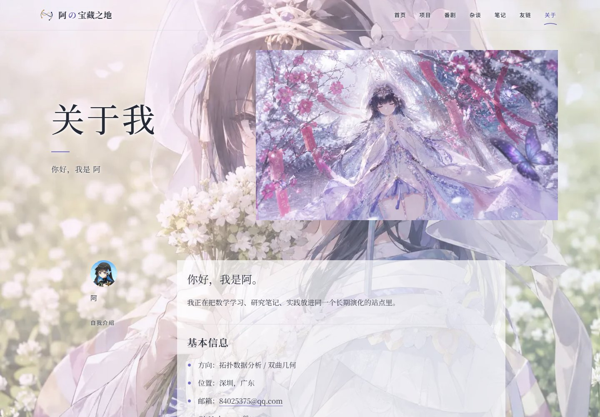
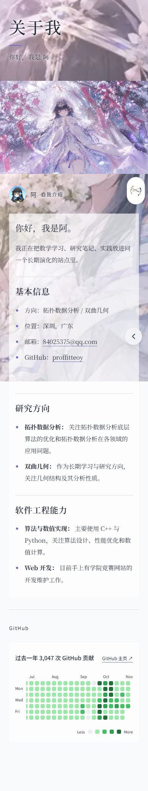
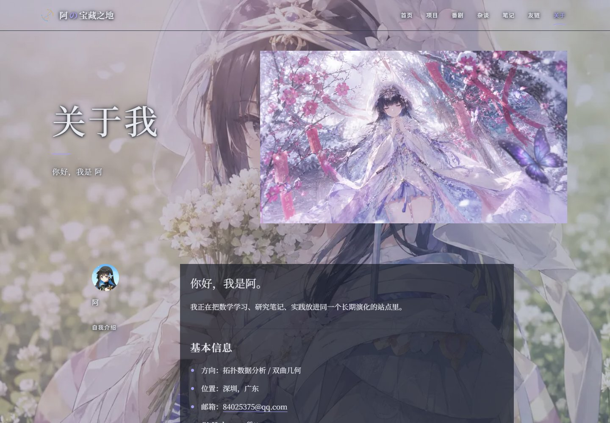
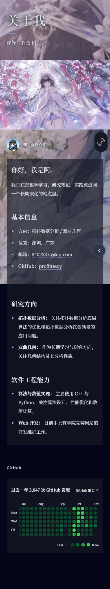
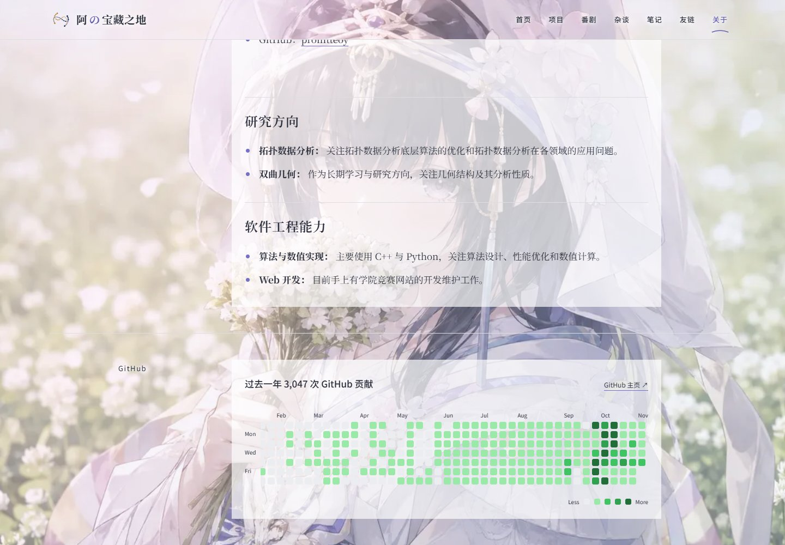
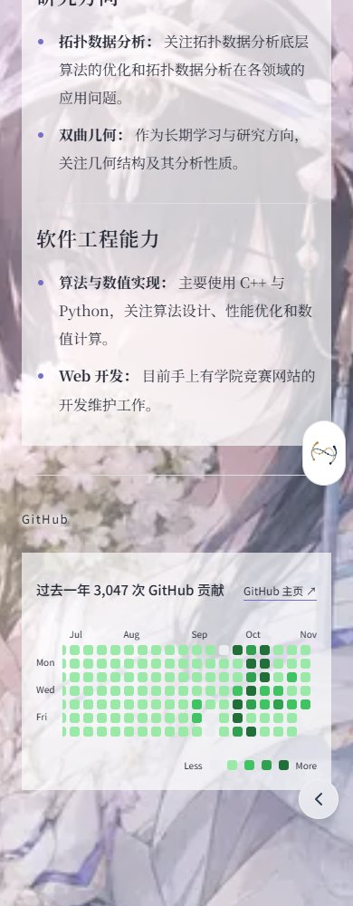
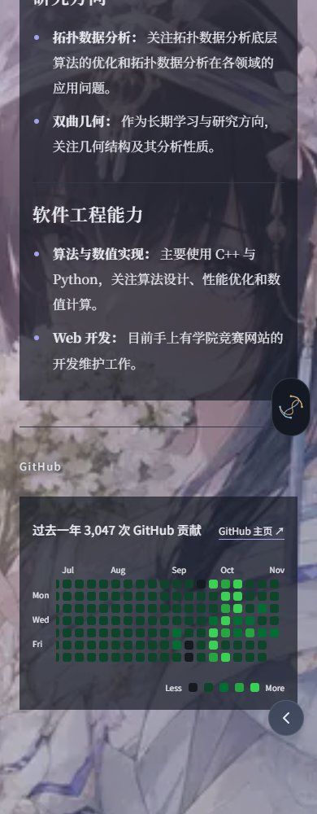
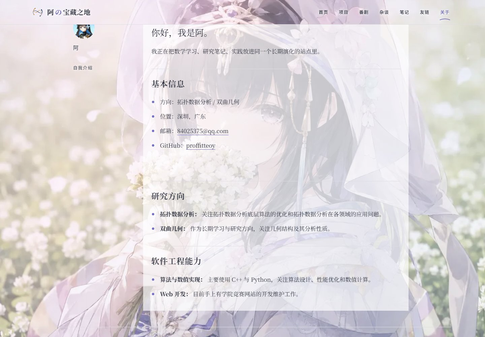
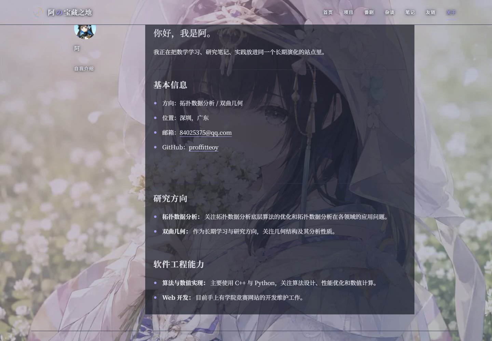

# 关于页个人档案

对应 #58。基于 `origin/main` 的 `08012ef` 独立实现；只调整 `/about` 的视觉，不合并 main、不修改生产部署设置。

## 设计与内容边界

- 保留全站原始背景：关于页外层透明，不添加整页冷白／深色底，也不叠加封面渐变蒙层。桌面导航在本页透明，内容滚动区域从导航下方开始，避免叠字；手机导航圆盘仅作为局部控件保留日夜表面。
- 正文和贡献日历各有局部 68% 透明度的冷白／深蓝灰阅读底，背景仍可透出；标题和边注只使用文字阴影。用户明确禁止米黄色。
- 依据本地 `frontend refactoring.md` 与 `interaction research.md`：采用开放式图文与阅读网格。后者的五分钟生命周期、左右边缘组件和日月对象只属于首页，不迁移到关于页。原始交互文档保持原有本地状态，不随本 PR 上传。
- 宽屏保留原背景，封面作为正常图像内容与左侧标题并列，头像旁注配合 740px 正文；手机使用单列、16px 正文。没有胶带、相框、英文页码和章节编号装饰。
- `app/about/about.md`、图片文件、Markdown 清洗／渲染和 GitHub 抓取／解析／缓存逻辑均保持原样。原文的图片、公式、列表、引用、表格、删除线和代码继续由现有管线生成。
- 两处直接注入的全局 `.prose` 样式改为 `AboutClient.module.css`，样式只作用于关于页。无额外字体请求、插画或首页场景组件。
- 贡献图保留原来的真实日期、计数、颜色、月份与默认滚到最新日期行为，新增可聚焦的滚动区域，支持键盘 ←／→ 查看全年。

## 可检查的隔离预览

在此分支目录使用 Node.js 22：

```powershell
npm.cmd ci
npm.cmd run build
npm.cmd run start -- --hostname 127.0.0.1 --port 3168
```

访问 <http://127.0.0.1:3168/about>。预览是本分支的完整站点，正文和照片来自原文件。PR 的 Vercel Preview 若可用，也只用于此分支验收。

## 浏览器复现

Python Playwright 是可选验收工具，不新增项目运行依赖：

```powershell
python -m venv .sync/tmp-about-58/venv
& .sync/tmp-about-58/venv/Scripts/python.exe -m pip install playwright
& .sync/tmp-about-58/venv/Scripts/python.exe -m playwright install chromium
& .sync/tmp-about-58/venv/Scripts/python.exe scripts/about-preview.py
```

可用 `--url` 指定隔离预览地址，或用 `--browser` 指定已安装的 Chromium／Edge。脚本检查 320、390、768、1024、1440、1920px，覆盖日夜与减少动画、透明外层／导航／无封面遮罩，并在顶部／中部／底部逐像素比较固定原背景在页面留白处的连续性，检查原有三个章节／八个条目、真实图片、页面无横向溢出、链接焦点、手机导航、数学／代码／表格排版和浏览器异常。富文本兼容性样本只临时插入浏览器 DOM，截图之后恢复，不修改内容文件。

### 贡献数据

原有 4 秒超时／12 小时缓存与降级文案保持不变。2026-11-06 本次生产构建成功取得 GitHub 真实贡献图：**3,047 次贡献、369 个日期单元格**。所有交付截图均来自普通生产构建，不注入贡献数据或修改 Markdown。外部网络不可用时，脚本检查现有降级提示。

## 截图

`live-*` 为当前生产构建截图。桌面使用原有内层滚动容器，分为首屏、正文中部与贡献区；手机首屏文件是完整长图。

| 内容       | 桌面                                                                   | 手机                                                                  |
| ---------- | ---------------------------------------------------------------------- | --------------------------------------------------------------------- |
| 日间       |                |                |
| 夜间       |                 |                 |
| 日间贡献图 |     |     |
| 夜间贡献图 |  |  |

### 滚动中段：原背景持续可见

| 日间桌面                                                            | 夜间桌面                                                           |
| ------------------------------------------------------------------- | ------------------------------------------------------------------ |
|  |  |

## 验证记录与待人工验收

- Node 22：ESLint 无错误（4 条现有警告）、83 项测试、TypeScript 与生产构建通过。Quartz 对已有笔记的中文数学字符仍有警告。
- 浏览器记录输出至 `.sync/tmp-about-58/report-live.json`。截图和日志均不读取或写入账户凭据。
- 数据获取逻辑未变化；本次生产构建已通过实时获取，其他网络环境下的长期缓存仍需持续观察。当前正文没有公式和内嵌照片，已以 DOM 样本检查其视觉兼容。
- 最终视觉仍待人工验收；保持独立 PR，不自动合并或关闭 #58。
