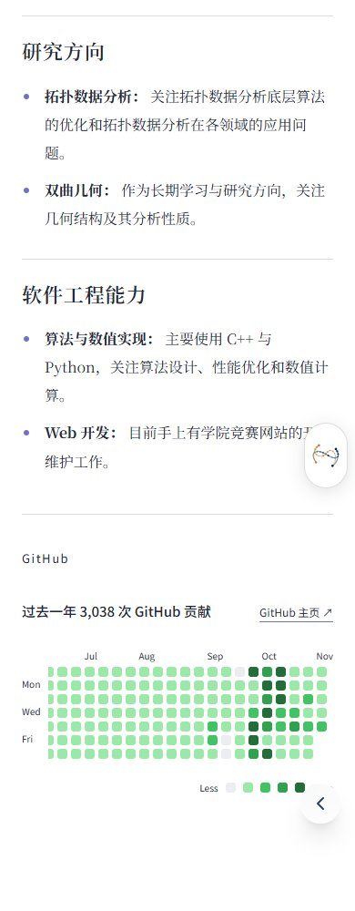
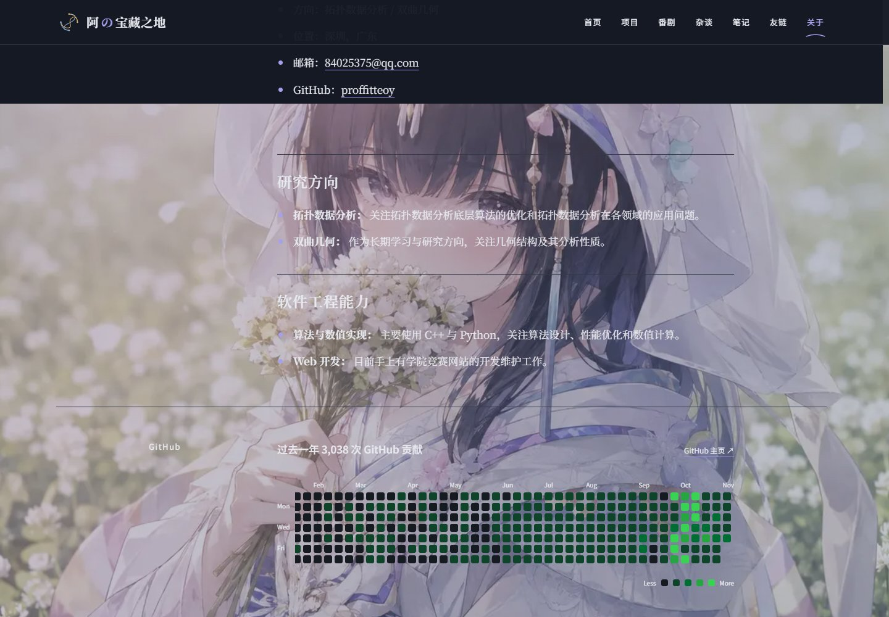
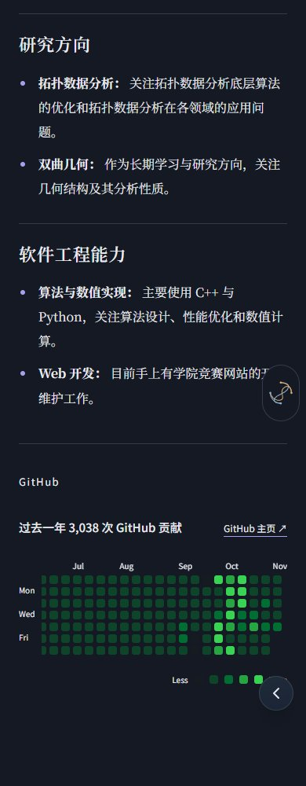

# 关于页个人档案

对应 #58。基于 `origin/main` 的 `08012ef` 独立实现；只调整 `/about` 的视觉，不合并 main、不修改生产部署设置。

## 设计与内容边界

- 用户明确禁止米黄色：关于页日间底色、封面渐变、桌面导航及手机圆盘统一使用 `#FFFFFF` 冷白，覆盖原稿 `#F8F7F3` 候选底色。夜间使用 `#141923` 深蓝灰。其余文字／强调色沿用原稿，原画保持蓝紫、樱粉。
- 依据本地 `frontend refactoring.md` 与 `interaction research.md`：采用开放式图文与阅读网格。后者的五分钟生命周期、左右边缘组件和日月对象只属于首页，不迁移到关于页。原始交互文档保持原有本地状态，不随本 PR 上传。
- 宽屏以完整原画、左侧标题、头像旁注和 740px 正文形成层次；手机使用单列、16px 正文。没有胶带、相框、英文页码和章节编号装饰。
- `app/about/about.md`、图片文件、Markdown 清洗／渲染和 GitHub 抓取／解析／缓存逻辑均保持原样。原文的图片、公式、列表、引用、表格、删除线和代码继续由现有管线生成。
- 两处直接注入的全局 `.prose` 样式改为 `AboutClient.module.css`，样式只作用于关于页。无额外字体请求、插画或首页场景组件。
- 贡献图保留原来的真实日期、计数、颜色、月份与默认滚到最新日期行为，新增可聚焦的滚动区域，支持键盘 ←／→ 查看全年。

## 可检查的隔离预览

在此分支目录使用 Node.js 22：

```powershell
npm.cmd ci
npm.cmd run build
npm.cmd run start -- --hostname 127.0.0.1 --port 3168
```

访问 <http://127.0.0.1:3168/about>。预览是本分支的完整站点，正文和照片来自原文件。PR 的 Vercel Preview 若可用，也只用于此分支验收。

## 浏览器复现

Python Playwright 是可选验收工具，不新增项目运行依赖：

```powershell
python -m venv .sync/tmp-about-58/venv
& .sync/tmp-about-58/venv/Scripts/python.exe -m pip install playwright
& .sync/tmp-about-58/venv/Scripts/python.exe -m playwright install chromium
& .sync/tmp-about-58/venv/Scripts/python.exe scripts/about-preview.py
```

可用 `--url` 指定隔离预览地址，或用 `--browser` 指定已安装的 Chromium／Edge。脚本检查 320、390、768、1024、1440、1920px，覆盖日夜与减少动画、原有三个章节／八个条目、真实图片、页面无横向溢出、链接焦点、手机导航、数学／代码／表格排版和浏览器异常。富文本兼容性样本只临时插入浏览器 DOM，截图之后恢复，不修改内容文件。

### 真实贡献数据及网络边界

本次首次本地构建的 GitHub 请求超时，原有 4 秒超时／12 小时缓存与降级文案保持不变。网络经现有本机代理抓取同一 URL，HTTP 200 响应耗时约 11 秒。为确认贡献日历成功分支的完整视觉，使用这份真实 HTML 在临时进程回放：**3,038 次贡献、369 个日期单元格**。这不是实时请求成功的证据，也没有用随机数生成贡献数据。

可自行抓取当前响应（网络需要代理时，按本机设置给 curl 添加 `--proxy`；不修改系统代理或生产配置）：

```powershell
curl.exe --fail --location --max-time 30 --output .sync/tmp-about-58/github-contributions.html https://github.com/users/proffitteoy/contributions
& .sync/tmp-about-58/venv/Scripts/python.exe scripts/about-preview.py --snapshot-html .sync/tmp-about-58/github-contributions.html
```

`--snapshot-html` 在独立的本机 3159 端口启动临时 Next dev 进程，只拦截该进程内唯一的 GitHub 贡献 URL，交回原解析器处理；检查结束清理进程及此次回放的开发缓存，并恢复原来的开发缓存、`next-env.d.ts` 和 `tsconfig.json`；运行前需先停止此 worktree 的其他 dev 进程。HTML 和临时 preload 文件留在忽略目录，不进入产品、Git 或生产部署。若使用其他 Node 22 可执行文件，传入 `--node`。

## 截图

`live-*` 是普通生产构建，显示当时的真实网络降级；`github-snapshot-*` 是真实 HTML 回放。桌面截图使用原有内层滚动容器，分为首屏与贡献区；手机首屏文件是完整长图。

| 来源                | 桌面                                                                              | 手机                                                                             |
| ------------------- | --------------------------------------------------------------------------------- | -------------------------------------------------------------------------------- |
| 普通构建 · 日间     |                           |                           |
| 普通构建 · 夜间     |                            |                            |
| 真实贡献快照 · 日间 |     |     |
| 真实贡献快照 · 夜间 |  |  |

## 验证记录与待人工验收

- Node 22：ESLint 无错误（4 条现有警告）、83 项测试、TypeScript 与生产构建通过。Quartz 对已有笔记的中文数学字符仍有警告。
- 浏览器记录输出至 `.sync/tmp-about-58/report-live.json` 和 `report-github-snapshot.json`。截图和日志均不读取或写入账户凭据。
- 数据获取逻辑未变化；独立网络环境下 GitHub 的实时成功与长期缓存仍需预览环境复核。当前正文没有公式和内嵌照片，已以 DOM 样本检查其视觉兼容。
- 最终视觉仍待人工验收；保持独立 PR，不自动合并或关闭 #58。
