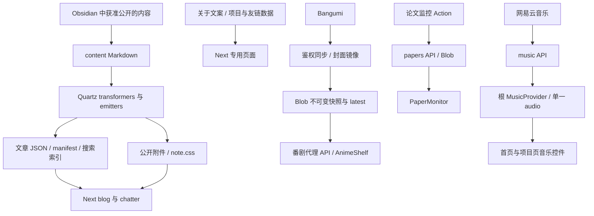

# 代码库架构与弃用残留调查

调查日期：2026-11-12（Asia/Shanghai）。调查基线：[b4e7e79b64e749276b4aacff786fd788935106d8](https://github.com/proffitteoy/nothing-new/tree/b4e7e79b64e749276b4aacff786fd788935106d8)，Next.js 16.2.1、React 19.2.4。

本报告面向后续维护者，回答整个代码库如何运行、哪些内容已经退出生产调用链、哪些架构边界值得调整。四批整改已完成统一高性能、F01–F07、第 5 节退役功能树及 A01–A05 的实现和本地验证，结果见第 11–14 节；部署、真机与公共兼容接口下线决策仍另行处理。

## 1. 范围、方法与结论

现有 Next.js 页面层、Quartz 内容编译器、番剧快照发布链和根级音频所有权可以保留。优先修复跨模块契约和已失效入口，再按调用图清理退役功能。调查没有提供迁移数据库、替换框架或引入统一插件平台的依据。

调查覆盖 `app/`、`components/`、`lib/`、`quartz/`、`scripts/`、根配置、部署入口和相关 `docs/project/`。方法包括三路只读探索、交换领域后的独立 Critique、主代理核对源码、TypeScript 静态导入可达性分析和全仓引用搜索。公共 HTTP 路由、动态加载入口和刻意保留的模块另行判断，不能只凭零内部引用判定可删。

证据采用以下口径：

| 标记       | 含义                                       | 限制                                         |
| ---------- | ------------------------------------------ | -------------------------------------------- |
| 源码确认   | 实际读取入口、调用者和实现                 | 不代表已验证部署环境或外部服务               |
| 执行复现   | 在本地调用实际实现得到结果                 | 不代表真实浏览器、生产流量或真机性能         |
| 既有产物   | 读取本地已经生成的缓存                     | 其生成时间早于本次调查，不能当作线上当前统计 |
| 待测建议   | 源码上存在成本或边界问题                   | 收益、延迟和实际负载尚未测量                 |
| 兼容待确认 | 没有内部消费者，但仍为公开接口或有保留约定 | 下线前需要外部使用证据或明确决定             |

本文引用以文件路径、符号和调查基线为准。后续代码变化后，应重新核对行号和状态。调查没有读取密钥值、修改 GitHub 认证或发布审查评论。

## 2. 实际执行架构

### 2.1 页面、启动与图形生命周期

[app/layout.tsx](../../app/layout.tsx) 读取默认笔记入口，挂载 ThemeProvider、SplashScreen、MusicProvider、导航、背景和滚动管理。MusicProvider 保留在根布局中，软导航不替换 audio，从而延续播放。统一高性能后，根布局不再挂载 FieldModeProvider。

手机根路径由 [proxy.ts](../../proxy.ts)、hydration 前脚本和 [HomeDeviceGate](../../components/HomeDeviceGate.tsx) 分别覆盖服务端识别、首次浏览器执行和客户端导航。它们处理不同阶段；不能只因存在多层判断就认定应合并。桌面舞台经过动态导入，避免手机入口先下载完整场景。

[HomeScene](../../components/HomeScene.tsx) 管理音乐、周报和联系入口；[HomeSpectralCanvas](../../components/HomeSpectralCanvas.tsx) 持有自己的 RAF、可见时钟、Canvas 缓冲和清理。开场 iframe 发出同源完成消息后，SplashScreen 揭幕，首页 Canvas 才开始运动。隐藏标签页停止绘制，重新可见时继续。

[ProjectsBoard](../../app/projects/ProjectsBoard.tsx) 提供文字目录、详情和音乐面板，动态加载 [RoomScene](../../app/projects/RoomScene.tsx)。RoomScene 直接使用 Three.js，管理模型、BVH、贴图、交互和 GPU 资源；没有 React Three Fiber 运行依赖。其 renderer 初始化 effect 仅在挂载时运行，状态更新通过 ref 和控制器传入。

### 2.2 内容编译与公开资源

`npm run dev/build` 先执行 `notes:build`，经 `quartz/bootstrap-cli.mjs`、CLI handler 到 `quartz/build.ts`。配置中的 FrontMatter、日期、Shiki、OFM、GFM、目录、链接、描述和 LaTeX transformers 处理 Markdown；随后两个 emitter 分别输出正文资源和 Next 内容产物。

- [nextContent.ts](../../quartz/plugins/emitters/nextContent.ts) 输出 `.quartz-cache/next/` 的 manifest、文章 artifact、搜索数据和 `public/quartz-assets/content/` 附件。
- [componentResources.ts](../../quartz/plugins/emitters/componentResources.ts) 生成正文 CSS/字体资源。
- [lib/notes/server.ts](../../lib/notes/server.ts) 读取 manifest/artifact，解析目录和别名。
- [NoteRoutePage](../../components/notes/NoteRoutePage.tsx) 决定文章、目录、重定向或 404；[NoteShell](../../components/notes/NoteShell.tsx) 消费 HTML、TOC、backlinks 和 note.css。
- [NoteExplorer](../../components/notes/NoteExplorer.tsx) 在需要搜索时加载 FlexSearch 和公开索引。

Quartz 没有作为第二个生产站点提供整套页面路由。它仍是活跃的内容编译器。生成器会在重建前清理旧 artifact 和附件目录，本次没有发现“旧附件没有清理”的证据。

Obsidian 同步是发布前工具。`obsidian-sync.config.mjs` 和 `scripts/obsidian-sync.mjs` 管理批准、排除、受管文件和删除边界；运行网站不依赖本机 Obsidian。`getLegacyBlogAliases()` 和 Next 的 permanentRedirect 仍保护迁移前链接。

关于页直接使用 unified、highlight.js、KaTeX 渲染三份专用文案；周报还有受限的 Markdown 管线。它们与 Quartz 的输入、资源重写和 Obsidian 语义不同。目前不存在必须合并为一个 renderer 的依据，highlight.js 仍有真实消费者。

### 2.3 音乐、番剧与周报

**音乐。** MusicProvider 初次挂载即读取 `siteConfig.cloudMusicIds`，请求 `/api/music?ids=...`。当前 route 只调用 `_mineradio.ts` 的 `fetchNeteaseSongsByIds()`；每首歌曲取详情后取歌词。浏览器解析歌词，audio 使用外部音频链接和 `preload="none"`。这里的 preload 只限制媒体加载，不阻止歌单元数据请求。

**番剧。** Vercel Cron 或鉴权手工请求调用 `/api/anime/sync`，从 Bangumi 读取、规范化、以有限并发镜像封面，写入内容哈希命名快照并回读验证，最后更新 latest 指针。客户端共享 pending 请求和五分钟元数据缓存，读取 latest 后取不可变快照；失败可进入 `/api/anime`，由后者尝试快照并回退到实时 Bangumi。latest 与不可变快照/封面采用不同缓存策略。超时预算及多层缓存是否符合期望，需要实际部署测量，当前没有确定的新鲜度事故证据。

**周报。** 外部监控 Action 向 `/api/papers` POST，接口鉴权、限制 2MB、解析并编译验证后保存原始 payload。GET 绕过 Blob 读取缓存、重新编译并输出 no-store。PaperMonitor 在挂载及 active 条件变化时检查，不是持续后台轮询。no-store 和绕过可变 Blob 缓存服务于修订后及时可见的约定。

公开站点图片已由 `public/`、构建附件和 CDN 分发；私有 Blob 继续承载番剧及周报。`lib/blob.ts` 是活跃共用边界，不能整体移除。

## 3. 已实施决定：统一高性能

用户已明确选择统一高性能，本轮将该项从调查建议转为代码修改。

| 行为         | 当前约定                                                              |
| ------------ | --------------------------------------------------------------------- |
| 正常首页     | 目标帧率上限 45fps，DPR 上限 1.5                                      |
| 默认密度     | 请求密度 3200 / 120，继续使用原六模态渲染器                           |
| 持续低帧率   | 两个连续两秒采样窗口低于 24fps 后降至 18fps、DPR 1、密度 1800 / 64    |
| 减少动态效果 | 单帧静态呈现，不持续动画                                              |
| 标签页隐藏   | 停止 RAF，恢复可见后继续                                              |
| 历史存储     | 不读取 `blog-performance-mode`，不需要删除用户 localStorage           |
| 诊断属性     | 正常为 `homeQuality=high`，降级为 `adaptive-low`，减少动画为 `static` |

目标上限不等于实际达到的帧率。高性能基线保留设备保护和无障碍行为，不表示强制所有设备持续高负载运行。

实现移除了 HomeSpectralCanvas 对性能 Context、旧设置事件和 normal 分支的依赖；根布局撤下 FieldModeProvider；删除无入口的 FieldModeProvider、SiteDisplayControls 及其专用 CSS。没有恢复旧音乐页或旧显示开关。历史设计文档增加了当前状态说明，项目研究文档中的旧实现链接固定到调查基线。

本项关闭调查中的“旧模式状态在无 UI 情况下改变新首页质量”问题。其他问题状态见下表和后续章节。

## 4. 应优先处理的已确认问题

| 编号 | 优先级 | 状态        | 问题与最小修改                                                   |
| ---- | ------ | ----------- | ---------------------------------------------------------------- |
| F01  | P1     | 已修复      | Quartz 仅生成 Next 允许的宽度；契约测试与重建产物验证见第 11 节。 |
| F02  | P2     | 已修复      | 音乐目录打开共享耳机面板；已移除退役导航及无效数据。              |
| F03  | P2     | 已修复      | 每批最多 32 个合法 ID，按序去重，上游并发上限为 4。               |
| F04  | P2     | 已修复      | RoomScene 浅比较隔离无关更新；播放进度不再触发场景绘制。          |
| F05  | P2     | 本轮已修复  | 旧持久化性能模式控制新首页；现已统一高性能。                     |
| F06  | P2     | 已修复      | 旧天体脚本明确报停，不再生成或清理路由；历史命令已撤下。          |
| F07  | P2     | 已修复      | 修正夜间双描边的测试计数，按关于页现行三章节合同更新结构断言。   |

### F01：响应式图片尺寸契约错误

**整改状态：已修复。** 下述为调查基线问题；当前宽度集合为 `384、640、828、1200、1440、1920`，1000px 原图的 fallback 改为 `w=1200`。测试直接读取 Next 配置约束全部生成候选，不增加共享配置框架。

[nextContent.ts](../../quartz/plugins/emitters/nextContent.ts) 的 `optimizedImageWidths` 包含 `750` 和 `1080`。`getResponsiveImageAttributes()` 直接将这些宽度写为 `/_next/image?...&w=...&q=75` 的 src/srcset。[next.config.ts](../../next.config.ts) 的 deviceSizes/imageSizes 并集却没有它们。

使用当前安装的 Next `ImageOptimizerCache.validateParams()` 执行验证，结果如下：

| 宽度           | 参数校验                  |
| -------------- | ------------------------- |
| 640、828、1200 | 通过                      |
| 750、1080      | 返回 width is not allowed |

Next 在请求参数校验失败时拒绝该优化请求，不会自动替换宽度。浏览器选到对应候选会失败；部分图片的 fallback src 本身也使用无效宽度。

现有本地缓存 manifest 的生成时间为 `2026-11-07T14:05:09.763Z`，167 篇 artifact 中有 18 篇包含这两档候选，6 篇的 fallback src 使用无效宽度。这是旧产物中问题条件存在的旁证，不能作为当前生产站故障数量。

[nextContent.test.ts](../../quartz/plugins/emitters/nextContent.test.ts) 对 1000px 图片断言 fallback 为 `w=1080`，说明当前测试检查了生成规则，却没有检查与消费者兼容。

建议先让 emitter 只生成当前允许的宽度；增加“全部生成宽度属于 Next 允许集合”的检查，并更新错误断言。验收需覆盖 src 和 srcset、原图介于档位之间的情形、中文/空格路径，并重建产物。在确认配置含义前，不为这两个数组引入新的配置框架。

### F02：项目页存在退役页面实链

**整改状态：已修复。** 目录“音乐”改为调用现有 `choose("headphones")` 的按钮，详情中删除“前往音乐页”，耳机元数据移除无效 href。文字入口和 3D 热点共用面板、关闭与焦点恢复逻辑。

[ProjectsBoard.tsx](../../app/projects/ProjectsBoard.tsx) 的目录“音乐”和详情“前往音乐页”仍链接 `/music`；[projects.ts](../../app/projects/projects.ts) 的耳机 target 也保存该 href。当前无 `app/music`，`home-scene-preview.py` 明确断言该地址应为 404。

3D 耳机热点的 choose 分支会正确打开共享播放器控制面板。整改应保留这个功能，处理两处实际链接和无效数据。验收需同时测试文字目录、键盘操作、耳机面板和跨页继续播放；不应恢复退役音乐路由。

### F03：音乐公开接口无请求规模边界

**整改状态：已修复。** route 在任何上游请求前校验批次与 ID，按首次出现顺序去重；helper 以四个 worker 顺序完成每首歌曲的详情和歌词请求，并按输入索引返回。具体合同及失败行为见第 12 节。下述为调查基线。

[app/api/music/route.ts](../../app/api/music/route.ts) 仅 split/trim/filter IDs；没有格式校验、去重和数量限制。[\_mineradio.ts](../../app/api/music/_mineradio.ts) 的 `fetchNeteaseSongsByIds()` 对全部 ID 使用 Promise.all，每个 ID 取详情，存在歌曲时继续取歌词。重复 ID 也重复工作。

因此上游工作量和初始并发由调用方决定。当前站点固定歌单较小，不能据此断言已经发生事故；公开接口本身仍应设边界。

建议在现有 route 中限定合法 ID 和批次数量、按首次出现顺序去重，helper 使用小的并发上限。验收覆盖空输入、非法 ID、重复、超量、部分上游失败和返回顺序。不需要队列服务或新音源平台。

### F04：音乐进度泄漏到 Three.js 绘制边界

**整改状态：已修复。** RoomScene 使用 React memo 的默认浅比较，现有稳定回调及真实场景属性变化仍可穿过边界。Provider 的进度仍正常更新，无需拆分 Context；修改前后相同播放条件下的绘制次数见第 12 节。下述为调查基线。

[MusicProvider.tsx](../../components/MusicProvider.tsx) 的 timeupdate 更新 currentTime/progress；Provider 每次创建包含全部字段的新 Context value。[ProjectsBoard](../../app/projects/ProjectsBoard.tsx) 虽然只需要歌曲、播放状态等，也会订阅这些变化。

RoomScene 未做 memo，其 `[props]` effect 每次调用控制器 update；update 末尾无条件 schedule。播放音乐时，这条链会额外触发 React 更新、房间绘制和标签计算。renderer 初始化 effect 是空依赖数组，不存在“每次进度更新重新创建 WebGL”的证据。

建议先限定 RoomScene update 的真实依赖或加有效的浅比较边界，也可将音乐订阅下移到耳机控制局部。修改前后用相同播放场景比较 draw/update 次数；同时验证主题、选择、旋转、重置和尺寸变化仍能触发应有更新。当前没有实测性能收益。

### F06：天体预览脚本失效

**整改状态：已修复。** 保留小型退役入口供旧命令获得明确错误：`--prepare-study`、`--clean-study`、旧检查/录制选项均返回状态码 2，`--help` 返回 0；没有文件读写或 Playwright 依赖。哨兵验证确认不生成路由、不删除已有文件；仓库无遗留 study 页面。旧文档改链调查基线源码，并指向现行页面检查。下述为调查基线。

[scripts/celestial-preview.py](../../scripts/celestial-preview.py) 的 `--prepare-study` 会生成 `app/celestial-study/page.tsx`，导入已经删除的 HomeCelestialControl。该入口仍被旧文档推荐，执行后会留下无法编译的测试页面。

应归档旧流程，或让验收脚本覆盖实际存在的页面/控件。不要恢复已退役组件来满足旧测试。若保留生成夹具功能，必须验证生成和清理的路径边界。

### F07：本轮暴露的现有测试失败

**整改状态：已核实并修复测试。** 重生后的核心线和夜间光晕各为背景 318 段、前景 40 段；旧测试将两次描边累加后与单次几何预算比较，产生误报。现在分开计数，保留原 320/40 上限并检查光晕复用同一几何。关于页已按 `about-restructure.md` 拆为三个语义章节，测试改查现行章节及独立正文，不恢复无生产消费者的障碍物协议。未修改谱线算法或关于页生产实现。以下失败记录属于调查轮；第二批全量测试为 99/99 通过。

运行 `npm test`：92 项测试，90 通过、2 失败：

1. `homepage long spectral curves render immediately, remain visible, and fade over time`：在 ambient 重生场景触发 `background respawns cannot flash long paths` 断言。
2. `the about obstacle belongs to the article, not the page grid`：断言应有一个带 data-field-obstacle 的 article，当前 AboutClient 中匹配数量为零。

这两项的测试、SpectralTracerLayer、spectralField 和 AboutClient 本轮没有修改。第一项需要单独复核当前算法是否违背预期或测试边界是否过时；第二项与关于页重构后的结构发生漂移。尚未证明第一项对应线上可见闪烁，也不应为让测试通过而直接放宽断言。

验收时应先明确当前产品行为，再修实现或更新过时测试，并保留能够发现真实回归的检查。

## 5. 弃用残留与清理边界

以下保留功能级或引用图级调查结论，并记录第三批状态。除明确保留的旧 DOM 参考协议外，表中退役功能树、孤立配置及构建工具残留均已清理；验证见第 13 节。

| 内容                              | 证据与状态                                                                                          | 建议边界                                                                            |
| --------------------------------- | --------------------------------------------------------------------------------------------------- | ----------------------------------------------------------------------------------- |
| HomeStoryBoard、SiteDashboard     | 已删除；核对无生产 import 或工具消费者，当前首页直接使用 HomeScene                                  | 现行周报入口和编译器保留。                                                         |
| buildDate、footerBadges 配置      | 已删除；仅服务于孤立 SiteDashboard                                                                  | avatarUrl 仍供友链 fallback 使用，保留。                                           |
| 天气电台、歌曲搜索链              | 已清理天气类型、位置解析、打分排序及内部互调                                                         | 保留按 ID 歌曲获取、四 worker 边界和授权出处。                                     |
| 旧番剧 SSR 切片模块               | 已删除 `app/anime/bangumi.ts` 和未使用的 AnimeCollectionSlice                                         | 保留当前快照、ANIME_BATCH_SIZE 及真实备用 API。                                    |
| 番剧未使用导出                    | 已删除 isAnimeStatus、getAnimeBlobUrl                                                               | 现行 schema 与 Blob 转发保持原实现。                                               |
| 旧播放器 Context 字段             | 已删除 stationName/stationDescription、playSong、对外 loadSongsByIds                                | 内部 loadSongsByIds 仍用于初始化和重试。                                           |
| 不可达远程歌词分支                | 已删除 lrcUrl、远程歌词 fetch 和其唯一的 playlist 回写分支                                          | normalize 仍解析内联 LRC；lyrics 类型收窄为数组。                                  |
| preloadRoomScene 与 prepared 缓存 | 已删除无消费者的预解析入口、待用对象和超时逻辑                                                       | 场景挂载时直接 prepareRoom，保留 preloadRoomAssets 压缩资源缓存。                   |
| 旧 DOM 协议                       | 保留；读者仅在明确保留的 opt-in detached runtime 中                                                  | 继续作为参考兼容合同，不自动接回生产页面。                                         |
| Quartz 页面配置                   | 已删除未读的页面/分析/日期选择配置及 baseUrl                                                         | 只保留 ignorePatterns、theme、locale 和插件链。                                   |
| Google Fonts 工具和配置           | 已删除 Google Fonts 工具、fontOrigin/cdnCaching 与专用字体选项                                       | 保留 joinStyles、SCSS 和实际 KaTeX 字体输出。                                      |
| 旧 JSX/inline 加载器、preact      | 已删除无消费者加载器及 preact 直接依赖/锁节点；单/多线程内容构建通过                                | 不改动其他依赖版本。                                                               |
| CLI output 参数                   | 已取消 `-o/--output` 及其旧目录清理副作用                                                            | emitter 固定输出；旧参数报未知选项，不清理任意目录。                               |

## 6. 可随后优化的架构边界

### A01：根导航不应依赖全部笔记正文读取

**整改状态：已完成。** 首选路由先通过 manifest 直接读取单篇（含别名解析），缺失时保留原排序与正文长度回退；目录在读取 artifact 前按路径过滤。对同一批产物测量，单次入口函数调用的正文读取从 109 篇/17,367,696 bytes 降为 1 篇/372,377 bytes，目标地址相同；不是 HTTP 请求或生产延迟基准。下述为调查基线，验收见第 14 节。

`app/layout.tsx` 调用 `getBlogEntryRoute()`，后者先 `getSectionNotes("blog")`，加载所有文章 artifact 并排序，随后才寻找固定首选路由或正文长度达标的文章。`getFolderNotes()` 也先读取全部 section 再按目录过滤。

现有旧缓存中 blog 为 109 篇、约 17.4MB，manifest 约 80KB。两者差异说明读取粒度不匹配，不是性能基准。React cache 可以在 render pass 内去重，静态生成也影响运行频率，不能声称每个 HTTP 请求都读取 17.4MB。

最小方案是先直接查首选路由，缺失时再回退；目录先按 manifest 路径过滤再读。确有进一步收益时，可在构建 manifest 输出入口和列表所需轻量 metadata。验收应包含首选缺失、无文章、别名、目录和静态构建。

### A02：音乐元数据可以按需初始化

**整改状态：已完成。** 首次展开首页音乐或打开项目页耳机面板时才请求歌单，根 Provider 保留初始化状态及 audio；首次加载有连接提示，空歌单/错误可重试。直接阅读和关闭的入口无请求，首开一次、重复进入和软导航不重取，见第 14 节。下述为调查基线。

根 MusicProvider 保证跨页播放，位置合理；其首次挂载 effect 无差别请求歌单，纯阅读入口也引入了音乐上游依赖。当前配置八首歌，静态调用路径最多产生十六次详情/歌词请求，不代表已经测量实际延迟。

可在首次打开音乐入口时初始化，或在允许的空闲阶段预热；初始化后仍由根 Provider 持有。需要决定首次点击 loading 的产品取舍，并测试首页、项目、直接阅读和跨页继续播放。此项与 F03 的 API 输入边界可以分开交付。

### A03：周报可按版本复用编译结果

**整改状态：已完成本地测量与最小缓存。** GET 仍逐次读取最新 Blob，随后复用当前原文 SHA-256 对应的编译 Promise；只保留一个版本、无 TTL，响应继续 no-store。同周期修订、失败重试、并发复用和 POST 写入失败隔离均有测试。本地处理开销测量见第 14 节，未测真实 Blob 延迟，也不据此认定线上存在瓶颈。下述为调查基线。

POST 已编译验证却只存原始 source；GET 对同一份 source 重复执行 Markdown/KaTeX 编译。建议先测量编译耗时和 Blob 读取，再考虑内容哈希缓存或发布时生成带 schema/compiler 版本的已编译快照。

任何优化都应保证同周期报告被覆盖修订后及时可见。直接恢复任意 TTL 的 stale cache 会改变当前合同。当前没有生产瓶颈测量，暂列 Consider。

### A04：内容能力标记与客户端能力未闭环

**整改状态：静态回退已完成。** Mermaid 围栏保留可读源码，不生成扩展按钮/dialog；Callout 折叠标记被识别但全文展开，移除失效折叠外观。链接仍正常跳转，不提供悬停预览；features.mermaid/popovers 均表示未启用的 Next 客户端能力。完整内容管线与生产 CSS 下的可读性已验证，见第 14 节。下述为调查基线。

NoteArtifact.features 包含 mermaid/popovers，OFM 还可能生成 Mermaid 扩展按钮和 dialog DOM，但 Next 组件没有对应消费/交互代码。当前 content 没找到相关 Mermaid fence 或折叠 Callout，尚未确认已有文章受损。

应明确支持范围：若不支持，关闭会生成不可用交互的输出并如实说明；若确实需要，再做最小客户端能力接入。不能把 metadata 为 true 当作功能已可用。

### A05：启动协议需要统一描述

**整改状态：说明与验证已完成。** 明确 hydration 前 22 秒全局兜底、iframe load 后 9.5 秒回退、子页/减少动态等入口最多 2.5 秒准备及独立 4 秒 critical 预算；正常同源完成消息立即揭幕，无 logo hold。修正 layout 注释，历史记录整体标为历史，未修改 Alpha 资源、时长或启动状态机。受控组件和浏览器验证见第 14 节。下述为调查基线。

hydration 前脚本提供全局 fail-open；SplashScreen 处理动画完成和 iframe 回退；HomeDeviceGate 处理客户端回首页；Canvas 接管可见时钟。它们有各自时机，当前不需要引入全局状态机框架。

但旧注释/文档仍描述 logo hold，当前动画完成已经立即揭幕。宜明确 dataset、事件、超时的职责，并保持同源消息、跳过、hydration 失败、SPA 返回和减少动画回归。不要把旧截图或旧时间预算当作当前运行证据。

## 7. 明确保留、或需确认兼容期的内容

| 内容                               | 保留理由 / 下线前条件                                                                             |
| ---------------------------------- | ------------------------------------------------------------------------------------------------- |
| Quartz 内容编译主链与正文 CSS      | Next 正在消费 manifest、artifact、搜索、附件和 note.css。                                         |
| SpectralTracerLayer、spectralField | 首页与项目仍有实际消费者。                                                                        |
| detached SpectralFieldRuntime      | [保留合同](spectral-field-runtime.md) 明确为 opt-in 参考模块；不得自动接回首页制造第二个 RAF。    |
| 根 MusicProvider/audio             | 保证跨页继续播放；优化初始化和订阅边界即可。                                                      |
| `/api/anime`                       | 客户端真实备用路径。                                                                              |
| blog aliases                       | 仍保护历史公开 URL。                                                                              |
| `/api/bgm/**`                      | 无内部调用只能证明新前端不需要；需要访问日志或明确公共合同判断外部使用。                          |
| `/assets/**`、images:sync          | [迁移文档](vercel-origin-transfer-migration.md) 明确保留兼容/回退入口；未退出兼容期前不能直接删。 |
| `/preview/home-music`              | HOME_MUSIC_PREVIEW 门控，默认 notFound；仍为受控测试支架。                                        |
| 三方许可证与来源记录               | 清理旧实现可更新“当前使用位置”，不能因此删除必要的版权和授权记录。                                |

番剧同步“先验证不可变对象、最后发布 latest”的边界合理。公开静态图片与私有动态 Blob 的分工也有明确用途，本次没有发现必须合并存储方案的证据。

## 8. 文档与源码漂移

| 文件                                 | 漂移                                                               | 处理方式                                                     |
| ------------------------------------ | ------------------------------------------------------------------ | ------------------------------------------------------------ |
| README.md、docs/project/index.md     | 关于页仍描述 GitHub 贡献图，about-restructure 已明确删除           | 当前入口指向新结构；旧验收记录标为历史。                     |
| scripts/README.md                    | 宣称 npm build 自动 images:sync、旧图片 URL 由全套 rewrite 兼容    | 按 package.json/next.config 更新；保留显式历史维护入口说明。 |
| .env.example                         | Blob 注释仍声称承载全站自有图片                                    | 区分动态 Blob 与静态站点图片，不改实际密钥。                 |
| home-mode-panels.md                  | 旧控件/Provider/天体夹具被描述成当前接口                           | 本轮已增加历史标记；旧脚本本身仍待 F06 处理。                |
| home-scene.md                        | 旧双模式性能约定                                                   | 本轮已写入统一高性能约定；其余旧视觉与验收历史另待整理。     |
| site-startup.md、layout 注释         | 旧 logo hold 时间与现行立即揭幕不一致                              | 按当前完成消息和回退职责更新。                               |
| music-particle-medium-restoration.md | 已删除音乐页/FieldScene 仍被写作当前基线                           | 明确研究规格和历史实现，不当作恢复指令。                     |
| third-party-notices.md               | 仍列已删除粒子组件或贡献图为当前使用位置                           | 更新来源对应关系，保留授权要求。                             |
| vercel-origin-transfer-migration.md  | 验收范围仍出现退役 /music                                          | 替换成实际音乐入口及跨页连续播放检查。                       |
| README 技术栈与输出目录说明          | 仍提未安装 React Three Fiber/PixiJS，旧 quartz-site 输出职责易误解 | 依据实际依赖和 emitter 输出重新描述。                        |

上表保留调查时的漂移记录。第三批已同步 README、脚本说明、环境变量示例、天体历史入口、预解析说明、第三方来源位置、退役音乐页迁移验收和研究规格历史标记；第四批已补齐启动协议当前说明及注释。历史设计稿、截图、旧时间预算和原始文案作为历史继续保留。

## 9. 建议分批实施与验收

1. **显示契约修复：F01、F02（已完成）。** 修正尺寸生成与错误测试；移除退役页面实链。图片候选和项目文字/3D入口的验证见第 11 节，变更可单独回退。
2. **运行边界：F03、F04、F07（已完成）。** 限制音乐工作量，隔离进度到场景绘制的传播，厘清现有测试失败。请求并发、场景绘制次数和产品行为的验证见第 12 节，未放宽谱线重生预算。
3. **退役代码及脚本：第 5 节、F06（已完成）。** 已清理无消费者功能树及对应类型、配置、依赖和文档；旧 DOM 参考协议按保留合同留下，验证见第 13 节。
4. **读取与能力边界：A01—A05（实现与本地验证已完成）。** 采用单篇/目录读取、首次音乐入口初始化、单版本周报编译复用、静态正文回退和现行启动说明，结果与测量范围见第 14 节。
5. **公共兼容接口单独决策。** 收集 `/api/bgm/**`、`/assets/**` 使用证据和回退要求后再安排下线，不与本地死代码混删。

后续代码变更按涉及范围选择检查。内容/依赖变更至少 notes:build；页面与类型边界跑 typecheck；相关测试与 ESLint通过后再执行必要的生产构建。浏览器验收聚焦实际改变的入口、图片、播放连续性和场景生命周期。当前测试已有失败，任何“全绿”结论都必须先处理或明确隔离这些失败。

## 10. 本轮验证与剩余限制

本轮性能实现已完成以下验证：

- `npm run typecheck`：Next 路由类型生成与 TypeScript 检查通过。
- 执行真实 HomeSpectralCanvas 代码的受控行为检查：历史 normal/field 均不触发存储读取，首帧为 high；DPR2 环境初始缓冲按 1.5 上限分配；持续慢帧进入 adaptive-low/DPR1；减少动画只绘制一帧；卸载取消 RAF、移除监听并释放缓冲。环境使用受控 DOM/RAF 和 tracer 替身，不代表浏览器帧率测量。
- `npm test`：90/92 通过，失败两项见 F07；没有因本轮任务放宽测试。
- 修改组件的 ESLint、`git diff --check`、预览脚本 Python 语法检查均通过；报告中的本地文件链接全部存在，生产代码已无旧性能模式引用。

调查阶段直接调用当前 Next 图片参数校验器确认 F01，并核对旧缓存时间与受影响候选。没有访问真实网易云/Bangumi/Blob 服务，没有将旧产物统计当作线上事实。

调查轮尚未运行生产构建、完整 Playwright 页面矩阵、真机性能或部署验证。`home-scene-preview.py` 仅更新了性能分支的统一高性能语义和旧偏好不影响行为的检查；该历史脚本其他分支仍有依赖旧天体/周期的断言，不作为该轮浏览器通过证据。后续第一批构建和局部浏览器验收见第 11 节。

## 11. 第一批整改：F01、F02

实施日期：2026-11-12（Asia/Shanghai）。保留工作区已有的统一高性能修改，本批仅调整 Quartz 图片候选、项目页音乐入口、对应测试及维护说明；未提交、推送或部署。

- **图片契约：** 删除 `750、1080` 两档生成宽度；新增测试直接对照 `next.config.ts` 的允许宽度和质量，覆盖 src/srcset、档位边界、小于最小档和超过最大档的原图，以及中文/空格路径。重新生成的 167 篇 artifact 中，295 个图片优化 URL 全部通过当前 Next `ImageOptimizerCache.validateParams()` 的生产参数校验；六档宽度各取一个实际生成的 URL 请求本地生产服务，均返回 HTTP 200 与 `image/webp`。
- **音乐入口：** 目录按钮与耳机热点均打开现有共享播放器；移除两处退役页面链接、耳机无效 href 和链接专用样式。扩展 `scripts/projects-preview.py`，检查目录按钮 Enter 打开、面板获焦、Escape 返回目录开关，以及播放中软导航至笔记再返回项目页时，保留同一个 audio 元素、只有一个实例并继续播放。
- **构建与静态检查：** `npm run build`（含 `notes:build`）通过，生成 247 页；`npm run typecheck`、修改 TypeScript 文件的 ESLint（Quartz 文件显式取消默认忽略）、Prettier、Python 语法及差异检查通过。构建保留原有 KaTeX 中文数学警告。
- **测试现状：** `npm test` 为 91/93 通过；新增图片契约测试通过，仍失败的两项与 F07 记录一致。本批未修改谱线算法、关于页或其断言，未将全量测试报告为通过。
- **浏览器范围：** Windows、本机 Chrome 无头生产预览，1440×1000 与 390×844 的日夜四个用例通过，并通过 GLB 请求失败、WebGL context loss、重试、静态回退及项目交互检查。音乐使用浏览器内的 WAV/API 夹具，运行真实根 Provider 和 HTMLAudioElement；不代表外部音乐服务、Safari、手机真机或部署验收。产物在忽略目录 `.sync/tmp-architecture-batch1-desktop/`、`.sync/tmp-architecture-batch1-mobile/`，构建日志为前者的 `build.log`。

本批运行时为本机已安装的 Node 24.11.1；项目与部署仍要求 Node 22，尚未补 Node 22 构建验证。第一批结束时 F03、F04、F06、F07 及后续清理/测量项仍待处理；运行边界的后续结果见第 12 节。公共兼容接口与保留合同不变。

## 12. 第二批整改：F03、F04、F07

实施日期：2026-11-12（Asia/Shanghai）。延续第一批工作区，不覆盖既有修改，未提交、推送或部署。

### 音乐请求边界（F03）

- `/api/music` 仍使用 `ids` 逗号分隔参数，先 trim 并忽略空项。缺少参数、无有效项、超过 32 个非空输入项或任一非法 ID，均返回 HTTP 400，且不发出上游请求。数量检查在去重前执行，33 个重复 ID 同样拒绝。
- 合法 ID 为无前导零的十进制正整数，且不超过 JavaScript 安全整数范围；验证后不改变 ID 字符串。按首次出现顺序去重，例如 `3,1,3,2` 返回 `3,1,2`。
- 每批最多四个 worker，每个 worker 等待该首歌的详情和歌词完成后才处理下一首，因而两类请求的总并发不超过四。结果保留输入顺序。详情失败、未找到歌曲和歌词失败仍逐首处理，不使整批失败；歌词失败返回空歌词。此限制针对单批请求，不是跨请求/进程的全站限流。
- 新增 `app/api/music/route.test.ts` 六项测试，覆盖非法/空输入、超量与重复超量、去重、32 项边界、详情和歌词合计峰值并发 4、返回顺序、部分上游失败及空内部批次。测试使用 fetch 替身；本地生产路由的非法和超量请求也分别验证返回 400。

### 场景订阅边界（F04）

只给 `RoomScene` 增加默认浅比较的 React memo 边界；`ProjectsBoard` 原有 ready/error/choose 回调保持稳定。未改根 Provider/audio 的所有权，也未改 Three renderer 初始化或控制器行为。

使用真实根 Provider、HTMLAudioElement 和本地 WAV，在相同三秒采样窗口中观察音乐 `timeupdate`，并通过现有 `data-triangles` 的属性更新计数实际提交的场景绘制。采样前等待 hover/camera 反馈结束；无注入 RAF 或虚拟时钟。

| 场景 | 修改前桌面日间 | 修改后桌面/窄屏日夜 |
| ---- | -------------- | ------------------- |
| 音乐面板打开 | 11 次 timeupdate、11 次绘制 | 每窗 11–12 次 timeupdate、0 次绘制 |
| 关闭面板、场景静止 | 11 次 timeupdate、11 次绘制 | 每窗 11–12 次 timeupdate、0 次绘制 |

这是去除无关绘制的本机证据，不是全设备 FPS 或功耗承诺。四个用例仍通过主题、项目选择、标签、拖动/旋转、重置、跨页单音频继续播放、静态回退和故障重试。同一已挂载场景的 resize 另行验证：桌面缓冲宽度 `1230 → 1333 → 1230`，窄屏 `390 → 510 → 390`，均发生相应绘制。

`scripts/projects-preview.py` 加入两种面板状态下的三秒零额外绘制断言、实时 resize 检查，并把本地音轨延长为 30 秒，以覆盖采样和跨页导航。完整交互矩阵与独立 resize 采样均通过。

### 测试漂移（F07）与验证范围

谱线重生的修复仅涉及测试的核心线/光晕计数；关于页结构测试按当前三章节合同更新，继续检查各章节的语义标记、独立正文和 detached runtime 不被挂载。关于页冒烟脚本修正 Playwright `wait_for_function` 的 `arg=` 调用，并用空音乐响应隔离无关上游请求。

- `npm test`：99/99 通过，原两项失败已消除。
- `npm run typecheck`、修改 TypeScript 文件 ESLint、音乐路由与新增测试 Prettier、修改 Python 脚本语法及 `git diff --check`：通过。保留既有文件其他区域格式，不批量重排。
- `npx next build`：通过，247 页；沿用第一批已重建的内容产物，本批没有改动内容编译链。
- 项目页 Chrome 无头生产预览：1440×1000、390×844 的日夜四例通过，0 个 pageerror；包含 GLB 请求失败、WebGL context loss 和重试。
- 关于页 Chrome 冒烟：390、768、1024、1440 四种宽度均通过章节、导航、滚动标记、图片和无横向溢出检查。

本地产物位于忽略目录 `.sync/tmp-architecture-batch2/`：`before.json`、`desktop/report.json`、`mobile/report.json`、`resize.json`、截图和 `build.log`；含实时 resize 检查的最终版脚本报告为 `desktop-final/report.json`、`mobile-final/report.json`，四例及故障重试均通过。运行时仍为 Node 24.11.1；Node 22、真实网易云服务、Safari、移动真机与部署验证仍未覆盖。下一批为 F06 及第 5 节退役功能树清理；公共兼容接口、许可证和明确保留的 runtime 不因本批下线。

## 13. 第三批整改：F06 与退役功能树

实施日期：2026-11-12（Asia/Shanghai）。延续前两批工作区，未提交、推送、部署或执行 GitHub 写操作。

### 清理范围与保留边界

- 删除无消费者的 HomeStoryBoard、SiteDashboard 及其专用 buildDate/footerBadges；保留现行 HomeScene/PaperMonitor 与仍使用的 avatarUrl。
- 删除天气电台、歌曲搜索、位置/天气类型和排序链；按 ID 获取详情/歌词、单批四 worker、逐首失败行为及 Mineradio 来源记录保留。
- 删除旧番剧 SSR 切片文件、重复切片类型和两个未用导出；ANIME_BATCH_SIZE、客户端快照、同步发布链、Blob 和 `/api/anime` 备用路径保留。
- 删除旧播放器 Context 字段、直接选曲方法及外部加载入口；内部 loadSongsByIds 继续负责初始化与重试。唯一的有效 playlist 写入路径仍是 normalizeApiSong，保留内联 LRC 解析，删除恒为 null 的远程歌词 URL 和不可达 fetch/回写分支。根 Provider/audio 的所有权不变。
- 删除小屋 CPU 预解析入口、待用对象及 60 秒缓存；挂载直接 prepareRoom，继续共用压缩资产缓存，每次场景单独持有并释放模型、贴图和 BVH。
- Quartz 删除未读页面配置、分析/日期选择类型、baseUrl、Google Fonts 工具/专用选项、旧 JSX/inline 加载器；保留正文 SCSS、joinStyles、KaTeX 字体、单/多线程处理和实际 emitter。移除 preact 根依赖及其无其他依赖者的锁节点，其余锁定版本未变，锁文件依赖图检查通过。
- 取消仅清理旧目录的 CLI `-o/--output`，保留 directory/verbose/concurrency。产物固定在 `.quartz-cache/next/` 和 `public/quartz-assets/`；旧参数报未知选项，不再清理任意指定目录。

旧 DOM 标记继续服务于明确保留的 detached runtime 参考合同。`/api/bgm/**`、`/assets/**`、images:sync、blog aliases、受门控音乐预览和许可证文本均未下线。

### F06：退役入口无路由副作用

celestial-preview.py 现为小型退役提示，不导入 Playwright、不读写文件。prepare/clean/check/record 旧选项返回 2，help 返回 0；文档撤下失效命令，旧源码使用固定基线链接保留。对含既有路由哨兵文件的隔离目录分别执行这些选项，文件集合和内容哈希均不变，仓库未生成 celestial-study 页面。对旧 CLI output 参数也验证为非零退出、哨兵不变。

### 验证与结果

- `npm test`：99/99 通过。
- `npm run typecheck`、受影响应用/Quartz 文件 ESLint、选定 Quartz 和番剧文件 Prettier、退役 Python 语法及 `git diff --check`：通过。触及 worker 的 ESLint 检查同时修正了原有 any 类型和未用参数，不改变解析行为。
- 默认 `notes:build`、显式 `--concurrency 2` 和完整 `npm run build`：通过，生产构建 247 页；保留既有 KaTeX 中文数学警告。
- 内容对照：与隔离的清理前 Quartz 源码比较，并复核最终当前构建，167 篇 artifact 的正文、元数据及其他字段一致；manifest 仅 generatedAt 不同，note.css 完全一致。比较规范化了 167 篇未声明 published/publishDate/date 的文章之 dates.published：既有 lastmod 转换器会将缺省值写成构建当前时间，不能据此声称原始 JSON 字节完全一致。本批未修改该日期逻辑。隔离对照保留第一批图片修正，仅还原本批精简前的配置与构建结构。
- 项目页：Chrome 无头生产预览，1440×1000、390×844 日夜四例通过，含实时 resize、文字/热点、旋转/重置、静态切换、GLB 失败、context loss 和重试。八个三秒播放窗口仍有 11–12 次 timeupdate，额外场景绘制均为 0，0 个 pageerror。
- 首页音乐：真实根 Provider、HTMLAudioElement 与本地 WAV 验证内联歌词随时间变化、播放/暂停、键盘/指针 seek、前后切歌、纯音乐无歌词 DOM、软导航保留同一个 audio，以及 empty/error 后重试恢复。preload=none 下，重试先恢复歌曲，再在播放取得媒体元数据后启用 seek。
- 番剧：真实页面分别通过 latest + 不可变快照、latest 失败转 `/api/anime` 两条浏览器夹具路径；在看和已看内容正常，0 个 pageerror。没有将夹具结果当作真实 Bangumi/Blob 验收。

本地证据位于忽略目录 `.sync/tmp-architecture-batch3/`：tests.log、notes-build.log、notes-workers.log、build.log、retired-guard.json、reference-comparison.json、content-comparison.json、desktop/report.json、mobile/report.json、runtime-smoke.json 及截图。原始哈希对比因既有缺省发布日期的构建时间变化而不适用，最终采用上述有明确归一化范围的语义比较。

运行时仍为 Node 24.11.1，使用现有 node_modules；Node 22、干净安装、真实外部音乐/Bangumi/Blob、Safari、移动真机和部署仍未覆盖。离线 npm 操作因缺少无关平台包缓存未完成，最终仅精确删除 preact 的根依赖与无依赖者锁节点，未安装或升级其他依赖。后续按第 6 节推进 A01–A05；A03 仍需测量，A04 仍需明确支持范围，公共兼容接口继续单独决策。

## 14. 第四批整改：A01–A05

实施日期：2026-11-12–13（Asia/Shanghai）。延续前三批工作区，未提交、推送、部署或写入真实外部服务。

### 读取与初始化

A01 先通过 manifest 查首选文章，保留别名解析；缺失时仍按原日期/标题排序，再选正文长度达标的文章，空集合或均为短文仍返回 `/blog`。目录查询先过滤 manifest 的目录前缀，再读取并排序目标正文。没有新增 manifest schema 或列表抽象。

对同一批真实产物执行一次入口函数：旧实现读取 109 篇 artifact、17,367,696 bytes；新实现读取 1 篇、372,377 bytes，目标地址一致。这不是每个 HTTP 请求的读取量承诺；测量未模拟 React render-pass cache，静态生成及缓存会影响调用频率。五项边界测试覆盖首选短文、首选缺失、无文章/全短文、别名和目录前缀/嵌套排序。

A02 由根 Provider 保留 requested 状态，CloudPlayer 仅在 active 时初始化；首页把侧栏真实展开状态传入，项目页从耳机/目录选择入口初始化。初始化后重复进入和软导航复用歌单与唯一 audio。首次打开显示加载提示，项目页补齐空歌单/错误和重试操作。没有添加空闲预热、轮询或新播放上下文。

### 周报编译版本复用（A03）

先测量真实两期种子报告（25,597 bytes）：纯编译首次约 39.7ms，后续中位数约 7.7ms。随后在现有 route 内增加一个内容 SHA-256 对应的编译 Promise，最多保留一个版本。配置 Blob 时每次 GET 仍先绕过对象缓存读取最新 source，再比较版本；HTTP 响应仍 no-store。进程/部署间不共享缓存，源码变更后按新进程的编译器生成结果，无需持久化 schema 或新增存储。

| 同一进程 12 次 GET、本地原文 transport 替身 | 修改前 | 修改后 |
| ---------------------------------------- | ------ | ------ |
| Blob 读取调用 | 12 | 12 |
| 实际 Markdown/KaTeX 编译 | 12 | 1 |
| 第一次之后的处理时间中位数 | 7.88ms | 0.53ms |

表中包含真实 GET、解析器和渲染器，Blob 网络由本地 payload 替代；不是线上 Blob 延迟或端到端提速百分比。未声称生产存在瓶颈。六项测试检查并发复用、同周期修订立即可见、仅留一版本、编译失败重试、旧失败不驱逐新版本、POST 验证结果复用及写入失败不误发未发布内容。真实存储写入仅使用替身。

### 静态正文与启动合同

A04 采用静态回退：配置禁用 Mermaid 交互输出，保留源码与高亮；Callout 的 +/- 折叠标记仍可解析，正文展开，移除失效折叠类/图标。内部链接保留普通跳转，features.mermaid/popovers 明确表示当前未启用 Next 客户端能力。用不受 Git ignore 排除的临时源目录跑真实 Quartz 管线，确认 Mermaid 可读、两段 Callout 正文可见、内部链接正确且无按钮/dialog，保存产物后仅删除本次创建的两个文件和空目录。最终完整构建已恢复真实内容，临时测试路由/源目录均未进入工作区变更。

A05 在 site-startup 文首明确现行职责、dataset、事件和独立预算，将原 logo hold、旧 Field、音乐页及历史测量整体标为历史；layout 的旧注释同步修正。没有修改 Alpha HTML 资源、7.4 秒时长、完成消息或状态机。实际 SplashScreen 的受控执行测试覆盖 origin/source 拒绝、正常完成、跳过、9.5 秒回退、只揭幕一次及监听清理；原 Alpha 几何/时间回归继续通过。

### 最终验证与限制

- `npm test`：113/113 通过；最后 OFM 的 const 静态修正另有 9/9 定向回归。新增测试共 14 项，覆盖上述读取、缓存、新静态输出和实际启动组件行为。
- `npm run typecheck`、相关 ESLint、选定修改文件 Prettier、项目脚本 Python 语法与 `git diff --check`：通过。ESLint 保留 CloudPlayer 图片元素及 OFM 五个既有未用参数 warning，0 errors；OFM 原有 prefer-const 三项错误以一行 const 修正，不改解析逻辑。
- 完整 `npm run build`：通过，真实内容重新生成，247 个生产页面；保留既有 KaTeX 中文数学警告。
- 项目页 1440×1000、390×844 日夜四例：未打开音乐时 0 请求，首次入口 1 请求，软导航不重取；焦点、主题、resize、旋转/重置、场景回退/重建和跨页播放通过，音乐进度仍不产生额外场景绘制。
- 实际首页/笔记浏览器：直接阅读无音乐请求或 audio，关闭首页侧栏无请求；首开后歌词、前后切歌、键盘/指针 seek、纯音乐无歌词、empty/error 重试和单音频软导航通过。静态 Mermaid 与 Callout 在生产 note.css 下可见。音乐/番剧使用浏览器本地夹具，0 个 pageerror。
- 启动浏览器：真实 SplashScreen 配同源 iframe 协议夹具，错误 origin/source 不揭幕，正确消息、跳过与 9.5 秒回退揭幕；减少动态不加载 iframe，SPA 回首页不重播；CSP 阻止 hydration 外部脚本时，内联 22 秒兜底仍揭幕。超时使用浏览器虚拟时间，不作为真实动画、帧率或加载延迟样本。
- 本地生产 GET `/api/papers` 连续两次返回 200、no-store、两期共九篇论文；实际 Blob 覆盖修订由 route 受控测试验证，没有向远端写入。

证据位于忽略目录 `.sync/tmp-architecture-batch4/`：notes-reads.json、papers-before.json、papers-after.json、tests.log、build.log、static-artifact.json、desktop/report.json、mobile/report.json、runtime-smoke.json、startup-browser.json 及脚本/截图。

运行时仍为 Node 24.11.1 和已有 node_modules；Node 22、干净安装、真实外部音乐/Bangumi/Blob、Safari、移动真机和部署仍未覆盖。A01–A05 的实现及上述本地验证完成；是否对公开兼容接口下线，仍需第 7 节要求的外部使用证据或明确决定。
