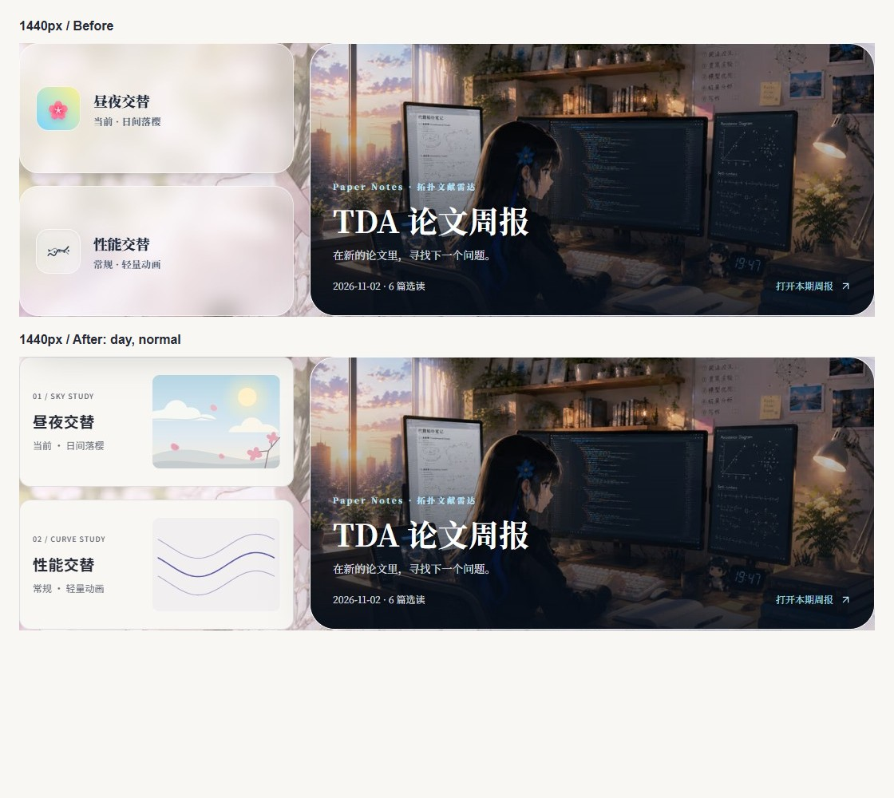
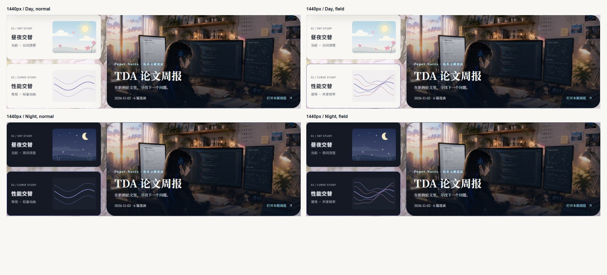
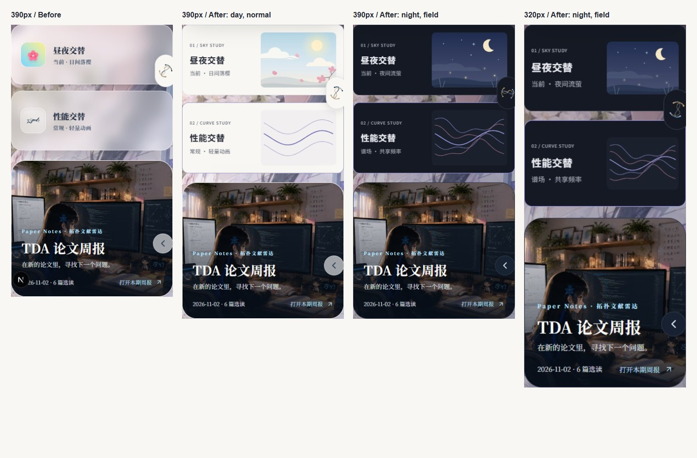

# 首页昼夜与性能面板

本次对应 #49，基线为 `deeb493`。对照[原始视觉方案](<./frontend refactoring.md>)的 2.1、6.1、9.3 节，并沿用[导航已验收的局部规范](./navigation-renewal.md)。原稿中的全站 Field Motif 仍属于 #44；首页没有挂载实际谱场。

## 实现与边界

两张面板共用纸面、细边框、14px 圆角、19px 标题、12px 状态与外置键盘焦点。日间和夜间分别使用导航的暖白与深蓝灰 Token；性能选择只改变曲线，不改变纸面。状态文字始终显示，整张原生按钮均可点击。

昼夜插画使用内联 SVG：日间包含天空、暖阳、远近云层、樱花枝与花瓣；夜间包含靛蓝天空、弯月、稀疏星点、前景草叶和四处小范围流萤。两组画面交叉淡化 900ms，太阳和月亮只移动 6px。两个花瓣缓慢漂移、流萤轻微明灭；没有新增 Canvas、动画依赖、每帧数学计算或 JavaScript 渲染循环。减少动态效果时取消所有局部动画和过渡，完整静态画面及操作保留。

性能插画在模块加载时一次性采样有限频率曲线：常规为三条平缓曲线，谱场为五条相关曲线，其中主线完全相同，其余线条叠加二倍频与局部振幅包络。两组辅助线交叉淡化 400ms，不插值路径、不建立预览状态。这只是已选模式的指示图形；真实场景仍在 `/music`。

桌面及手机采用左文右图；640–1023px 沿用首页原有双列，在面板容器宽度不足时把图形置于文字上方。320px 收紧局部留白，保留完整中文状态。没有修改 `HomeStoryBoard` 的网格、周报封面或全站排版。

| 文件                                    | 必要性                                                               |
| --------------------------------------- | -------------------------------------------------------------------- |
| `components/ThemeToggleBlock.tsx`       | 天空插画，保留 `useTheme()`、提示、`aria-pressed` 和立即切换         |
| `components/PerformanceToggleBlock.tsx` | 固定曲线示意，保留 `useFieldMode()`、提示、`aria-pressed` 和立即切换 |
| `components/ModePanel.module.css`       | 两面板局部 Token、排版、容器查询、反馈与减少动态效果                 |
| `scripts/mode-panels-preview.py`        | 可复现的截图与真实浏览器回归，不修改业务数据                         |
| 本文、文档入口和三张截图汇总            | 设计核对、前后视觉证据、预览与验证记录                               |

未修改 Provider、`FieldScene`、`components/field/*`、首页布局、全局样式、音乐组件或配置；没有新增 npm 依赖。

## 视觉证据

截图包含两张面板与周报的相对关系。改造前为 `deeb493` 的本地开发预览，改造后为独立 #49 worktree 的生产构建；汇总仅排布原始浏览器截图，未替换页面内容。全部七种宽度、四种组合的原始 JPEG 与报告保留在本机 `.sync/tmp-mode-panels/production/after/`，不会批量提交二进制。







## 本地预览与复现

检出 `feat/home-mode-panels-visual`，使用 Node 22、npm 10+：

```powershell
npm.cmd ci
npm.cmd run dev -- --hostname 127.0.0.1 --port 3119
```

打开 <http://127.0.0.1:3119>。原有开场结束或跳过后，滚动到「主题与论文周报」，点击两张面板可检查四种组合。按 Tab、Enter、Space 操作，并在系统或浏览器中打开减少动态效果复查静态画面。预览无需生产凭据，不修改线上环境；本地外部音乐、番剧服务可能超时。

可选 Python Playwright 依赖的安装方法同[导航验收说明](./navigation-renewal.md)。保持服务器运行：

```powershell
python scripts/mode-panels-preview.py --stage after --url http://127.0.0.1:3119
```

支持 `--browser Chromium可执行文件路径`、`--output 输出目录`，以及仅重跑功能检查的 `--checks-only`。默认只向被 Git 忽略的 `.sync/tmp-mode-panels/after/` 写入截图和 `report.json`，不写业务数据、不上传资源、不连接生产环境。`--stage before` 只抓取改造前截图，应在基线代码上运行；不要覆盖已有基线。

无图片上传的构建方式：

```powershell
npm.cmd run notes:build
npx.cmd next build
npm.cmd run start -- --hostname 127.0.0.1 --port 3119
```

本次隔离 worktree 通过目录联接复用已安装依赖，因此构建使用 `npx.cmd next build --webpack`，未改 Next 配置。没有执行含 `images:sync` 的 `npm run build`。

## 验证记录与验收边界

2026-11-05，Node 22.23.4 / npm 11.6.2 / Chromium 的独立 worktree 验证：

- `npm run typecheck`、两张 TSX 的 ESLint、三份组件文件的 Prettier、`git diff --check` 通过。
- `npm test`：87 项全部通过。
- `npm run notes:build` 后 `next build --webpack` 通过，生成 250 个静态页面，无图片同步或上传。
- 浏览器在 320、390、640、768、1024、1280、1440px 检查日间/夜间 × 常规/谱场，均无页面横向溢出、状态文字截断或按钮热区不足；桌面单面板高度小于 180px。
- 鼠标、真实触摸、Tab/Enter/Space、连续切换、焦点轮廓、主题与性能独立、刷新恢复、性能跨标签页同步、同标签页自定义事件通过。
- 使用浏览器虚拟时钟验证 06:00/18:00 自动边界，手动覆盖可刷新恢复，并在下一边界释放。
- 纸面文字与焦点色对比度：日间主文字 13.52:1、次文字 5.22:1、强调色 5.23:1；夜间分别 14.66:1、7.30:1、7.41:1。
- 减少动态效果下局部 SVG 无运行中的动画，日夜静态截图完整；首页无场景 Canvas。
- 首页选择谱场后进入 `/music`，真实渲染器采用 `field`；切到 `normal` 后返回首页，选择一致且场景 Canvas 已释放。

独立生产预览的最终报告 `pageErrors` 为空。本地未配置 Blob / Bangumi 凭据时，原有预热请求会返回服务错误；开发预览也观察到原有 `PageTransition` 的减少动态效果 hydration 提示，本次没有修改范围外逻辑。艺术验收和 iOS Safari / Android 实机仍需人工完成；本 PR 不合并 `main`，不修改线上部署。
