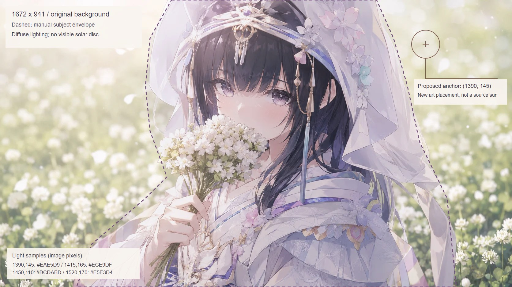

# 日月天体与显示入口（#49 / #70）

> 历史设计记录：2026-11-12 已移除旧 SiteDisplayControls、FieldModeProvider 和性能模式持久化，首页统一高性能基线。下文的开关、组件和独立场景预览不代表当前可用接口。`celestial-preview.py` 已退役，旧选项以状态码 2 报停，不再生成或清理路由；整改见[调查文档](codebase-architecture-audit-2026-11-12.md)。

按 #49 最新正文与 PR #62 的返工回复，旧两张模式面板已撤下。原 PR 保持 OPEN / DRAFT，待人工视觉验收。

## 实际设计依据

已查看 `public/background.png` 原图，尺寸为 1672×941，SHA256 为 `DF00CF1DC7D744EBF7F304A5A21D2FC825166DCB01385F41D4B6F82CE269CE69`。原图右上是漫射亮区，没有可辨认的太阳实体；不能把新增天体的位置声称为原画太阳坐标。

候选美术锚点为原图 `(1390, 145)`，按现有居中 cover 和 1.01 缩放投影，另限制距顶部和右边界的安全距离。实际热区为 80×80px，焦点与现有 72px 导航分开。该点采样为 `#EAE5D9`，附近 `(1415,165)` 为 `#ECE9DF`；太阳的暖光与月亮的灰紫层次据此与人物衣饰协调。主体虚线是人工审图的包络，不是已经交付给谱场的精确保护掩膜。

## 实现

- `HomeCelestialControl.tsx` 内联可编辑 SVG 路径：实体光盘、不对称光晕、确定性纹理；负形月相、月面分层与环轨迹。直接点击仅调用既有 `toggleTheme()`，日夜交叉过渡 1000ms；减少动态效果时立即切换。
- `SiteDisplayControls.tsx` 提供默认收起的原生 Popover，主题与 normal/field 独立操作；内页和窄桌面窗口仍可切换主题。Escape、外部点击由浏览器处理，手机菜单与返回按钮错开。
- `FieldModeProvider.tsx` 保留原有状态、持久化和 storage / 自定义事件同步契约。主分支已取消 `/music`，此处不恢复音乐馆、不挂载谱场；性能选项保存用户选择，后续首页引擎由 #71 接入。
- `HomeStoryBoard` 移除旧设置列，周报占满原容器，不留一列空洞；周报阅读逻辑不改。`app/layout.tsx` 仅接入共享状态和紧凑控制。
- 删除旧纸面样式、旧主题面板、旧三张对照图及旧面板脚本。原版提交仍在 PR 历史中。

## 新版独立场景预览

以下截图复用真实根布局、背景、七入口导航、Provider 和生产天体组件；是 #49 的独立展示，不冒充已经完成的 #51 全首页总装。当前根路径其余旧内容的编排、嵌入式导航、移动根路径跳转及五分钟周期分别由 #51 / #67 / #69 / #68 负责。现有背景的日夜呈现沿用根布局，本次没有新增第二张背景或重绘整幅原画。

原始脚本曾生成 `app/celestial-study/page.tsx`，以生产天体组件运行隔离预览，并写入 `.sync/tmp-celestial/`。该组件现已退役，`--prepare-study`、`--clean-study` 和旧录制/检查选项均不可再执行原流程。入口只打印退役提示，不修改已有文件；原实现可从[调查基线源码](https://github.com/proffitteoy/nothing-new/blob/b4e7e79b64e749276b4aacff786fd788935106d8/scripts/celestial-preview.py)恢复查阅。

现行主题和小屋交互使用 `scripts/projects-preview.py` 检查真实 `/projects`；首页检查入口见 `scripts/home-scene-preview.py --help`。后者仍有历史天体/周期断言，需按当前行为选择并核对分支，不能直接把旧完整矩阵作为当前首页通过证据。当前没有独立天体 study 路由。

## 已验证与剩余边界

2026-11-05，独立 worktree、Node 22.23.4：

- 生产构建通过；83 项现有测试全部通过；改动 TSX 的 ESLint 通过。
- Chromium：1440×900、1280×800、1024×768 的日夜 × 常规/谱场四组合通过，热区不与导航重叠，无横向溢出。
- 键盘、焦点、主题与性能独立、刷新恢复、跨标签页和同页事件同步、减少动态效果、首页不挂载 Canvas 通过。
- 320/390px 手机内页触摸、主题访问和菜单/返回按钮边界通过。
- 06:00/18:00 自动切换、手动覆盖刷新恢复及边界释放通过；最终浏览器报告 `pageErrors` 为空。
- 主题切换不导航、不刷新、不创建时钟或渲染循环。#68 的真实周期尚未在此分支装配，不能宣称已完成其端到端“不归零”验收。

**待补：切换录屏、人工艺术验收、与 #51/#67/#68/#69 总装后的联合验收。** 录屏依赖安装遇到浏览器版本不匹配，现有静态证据与功能报告不替代录像。不合并 main，不修改线上。
