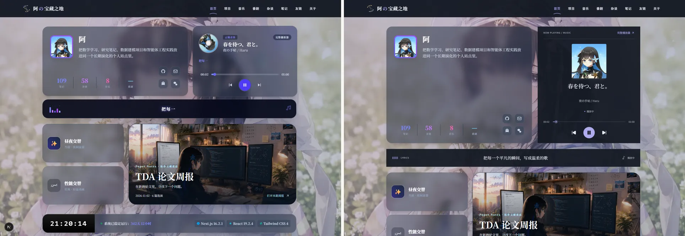
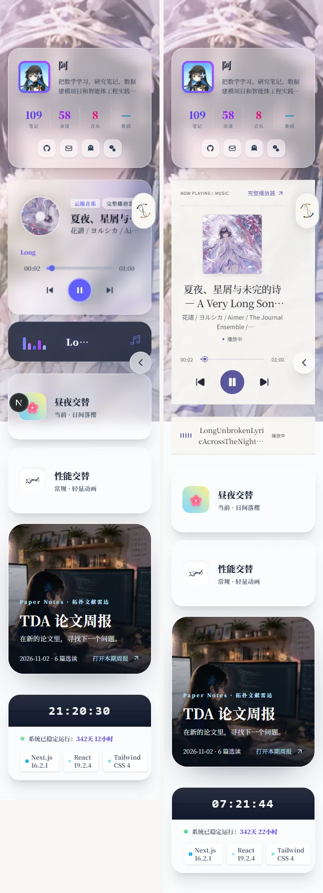
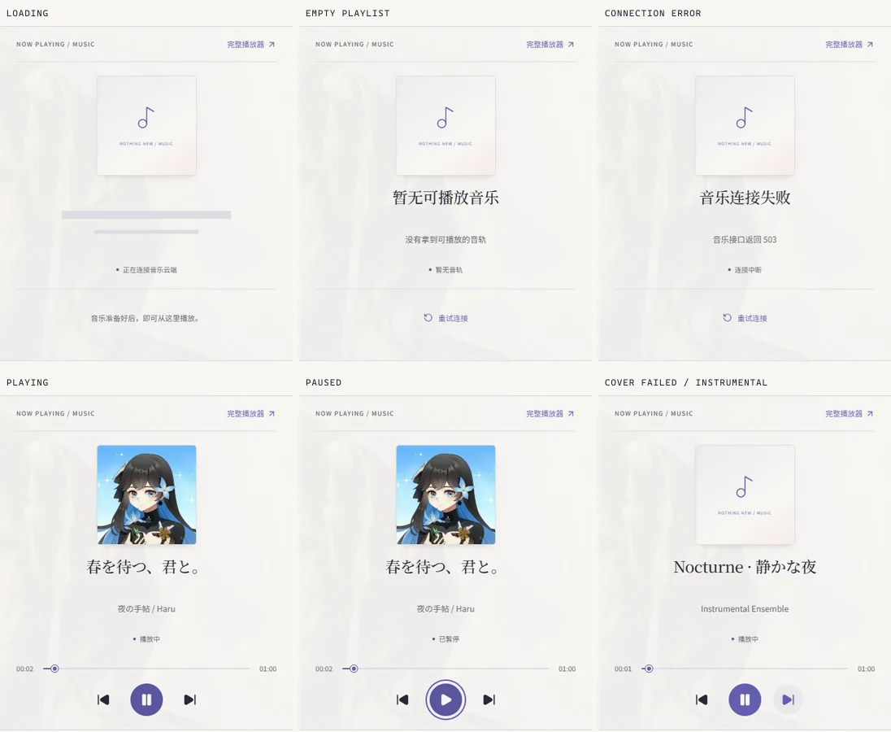

# 首页播放器与歌词视觉更新（#48）

依据[原始视觉设计](<./frontend refactoring.md>)的 5.1、5.2 与第九章，以及[导航已确认的局部规范](./navigation-renewal.md)。基线为导航 PR #61 已合并的 `deeb493`，独立分支为 `feat/home-music-visual`。本 PR 需人工视觉验收后合并。

## 构图与边界

播放器以顶部栏目栏、居中方形封面和歌曲文字、底部进度及三键建立共同对齐轴。封面最大 148px，标题使用现有展示衬线字体回退；歌名和歌手最多两行，完整文字保留在 DOM 和 title 中。日夜色值与导航一致，字体不新增网络依赖。没有旋转唱片、厚阴影、毛玻璃或额外数学背景；数学视觉留给 #44。

歌词是共享纸张色、细线和字体的横向信息带。五柱波形仅在播放时温和变化，歌词直接读取 Provider，约 200ms 淡入；取消两处逐字计时器和播放器中的重复歌词。减少动态效果时保留静态歌词和短线波形。

所有音乐状态使用同一框架：加载显示静态占位线；空歌单和错误显示原因及重试；音乐页入口始终可见；封面失败仅替换本地 CSS 占位，不影响音频，切歌重新尝试图片。进度采用原生 range，保留键盘和指针操作，时间对非有限数显示 00:00。主按钮 48px，两侧热区 44px。

`app/page.tsx` 仅移除歌词外层空容器，因此无歌时不会多出一个 flex 行间距。首页 7:5 网格、ProfileCard、其他区块、导航、背景、MusicProvider、FloatingPlayer 和完整音乐页均不改。手机仅在音乐内容内部给右侧既有导航与返回按钮留出 44px 安全空隙，保留原有顺序。

## 隔离本地预览

Node 22、npm 10+，检出本 PR 分支后：

```powershell
npm.cmd ci
npm.cmd run dev -- --hostname 127.0.0.1 --port 3148
```

访问 <http://127.0.0.1:3148>，等待开场结束或跳过，首页「昼夜交替」切换主题。开发服务器默认可用 Turbopack；若用 junction 复用另一个工作树的 node_modules，可在本地追加 `--webpack`，无需修改项目配置。无 Blob 凭据时使用本地图片，不需要部署。外部音乐 API 是否可用取决于网络。

## 可重复状态与交互验收

Python Playwright 仅是可选本地验收依赖，不参与产品构建：

```powershell
python -m venv .sync/tmp-home-music-qa/venv
.\.sync\tmp-home-music-qa\venv\Scripts\Activate.ps1
python -m pip install playwright
python -m playwright install chromium
python scripts/home-music-preview.py --url http://127.0.0.1:3148
```

可用 `--browser 路径` 指定现有 Chromium，`--output 目录` 改变输出位置，`--check-only` 跳过四张对照采样。默认输出 `.sync/tmp-home-music-evidence/after/` 的 PNG 与 `report.json`，不写生产数据、API 或应用状态测试钩子。

脚本只在浏览器内拦截音乐 API 和音频传输，以三首固定测试歌曲、现有本地图片、支持 HTTP Range 的一分钟 WAV 复现状态；组件、MusicProvider 和 HTMLAudioElement 为真实实现。测试数据不代表线上曲库或真实艺人。检查播放／暂停、时间与歌词更新、上一首／下一首、原生键盘和鼠标寻址、纯音乐、封面失败与恢复、首页 → 音乐 → 关于 → 首页的音频与进度连续性，并确认只有一个音频元素。另检查加载、空歌单、503 错误与重试、歌词行完全隐藏、长中英日混合文本、320／375／390／768／1280／1440px、日夜主题、减少动态效果，以及手机固定按钮避让。

对照基线使用同样脚本的 `--stage before`，运行在改造前 `deeb493` 的隔离预览上。四组图片按左侧改造前、右侧改造后排列，未修改页面内容；截图使用固定测试歌曲。完整原始 PNG 不提交，仅保留压缩对照图。

| 对照         | 截图                                                                     |
| ------------ | ------------------------------------------------------------------------ |
| 1440px 日间  |         |
| 1440px 夜间  |       |
| 390px 播放   |       |
| 320px 长标题 |  |

加载、空歌单、连接失败、播放、暂停及封面失败／纯音乐的实际状态截图（上排前三项，下排后三项）：



## 验证记录

2026-11-05 本地验证：

- Node 22.23.4，ESLint 0 错误、7 条现有警告；原生封面 img 继续保留网易云尺寸、CORS 和 referrer 兼容行为。
- `npm run typecheck` 通过；现有 87 项测试通过。
- 完整 `npm run build` 通过，生成 250 个页面；图片同步明确跳过，未上传 Blob。
- Chromium 开发与生产预览通过上述音乐交互、异常恢复、跨页连续性、尺寸／主题／减少动态效果检查。状态测试使用固定音乐传输数据，保持真实 Provider 和音频元素；完整报告可由脚本复现。无歌场景另核对下方模块与首行之间只保留一个正常的 24px gap。
- 仅保留四张压缩前后对照及一张状态组合图；完整 PNG 和过程日志在本地忽略目录中。

音乐／3D 预热期间记录到既有 `Cannot read properties of undefined (reading 'isReady')`；开发模式减少动态效果仍有原有 PageTransition hydration 属性警告（导航验收已记录同类问题）。这两处不属于本次改动，音乐交互检查没有被阻断。脚本保留错误记录，并对其余未预期的页面异常失败退出。未配置 Blob／Bangumi 时，番剧统计按原有逻辑回退，可能出现 503；不以此证明线上数据可用。

真实外部音乐服务、iOS Safari、Android 实机与线上环境尚未验收。
