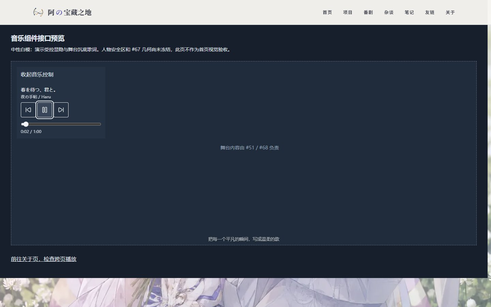

# 首页紧凑音乐控制与沉底歌词（#48 / PR #65）

## 设计依据与交付边界

已核对[原始视觉稿](<./frontend refactoring.md>)第 5.1、5.2 与第九章。其右侧 5/12 杂志播放器、纸面歌词带及手机首页方向已被 [#51 新首页合同](https://github.com/proffitteoy/nothing-new/issues/51)、[更新后的 #48](https://github.com/proffitteoy/nothing-new/issues/48) 和 [PR #65 返工要求](https://github.com/proffitteoy/nothing-new/pull/65#issuecomment-6647530960)覆盖。[#48 最新主账号回复](https://github.com/proffitteoy/nothing-new/issues/48#issuecomment-6648892839)进一步取消所有独立音乐页入口；主线 PR #72 的删除结果保持不变。

本轮只交付可独立挂载的紧凑音乐内容和舞台底边歌词，移除旧首页音乐列与歌词行。其他首页模块保留，未实现 #51 的中心人物总装。人物原图安全区审计、#67 容器几何及接口尚未冻结，因此产品首页暂不挂载音乐控件，等待 #67 接入。此分支不重建侧栏、导航、谱场循环、天体或移动首页。

PR #65 保持 OPEN / Draft；无关闭 Issue 语义、无合并、无生产变更。原杂志卡片及手机对照截图、旧验收结论已删除。

## 组件接口

两个组件必须使用根布局中已有的 `MusicProvider`，不添加新的 Provider、audio 或歌词计时器。

```tsx
// #67 控制开关、焦点及放置位置。示例不规定容器几何。
<CloudPlayer id="home-music-controls" active={musicOpen} className={hostClass} />

// 舞台 UI 层须 position: relative，置于可破坏场景之外。
<LyricBar active={stageVisible} className={lyricClass} />
```

- `CloudPlayer`：`active` 默认 true，false 时同时 `hidden` 与 `inert`，不停止音频。曲名／歌手单行截断，完整文字保留在 DOM 和 title；无封面、旋转唱片、跳转入口或舞台定位。播放／暂停、上一首／下一首各有至少 44px 热区；原生 range 保留键盘和指针寻址，未知时长时禁用。加载、空歌单与失败状态保持简洁；后两者可重试。
- `LyricBar`：`active` 默认 true，读取当前歌曲的真实已解析歌词；无歌、加载、失败、纯音乐或空歌词时返回 null。暂停保留当前歌词，不显示 Provider 的缓冲／纯享提示。绝对定位于父舞台底边，透明背景、单行截断、点击穿透；约 180ms 透明度淡入，reduced-motion 下无动画。
- 宿主可通过 `--music-ink`、`--music-lyric-inset`、`--music-lyric-bottom` 调整文字颜色和安全区。歌词底边默认 0，水平留白默认 1rem；这不是人物安全区结论。宿主负责层级和底部场景对比度。
- #67 负责切片、热区、hover 延迟、展开／关闭、失焦策略和焦点恢复。本组件不监听全局键盘或指针；宿主关闭时须恢复／转移焦点。歌词可以独立于控件展开状态显示。#68 应保持 UI 层及真实热区稳定；最终破坏阶段联调尚待完成。

## 隔离预览与可复现检查

要求 Node 22、npm 10+。`HOME_MUSIC_PREVIEW=1` 仅开启本地接口演示；未设置时 `/preview/home-music` 返回 404，页面始终 noindex，不加入导航或 sitemap。不要在生产环境配置该开关。

```powershell
npm.cmd ci
$env:HOME_MUSIC_PREVIEW = '1'
npm.cmd run dev -- --hostname 127.0.0.1 --port 3148
```

访问 <http://127.0.0.1:3148/preview/home-music>。若 node_modules 是跨工作树 junction，可追加 `--webpack`。预览仅用中性白模和普通开关演示真实组件，260px 示例宿主宽度不是 #67 的几何标准。Escape 关闭并回到开关，Tab 离开宿主后关闭且保留外部焦点；移入音乐按钮不会收起。歌词挂在独立舞台底边，收起控件后继续显示。

安装可选本地 Python Playwright，或使用已有环境：

```powershell
python -m pip install playwright
python -m playwright install chromium
python scripts/home-music-preview.py --url http://127.0.0.1:3148
```

`--browser 路径` 指定现有 Chromium，`--output 目录` 改变默认 `.sync/tmp-home-music-rework-evidence/`，`--check-only` 不截屏。脚本仅在浏览器拦截音乐 API 和支持 HTTP Range 的 WAV 传输，运行真实组件、根 Provider 和 HTMLAudioElement；测试曲目为固定虚构数据，不证明外部服务可用。

覆盖 1024/1280/1440 与 reduced-motion、开关／Escape／失焦、关闭时 inert 和跳过 Tab、收起仍播放、舞台歌词落底及点击穿透、长混合文本／无空栏、播放／暂停／切歌／键盘及鼠标寻址、空／加载／503／重试、预览 → 关于 → 返回时同一个音频元素及进度连续。报告不允许未预期的 pageerror。

## 验证记录与待接入项

2026-11-05，独立工作树以 Node 22.23.4 验证：

- ESLint 0 错误，3 条既有警告；现有 83 项测试全部通过。
- `npm run typecheck` 通过；Quartz 内容构建和 `next build --webpack` 通过，生成 247 个页面。
- 生产预览上的脚本全部通过，12 组记录、0 个 pageerror；包括三种桌面尺寸及 reduced-motion、真实音频操作、受控显隐与焦点、异常重试、关于页往返连续播放。实际首页在 1024/1280/1440 下已无旧音乐卡片及歌词行，音频仍连续播放。
- 未启用开关时，预览路由与已删除的音乐页均为 HTTP 404；预览路由不在 sitemap 中。
- 共享安装最初缺少启动器且 SWC 损坏，随后改用工作树独立锁定依赖，并清理已删除路由的旧开发类型缓存后重跑通过；未修改主工作区依赖或项目锁文件。

以下均为带明确范围提示的接口白模，未叠加真实人物、安全区或斜切容器。旧截图不再作为本轮视觉验收。

| 场景               | 最新证据                                                |
| ------------------ | ------------------------------------------------------- |
| 1024px 展开        | [截图](../images/home-music-renewal/desktop-1024.jpg)   |
| 1280px 展开        | [截图](../images/home-music-renewal/desktop-1280.jpg)   |
| 1440px 展开        | [截图](../images/home-music-renewal/desktop-1440.jpg)   |
| 收起后继续显示歌词 | [截图](../images/home-music-renewal/closed.jpg)         |
| 长曲名／歌手／歌词 | [截图](../images/home-music-renewal/long-content.jpg)   |
| 纯音乐无歌词栏     | [截图](../images/home-music-renewal/instrumental.jpg)   |
| 连接失败与重试     | [截图](../images/home-music-renewal/error.jpg)          |
| 完整检查范围与结果 | [report.json](../images/home-music-renewal/report.json) |



预热日志中仍可见未配置 Bangumi／Blob 的既有回退信息；本轮浏览器没有 pageerror。音乐传输使用固定 fixture，因此不代表线上曲库可用。

尚待 #51/#67 接入后验证人物安全区、真实斜切热区和 hover 不误收、场景日月／入口避让、#68 整场破坏重组稳定性；#69 移动分流由其独立任务负责。白模组件回归不代表这些集成项通过。真实音乐服务、移动实机、Safari 与生产环境也不在本轮本地 fixture 验证范围内。
