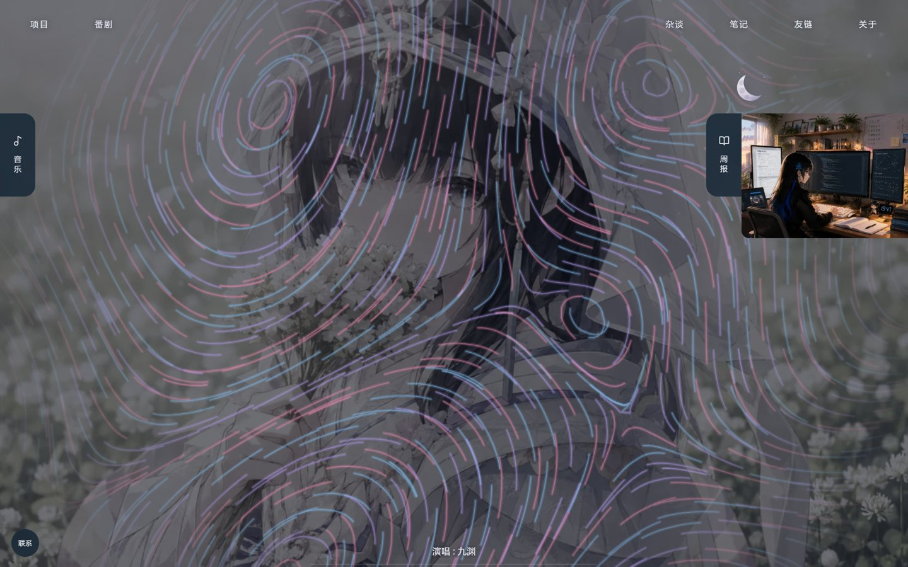
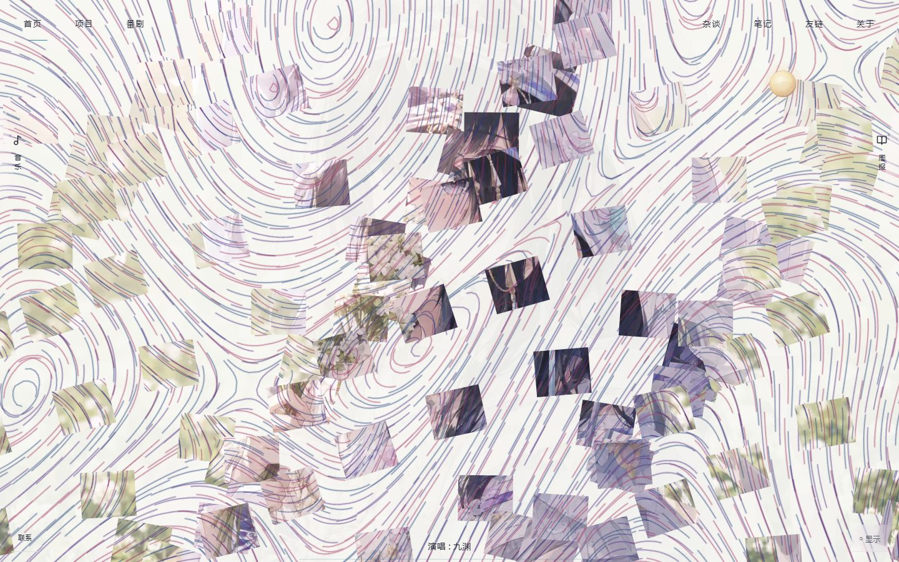
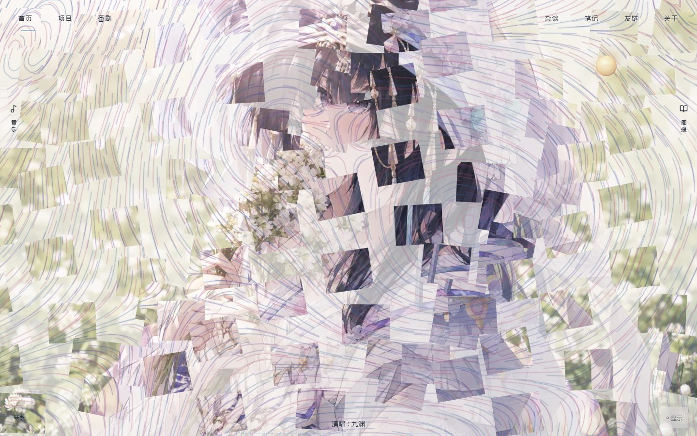
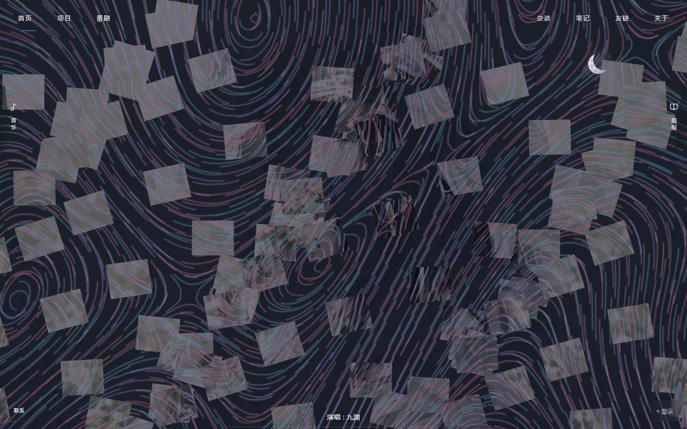

# 桌面首页总装（#51 / #67 / #68 / #69 / #71）

本分支以远端 PR #62、#63、#65 的 2026-11-05 版本为输入，本地合入独立集成分支；不合并 main，不关闭原 PR，不部署线上。原 PR 继续保留各自组件的责任边界。#70 的日月 SVG 直接使用 #62 的成果，没有新增重复实现。

## 设计依据

- [原始视觉文档](<./frontend refactoring.md>)提供日夜 Token、字体、音乐唱片与阅读层次。
- 本地原始交互文档 `docs/project/interaction research.md` 提供中心人物、边缘切片、可见访问时间及移动分流；原稿保持未跟踪状态，不附带上传。首页旧个人卡片、两屏 Dashboard 和独立模式面板不再挂载。
- 主线已合并 #72：导航实际为七入口，不恢复 `/music`。音乐继续由根级 MusicProvider 维护，跨页保留音频状态，播放控件只在首页出现。
- 界面使用[蓝色基调与组件色卡](blue-theme.md)，以中性局部表面承载蓝色主操作、紫色音乐和玫红装饰。原画保留本色，禁止使用统一染色／去色滤镜；界面米黄 Token 已移除。
- 原图全屏居中 cover。没有缩小图片的相框、四周渐隐或额外全屏灰色蒙层。顶部导航分列到人物两侧；展开边缘时只在原 cover 的可裁切范围内平移原图，不缩放、不增加第二张背景。日月投影随之调整，并限制在可操作的视口范围内。

## 原图与保护区

原始文件为 `public/background.png`，1672×941；右上为漫射光源，没有可辨认的原画太阳实体。天体候选锚点 `(1390,145)` 沿用 #62 的真实审图提案，不声称它是原画太阳坐标。


`lib/home-scene.ts` 的 `HOME_PERSON` 是人工审图的保守包络，包含头纱、花束和手部，不是人物分层抠图。该包络仅保留为审图依据。按用户“直接使用原版，只加颜色”的纠正，运行时没有额外的人物擦除遮罩，也没有另写粒子运动或历史轨迹引擎；本轮没有伪造分层资产。cover 在较窄桌面会裁掉部分两侧环境与衣饰，三宽度实图应作为构图审查依据，不能用测试通过代替美术认可。

## 组件和交互

2026-11-06 用户反馈后的修正：以下旧版色板及侧栏结构由本段覆盖。首页导航移除独立实色方框，文字沿用原有位置；两侧控制、音乐面板与联系入口统一为冷蓝灰半透明表面，日间不再使用米黄色。悬停移出联合区域后 120ms 收起；周报热区高度贴合实际封面，不保留 480px 空面板。周报侧栏只显示原封面图片，删除额外标题、日期、篇数、阅读提示和容器头；图片可点击，继续使用既有两层阅读窗口。键盘焦点、点击固定、Escape 和阅读中的保护保持可用。开场动画期间不绘制首页谱场，揭幕后恢复。

后续点击回归修正：周报阅读关闭后解除侧栏的点击固定，再按真实指针位置决定收起；原生弹窗还给封面的鼠标焦点不再阻止收起。键盘打开时保留封面焦点，Tab 离开后收回；弹窗的指针事件不会改变封面的键盘操作状态。右侧空白区域不再捕获指针。验收脚本不再调用 `blur()` 代替用户移开指针，增加按钮关闭、Escape 关闭、点击固定后阅读、空白热区及键盘返回的检查。

后续修正已通过 90 项 Node 测试、类型检查、生产构建及三种桌面尺寸的上述点击／键盘回归；完整首页矩阵 11 组检查通过，无未捕获页面异常。此前自动清除焦点的脚本结果不作为本项点击问题修复的证据。

本次生产预览的日夜截图如下，供人工视觉审阅；自动化通过不代表用户已认可样式。




- `HomeDeviceGate` 在确认桌面后才加载 HomeScene；`proxy.ts` 只匹配 `/`，手机和平板临时 307 到 `/blog`，再由原逻辑进入实际文章。响应带 private/no-store 及设备相关 Vary；桌面缩窄不凭宽度跳转。
- UA 漏判由 hydration 前的无 hover + 粗指针保护补足；Windows 触屏电脑不单凭粗指针跳转。内页手机圆盘保留；其首页链接指向 `/blog`，不预取首页舞台。
- 默认边缘热区是 56×132 CSS px，只有有限高度。指针停留 350ms 展开，离开交互联合区域后 500ms 收回；点击可固定，焦点可展开，Escape/外部点击可关闭，同时最多展开一侧。展开的形状只作用于装饰，真实按钮不斜切。
- 左侧挂载 #65 的紧凑 CloudPlayer；右侧仅日期、篇数、阅读入口，复用 PaperMonitor 原来的两层原生 dialog。隐藏的摘要不能获得焦点；dialog 不放在 inert 面板内。日月直接使用原 ThemeProvider；“显示”菜单提供独立性能选项。
- 关于和联系使用 #63 的 ProfileActions，默认收起；歌词只读取现有 MusicProvider。audio 设置 `preload="none"`，没有第二个 audio 或歌词计时器。

## 数学与生命周期

首页直接调用原版 `createSpectralTracerController(back, front)`，保留原 R2 种子、六模式速度网格、双向流线采样、线宽、光晕和播放倍率。没有用另造的积分路径或粒子运动代替原渲染器。对原渲染器的唯一新增接口是可选的三组 `colours`；不传时所有既有行为和调色保持原样。已有渲染测试同时验证加色前后的几何和密度相同。

首页向原流线传入蓝、紫、玫红三组颜色，随可见停留逐渐加深；日夜均有色彩演化。保留原版完整轨迹密度，调整其颜色可见度，不再用稀疏细线或大块人物遮罩削弱谱场。柔和配色参考 [Tyler Hobbs《Flow Interpretation》](https://www.tylerxhobbs.com/works/flow-interpretation)，不改变原版运动形态。全场破坏直接处理已包含原谱场的画面，人物、背景和谱场一起错位、旋转、分离，再于 265–290 秒复原。没有将访问时间染色写入原图或背景渐变。

原画离屏缓存只处理日夜光照，在主题改变时重算；缓存固定在原图审计分辨率。Canvas 数量和尺寸有上限，离开首页销毁原控制器并释放缓冲。290–300 秒清除色迹，下一轮开头渐入，避免周期边界跳变。

正式周期为 300 秒：0–30 初始、30–210 沉积、210–240 失稳、240–265 分片、265–290 重组、290–300 归零。`homeCycleAt` 接受 240/360 秒作为纯计算对照参数；产品不暴露调试菜单或加速 query。

时钟在首页 HTML 的 head 阶段启动，包含 Splash；以 performance.now 累计可见时间，hidden 暂停、恢复继续，离开首页清理。主题、音乐、侧栏和性能操作不重启时钟，循环不刷新网页。

一个 HomeSpectralCanvas 管理一个 RAF，原谱场控制器只接受帧参数，不创建另一个循环；背景、谱场和可逆 12×9 分片共用时间源。常规最多 24fps、DPR 1；谱场最多 45fps、DPR 1.5。均使用原请求密度 3200/120，由原版容量映射到实际的 1280/72 条流线。连续两个两秒窗口低于预算时降至 18fps、DPR 1、请求密度 1800/64，其余原算法不变。后台停止循环；reduced-motion 保留静态原画和全部操作，用低频计时更新，禁止分片和流线动画。

## 本地验证与证据边界

```powershell
npm.cmd ci
npm.cmd run notes:build
npm.cmd run lint
npm.cmd run typecheck
npm.cmd test
# 本地验证无需调用会上传图片的 images:sync。
node node_modules/next/dist/bin/next build
node node_modules/next/dist/bin/next start --hostname 127.0.0.1 --port 3161

python scripts/home-scene-preview.py --mode matrix
python scripts/home-scene-preview.py --mode stills
python scripts/home-scene-preview.py --mode interactions
python scripts/home-scene-preview.py --mode performance
python scripts/home-scene-preview.py --mode accelerated
python scripts/home-scene-preview.py --mode realtime
```

脚本需要可选 Python Playwright，浏览器路径由 `--browser` 指定；截图、真实浏览器录屏与报告默认只写入忽略目录 `.sync/tmp-home-scene-evidence/`。音乐测试使用本地 WAV 夹具和真实 MusicProvider，不能代表网易云可用性。accelerated 仅使用浏览器虚拟时钟，不改变正式代码的 300 秒；fast_forward 跳过中间帧，仅检查两轮阶段、边界和控制连续性，不能据此报告真实帧率或十分钟实时时序。连续运动另有原版谱场动图，真实性能由 performance 模式单独测量。

realtime 检查连续两轮。无头 Chrome 的标签页都报告 visible，所以 hidden 验证明确采用合成可见性事件加 60 秒实际等待；这不代替真实设备后台切换、最小化或 iOS Safari 验收。设备矩阵是 Chromium UA/触摸模拟，不冒充真机。

2026-11-06 再次按用户纠正接回原版渲染器。新版本已通过生产构建、87 项测试和集中设备/交互矩阵；lint 为 0 错误、4 条既有警告。此前 `spectral-heads`、粗笔刷、稀疏细线、固定路径和背景染色的视觉证据全部作废；必须使用 `original-spectral` 目录的新记录。

集中验证结果：三桌面尺寸交互、五组移动 UA/触摸分流、六内页、跨页音乐、周报两层阅读、reduced-motion 和两轮加速阶段/边界通过。正常模式在本机 DPR2 浏览器中约 20fps；切到高 DPR 谱场档位会触发自动降档，20 秒主线程争用时计时继续、播放可操作，浏览器 JS 堆约 19.9MB。该结果证明降档可用，不代表高画质在真实设备达到目标帧率。原控制器没有独立 RAF 或无界历史缓存。

以下为原版渲染器加色的整页候选截图，提供人工审阅，不作为已获视觉认可的声明：







**人工视觉验收仍待进行。** 尤其需要检查侧边展开的形状、窄桌面衣饰边界、日夜的原图光照、300 秒破坏强度与动画节奏。不得引用旧相框版、旧不透明盒状侧栏或原 PR 独立夹具的截图作为本次总装通过证据。
