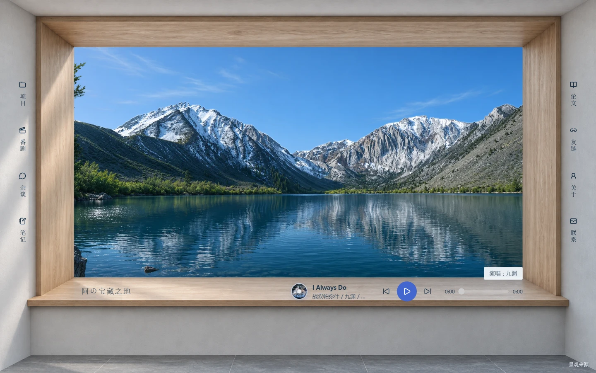
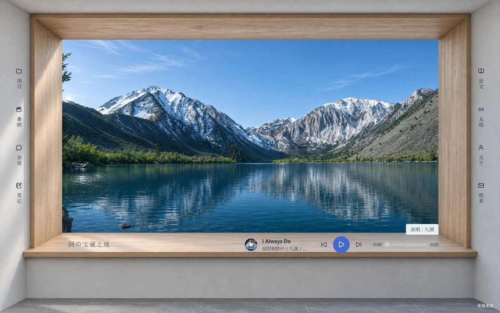
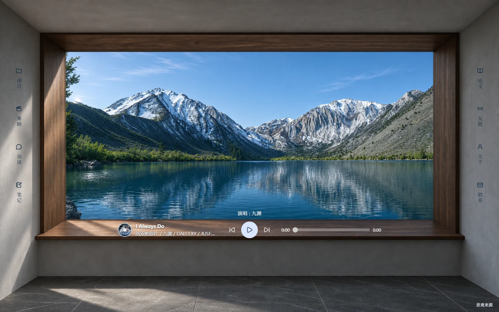
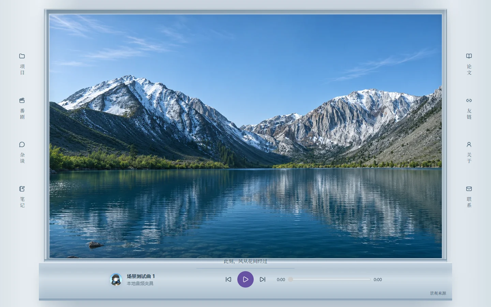
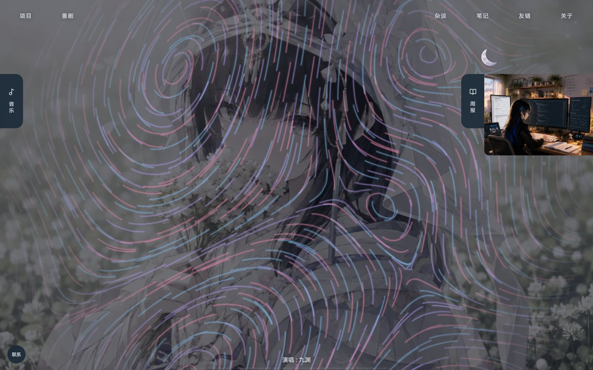
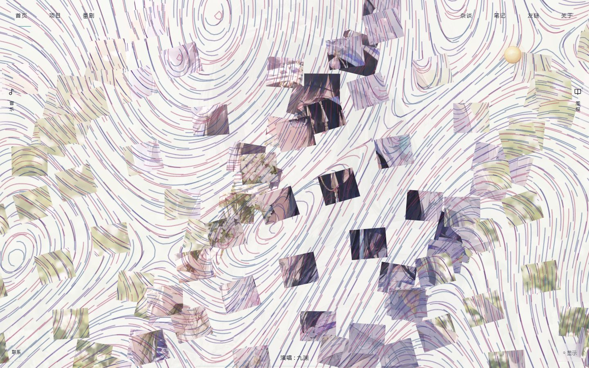

# 当前首页：原房间后侧的落地窗

## 首页页面入口（2026-11-23）

六个页面标签的文字、图标与展开的截图都是指向对应页面的链接；鼠标悬停或键盘聚焦仍展开预览，Enter 直接进入页面。论文和联系保留点击固定、Escape 收起与焦点归还。页面链接开始导航后，场景暂停自动路由交接，直到目标路由提交，避免慢响应期间的滚轮输入把目标页面覆盖成项目页。

`public/page-previews/` 更新为当前页面截图，项目页等待共享三维小屋就绪后取景；截图继续通过静态导入生成内容哈希地址，发布新构建后请求新图片。番剧使用生产公开真实快照在本地新版页面中渲染，没有使用模拟收藏数据。复验入口：`python scripts/projects-preview.py --navigation-only --url http://127.0.0.1:3192 --browser "C:/Program Files/Google/Chrome/Application/chrome.exe" --output .sync/tmp-navigation-fix/production`。

本地 Node 24.11.1 下通过 132 项测试、类型检查、修改组件的 ESLint 和 247 页生产构建；Chrome 157 通过 39 项导航检查与原有 22 组连接检查，未捕获页面异常为 0。旧路由逻辑在相同的慢响应、Escape、滚轮操作下实际跳到 `/projects`，新逻辑保持请求的 `/about`。浏览器报告保存在忽略目录 `.sync/tmp-navigation-fix/`；音乐使用本地音频，番剧公开截图使用 2026-11-23 的真实快照 `fd34a1646169`。尚未在 Node 22、Safari 或真实手机上复验。

## 恢复原首页与单一窗外景观（2026-11-24）

开场恢复转场改造前 `c966422` 的完整浅木大窗、白墙、原山湖构图、侧栏及窗台音乐。复用原片元公式、纹理投影和环境时间；静止首页由共享 Three renderer 内的原合成器输出，未创建第二个渲染器。

一旦滚动，整屏合成器立即停止绘制。室内照片只输出窗框／墙面的 RGB 和 alpha，投影到房间后侧；窗外始终只绘制一份不透明景观，远岸网格与水平湖面在同一边界衔接。湖面沿用摄影倒影和原谱场公式，近处使用同一宽景水纹的世界尺度细节。没有整张首页与另一张湖景交叉淡化，也没有玻璃处的湖景照片。

原照片视野外由 `lake-periphery-v1.webp` 补齐，使用原图特征点配准；离开首页后由完整连续宽景承接，避免保留一个边缘可见的原图矩形。原首页图片没有重写。补图来源、工具、实际提示词与配准矩阵见 [NOTICE-periphery.txt](../../public/home-window/NOTICE-periphery.txt)。这是有限深度摄影场景，仍不等同于完整山体模型或重新计算的真实倒影。

窗前的蓝色阅读椅和落地灯仅在共享场景中从无热点合并网格清除，原工作台、地板与项目机位保持原样。上滑后退、转身接到原项目页；下滑穿窗进入同一湖景。详见[恢复原首页与清空窗前](projects-room.md#恢复原首页与清空窗前2026-11-24)。

下方均为历史制作记录。

## 历史：浅木观景窗与环境运动（2026-11-18）

首页与项目页的桌面滚动连接以 `main@88ab6f8` 为基线，画面沿用本页实现；本轮只接通路由与输入，范围和复验见[项目页连接记录](projects-room.md#首页与项目页连接2026-11-18)。连续三维镜头转场尚未完成。

## 第二阶段本地审阅版

在下述第一阶段浅木版本上，扩展现有 `HomeSpectralCanvas` 的内部纹理与 uniform，接入薄云、室内受光和左上枝叶微动。原始湖景、浅木房间、统一投影、导航、播放器和六模态数学保持不变；没有公共 API、路由、产品设置或框架变化。仍是一个输出画布、一个 RAF 和一个可见时钟，谱场时间独立乘以原有 0.3，环境使用可见秒数。

**倒影未通过配准，保持关闭。** 首轮天空遮罩把蓝灰山体误判为天空，已改为逐列首次边界、2px 安全带及 3px 羽化，撤下粗略包络；这不代表恢复了照片深度。倒影候选的清理图改变了原水纹，合成后出现蓝色块状边界，已经撤下运行时纹理与合成代码。`data-home-reflection-status=disabled-registration` 明确保留失败状态，不能把本版描述为已实现同源动态倒影，原图中的静态云倒影仍然存在。失败图留在 `.sync/tmp-ambient-window/reflection-registration-rejected.png`，后续需提供真正配准的清理底图与开阔水域遮罩，再重新验收；不得直接恢复候选。

薄云由当前日景中的云丝经 imagegen 提取／重建，叠加在补全天空上，受山脊保护遮罩限制。基准位移约为 1 CSS px/s，以 24 秒缓变风势调制；重复云片的间隔在视野之外，不在天空中硬切循环。左上枝叶仍使用外景同一投影，6 秒主周期、自由端幅度约 3px，叠加同一 24 秒风势，位移在枝根降为零；窄视口允许自然裁切。

室内接收图与不变的窗框、窗台、下墙及地板配准。R/G 为投回同一云层的接收坐标，B 为手工设定的直射贡献。固定左上光源锚点约 `(0.1765,0.0863)`，衰减只读取这层移动云的 alpha，没有独立亮度正弦；环境底亮度保留。它是固定视点的艺术近似，不能从成品图片恢复反照率、三维法线或真实烘焙光照。

基础房间与湖景继续决定首屏就绪。五个环境资产作为可选组加载，整组解码并成功上传后用 1.2 秒平滑启用；任一请求／上传失败均回到原水面路径。减少动态、无 WebGL 和持续低帧显示完整第一阶段静态场景。卸载取消图片回调并释放纹理、缓冲、程序及着色器；上下文恢复重建同组纹理。

| 资产                     | 尺寸     |      编码大小 | 用途                     |
| ------------------------ | -------- | ------------: | ------------------------ |
| `ambient-sky.webp`       | 1672×877 |  12,502 bytes | 空天空补全，山体不使用它 |
| `ambient-clouds.webp`    | 1672×316 | 328,622 bytes | 云丝 RGBA 裁片           |
| `ambient-branch.webp`    | 168×246  |  40,486 bytes | 左上枝叶 RGBA 裁片       |
| `ambient-sky-region.png` | 1672×877 |  10,119 bytes | 数值天空保护遮罩         |
| `ambient-room-light.png` | 512×320  |   4,366 bytes | 接收面投影与直射贡献     |

新增传输共 396,095 bytes。完整来源、CC BY-SA 3.0 许可、六次实际生成提示词和被否决候选见 [NOTICE-ambient.txt](../../public/home-window/NOTICE-ambient.txt)。离线导出脚本为 `scripts/home-ambient-assets.mjs`，源 PNG 保留在忽略目录 `.sync/tmp-ambient-window/source/`；导出不在构建时重复生成艺术资产。

验收工具 `--mode ambient-window` 复用正式页面，用内部 dataset 冻结时间／单独开关，不向产品提供菜单。`homeClouds/homeLight/homeBranch=0` 表示该效果固定在中立时刻，`homeWorldTimeOverride` 冻结环境；`homeAmbientStrength=0` 回到原水面路径。单效果视频冻结其余环境并关闭水面，组合视频保留水面。倒影视频明确记录禁用状态，不能作为成功效果对照。比较水面零响应时固定云、光、枝叶、镜头和环境时刻，单独改变水面强度。

```powershell
uv run --python 3.12 --with playwright --with pillow python scripts/home-scene-preview.py --mode ambient-window --url http://127.0.0.1:3198 --output .sync/tmp-ambient-window/production
uv run --python 3.12 --with playwright --with pillow python scripts/home-scene-preview.py --mode coupled-window --url http://127.0.0.1:3198 --output .sync/tmp-ambient-window/interactions
```

本轮为本地审阅，未提交、推送或部署；倒影及人工美术认可仍有明确缺口。下述第一阶段及更早记录作为历史保留，不能替代第二阶段证据。

第二阶段四尺寸的正常动态性能采用 Windows、本机 Intel Core Ultra 7 155H / Intel Arc Graphics（驱动 31.0.101.5382）、Chrome 157.0.8103.79 / ANGLE D3D11、DPR1，各采样约 15 秒真实时钟。GPU 通过 `EXT_disjoint_timer_query_webgl2` 每 20 帧抽样一次，异步读取，丢弃 disjoint；本次各 29–30 样本，无 disjoint。GPU 数据仅覆盖该合成绘制，不含网页布局、视频编码和显示合成；CPU 是渲染器累计 JS 提交均值，不是 GPU 完成时间。四尺寸性能与视频采样先于最终“减少动态”清理补丁，正常动态计算未改变；补丁另在最终生产构建做生命周期回归。

| 视口 / DPR1 | 真实 fps | CPU 提交累计均值 | GPU 绘制均值 / P95 |   逻辑 RGBA 预算 |
| ----------- | -------: | ---------------: | -----------------: | ---------------: |
| 1440×900    |    39.89 |           0.22ms |    0.751 / 0.889ms | 32,003,488 bytes |
| 1920×1080   |    40.07 |           0.19ms |    0.929 / 1.011ms | 35,113,888 bytes |
| 1280×800    |    40.09 |           0.20ms |    0.859 / 0.956ms | 30,915,488 bytes |
| 1024×768    |    40.13 |           0.20ms |    0.613 / 0.699ms | 29,965,216 bytes |

七张无 mipmap 的 RGBA8 纹理合计 26,819,488 bytes，其中新增五张 14,664,832 bytes；表中另加一个输出缓冲的 RGBA 预算。驱动额外缓冲、浏览器解码、合成表面和查询对象未纳入，不能把此值称为实测显存。正常运行仍限制 DPR≤1.5，并沿用低帧降至 24fps/DPR1、持续低帧再转静态的策略。

单效果录屏冻结其余环境、水面强度为 0，真实连续记录约 16 秒有效活动段，文件还包含加载准备阶段。约 10 秒观察前后，云、光、枝叶分别有 32,233 / 64,100 / 906 像素变化超过 2/255；倒影对照为 0，确认关闭。组合录屏保持六模态水面。此统计证明可测变化，不替代人工观看对安静程度与可察觉性的评价。

首次切换减少动态时发现：Chrome 查询值已改变，但该次 MQL change 事件没有送达，原 RAF 直接停止却留下纹理。最终补丁让同一 RAF 在检测到减少动态时同时退化并释放，恢复仍使用既有媒体事件，不另加轮询。源码中的谱场、统一投影、原日景及浅木房间均与第一阶段 SHA-256 一致。

最终构建的 `ambient-lifecycle` 通过整组请求失败、部分纹理上传失败、真实 WebGL 上下文丢失／恢复、减少动态初始值与切换、合成隐藏 1.5 秒暂停／恢复、五张环境图加载中离页取消，以及 125ms 人为 RAF 争用触发 40→24→静态释放。正常组为七纹理／一缓冲／一程序／两着色器，静态及离页全部计数归零；跨页同一个正在播放的 audio 保持播放和时间连续。七尺寸 `coupled-window` 复验八入口、窄桌面预览、论文两层阅读、Escape 焦点、播放寻址和无 WebGL 静态场景通过，未捕获页面异常。媒体、论文测试使用本地夹具，不证明远程服务状态；后台为合成事件，不代表真实 OS 切换。

最终构建另在模拟 DPR2 的 1440×900 采样 15.016 秒，实际绘图尺寸受限为 2160×1350，约 40.09fps、累计 CPU 提交 0.30ms、逻辑预算 38,483,488 bytes。本段没有 GPU 定时查询，不借用上表 GPU 数字。

便于直接审阅的 [16 秒组合录屏](../images/home-window/ambient/videos/All-16s.mp4)、[薄云](../images/home-window/ambient/videos/Clouds-16s.mp4)、[采光](../images/home-window/ambient/videos/Light-16s.mp4)、[枝叶](../images/home-window/ambient/videos/Branch-16s.mp4)及[倒影禁用对照](../images/home-window/ambient/videos/Reflection-16s.mp4)已经归档；仅裁去原始加载开场并编码为 H.264 MP4，时间速度保持 1×。画面衍生许可沿用 CC BY-SA 3.0，原始 WebM 仍保留在本地证据目录。录屏不含音轨，音乐连续性由真实 audio 元素的播放状态与时间检查证明。



[1920×1080](../images/home-window/ambient/1920x1080.webp) · [1280×800](../images/home-window/ambient/1280x800.webp) · [1024×768](../images/home-window/ambient/1024x768.webp)。这四图来自无 API 拦截的最终构建；极限观察及单效果差分、五段至少 15 秒正常速度录屏保存在本地 `.sync/tmp-ambient-window/production/`，其中 `index.html` 可直接审阅。结构化报告、设备、视频校验值和冻结范围见 [evidence.json](../images/home-window/ambient/evidence.json)，倒影失败图也保留在证据目录。Safari、真实系统后台和人工美术认可仍待验证。

## 联合调研后的第一阶段审阅稿

以 `main@99df36b` 为基线，在 `feat/home-living-window-20261118` 隔离工作树接入新的浅木室内前景。窗洞测得为 1193×611 / 1585×992，1440×900 下高度约为视口 61.7%，此前约 53.5%；顶面和地板减少，保留清晨山湖、原谱场水面、指针观察和同一输出画布。

室内在所有视口保持等比 cover，撤下窄桌面拉伸。1024 宽的入口缩为 44px，四个目标尺寸保留两侧窗沿与可操作入口；更窄的桌面会裁去部分侧墙，标签使用局部中性阅读面保持可读，不能以功能通过代表该尺寸的美术验收。播放器收紧为最多 560px，位于窗台右侧，歌词按实际文本宽度显示；左侧复用站点既有身份文字。全站配色、开场和内页没有变更。

新资产来源、许可与完整实际提示词见 `public/home-window/NOTICE-observation-room-open.txt`。本阶段供四尺寸真实静帧审阅；云、枝叶、室内动态受光及照片深度尚未接入，后续按联合调研的资产和视觉门禁推进。下方旧阶段的布局参数与验证记录保留作历史，不能替代本阶段证据。

Node 22.23.3 下 126 项测试、修改文件 ESLint 与 247 页 Webpack 生产构建（含 TypeScript 检查）通过。Chrome 157 生产构建的七尺寸八入口、预览可达、论文两层阅读/Escape/焦点、音乐寻址/切歌、跨页唯一 audio 和画布释放、受控隐藏恢复及无 WebGL 静态退化通过，未捕获页面异常为 0。音乐与论文功能回归使用明确的本地夹具；四张静态审阅图另从没有拦截响应的本地生产页截取，均为减少动态模式。

1440×900、DPR1、常规动态下以真实时钟采样 15.01 秒，约 39.97fps；现有累计绘制提交均值为 0.09ms，逻辑 RGBA 预算 17,338,656 bytes，均不代表 GPU 完成时间或总显存。将 `#10283e` 与同投影原室内纹理的实际标签矩形背景比较，八个标签的最低背景对比估算为 5.50–9.12:1；这是保守背景估算，不冒充字形级人工无障碍审计。谱场数学和日景文件与基线一致。



[1920×1080](../images/home-window/open-room/1920x1080.webp) · [1280×800](../images/home-window/open-room/1280x800.webp) · [1024×768](../images/home-window/open-room/1024x768.webp)。原始截图、回归 JSON、实际水面录屏和性能记录位于工作树忽略目录 `.sync/tmp-home-living-window/`；不是已获人工美术认可或已经部署的声明。Safari、真实 OS 后台和新动态资产仍待后续验证。

## PR #104 基线实现与历史复验

本轮以 [v2 规范](Nothing_New_首页重构_设计与开发规范_v2_2026-11-17.md) 的连续景观和物体响应为依据。用户随后明确要求**保留侧栏截图预览和指针观察位移，并直接落实可见动态**；这覆盖原稿删除预览、关闭指针及停在静态阶段的条款。此前纯静态木框候选已被否决，不再作为当前完成状态。当前实现位于 `fix/home-coupled-window-20261118`，尚未取得人工美术认可，也未部署。

## 空间与渲染

- `observation-room.webp` 提供同一视点的顶面、墙体、深木窗洞、实体窗台和地面，窗洞保留透明 alpha。它是室内前景，不含窗外湖景、导航或播放器。来源与生成说明见 [室内资产台账](../../public/home-window/NOTICE-observation-room.txt)。
- `HomeSpectralCanvas` 用一个 WebGL2 输出合成室内前景与原授权连续日景。没有复制全景分层、独立倒影、发光光雾或粒子。动态可用时隐藏 DOM 底图；DOM 的完整房间与日景仅用于静态退化。
- `homeWindowProjection` 统一室内投影、测得窗洞、日景 cover 和 64px 取景余量。常规宽屏使用 cover；视口宽高比 ≤1.4 时整体适配室内图的宽高，保留两侧窗洞和导航空间，静态与动态共用同一映射。导航、音乐、静态底图和动态输出共用该坐标。指针只在窗洞内驱动缓动观察偏移；室内和导航稳定，山、水、岸线统一取景，不独立移动。
- 这是带有室内遮挡的 **2.5D 场景**。2m 开口、20m 外景参考平面和 ±45mm 观察位移是构图约定，不是从照片重建的深度或三维地形。

## 水面实际改变了什么

`spectralDirectionAt` 从旧流线组件移至纯数学 `spectralField.ts`，原六模态、频率、振幅、相位和播放倍率 0.3 保持不变；旧流线组件继续兼容导出。GLSL 常量从同一数组生成，首页不再调用流线显示控制器。

唯一动态对象是湖水。水面域使用 `depth=max(v-.62,0)`，映射为 `((u-.5)*2/(depth+.20), log(depth+.025)*1.4)`，远处变化更细、近处更宽。场方向乘以水面掩码及有界强度后，改变原纹理的局部 UV 采样；改变的是既有水纹和反射像素的位置，不绘制附加亮带，也不宣称真实流体仿真。

默认位移上限 **2.8 CSS px**；此前 1.25px 候选的可见性不足，已撤下。诊断属性 `data-home-water-strength` 限制在 0–4px，0 为零响应对照，没有面向用户的调试菜单。岸线下方逐渐淡入，水面两侧及 `v=.80–.86` 底部逐渐淡出，保护岸线和前景石头。天空、山体和室内不接受水面响应。

## 导航、音乐与生命周期

左右各四个入口，六张原页面截图预览保留。悬停 350ms 展开、离开 120ms 收起、点击固定、外部关闭、键盘焦点和论文原有两层阅读窗口均复用原行为。本轮纠正预览遮挡：**标签始终固定，预览在标签向内 66px 处展开**，不会把相邻标签压在浮层下面。

音乐继续使用唯一根级 MusicProvider/audio，窗台控件保留播放、暂停、切歌、歌词和进度，不自动播放。Splash 并行准备室内/日景及隐藏预览图片，仍保持原 Alpha 完成即揭幕和超时兜底。

场景使用统一可见时间，揭幕后运动。目标上限 40fps、DPR≤1.5；连续低帧先降至 24fps/DPR1，再持续低于预算才静态退化。后台停止 RAF，减少动态或无 WebGL 时显示完整静态房间；卸载释放纹理、程序、缓冲及画布尺寸。`data-home-fallback-reason` 留作诊断，不向用户显示技术错误堆栈。

## 复验与实际证据

```powershell
# 仓库要求 Node 22；生产构建后启动。
npm.cmd test
npm.cmd run lint
npm.cmd run typecheck
npm.cmd run build -- --webpack
npm.cmd run start -- --hostname 127.0.0.1 --port 3196
uv run --python 3.12 --with playwright --with pillow python scripts/home-scene-preview.py --mode coupled-window --url http://127.0.0.1:3196 --output .sync/tmp-coupled-window-20261118/production
```

`coupled-window` 为当前默认模式；旧 `static-window`、光雾实验及其注入工具仅保留作历史，不导入生产首页。脚本写截图、录屏和 JSON 到指定目录，不发布夹具。生产 Chromium 157 的本轮检查覆盖七种尺寸的八入口可达性、预览位置、论文两层阅读/Escape/焦点、音乐进度及跨页唯一 audio，以及无 WebGL 退化。1440×900 使用实际动态，其他尺寸检查减少动态退化；另有七尺寸正常动态的资源采样记录。

可见性通过实际前后帧和零响应对照检查：1440×900 相隔约一秒，变化包络为 `(261,469)–(1270,603)`；零响应对照变化包络为 `(261,469)–(1268,603)`。画面上方 `y<455` 和下方 `y>610` 不变化，室内与天空保持一致。这是局部运动范围证据，不是审美认可。实录 `water-live-6s.webm` 捕获正常实时画布，没有替换场景或修改时钟。

Node 22 下 126 项测试、类型检查、修改组件 ESLint 和 247 页 Webpack 生产构建通过；浏览器验收未捕获页面异常。证据在 `.sync/tmp-coupled-window-20261118/production/`：`coupled-window-report.json`、`coupled-window.webm`、水面前后帧/零响应/差分、七尺寸截图、`production-metrics.json`。CPU dispatch 不代表 GPU 完成时间；RGBA 预算不代表实测显存。

自动化音乐与论文操作使用本地 WAV/报告夹具，不证明远端服务可用。`home-live.png` 和下图另由未拦截响应的生产页截取。后台检查使用合成 document.hidden，不冒充系统真实后台切换。Safari、真实设备、远端 CI、发布及人工美术验收仍未完成。窄桌面的室内图采用整体宽高适配，比例与宽屏原稿不同；构图仍需人工审阅，功能检查不代表美术通过。



以下为历史实现与验证记录，不作为当前画面和交互的验收依据。

---

# 桌面首页总装（#51 / #67 / #68 / #69 / #71）

## 正式首页接入修复（2026-11-17）

PR #102 的日间方案此前仅在验收工具中显示，正式 `/` 仍引用夜景。本次将已确认日景、冷灰材质及光雾合成器接入 `HomeSpectralCanvas` 和正式首页 CSS；预览工具复用同一个生产合成器，不再提供独立配色或光雾实现。导航、音乐、窗口几何、移动分流和六模态参数保留。

Node 22 下 126 项测试、类型检查和 247 页生产构建通过，lint 为 0 错误、3 条既有警告。直接访问生产构建 `/`，四目标尺寸均确认真实日景资源、冷灰配色及光雾已加载，未注入预览脚本、样式或替换图片；实测约 45 FPS，八个生产 Canvas 的卸载回收及后台暂停恢复通过。严格跨构建像素对比未通过，差异集中于文字和少量图像像素；完整失败矩阵尚未完成，按用户要求停止追加验收并提交 PR。原始记录保存在 `.sync/tmp-production-home/`。


## 谱场纠偏：光雾、微光与同源倒影（2026-11-17）

本轮以 `7c7ad63` 为基线，仅修正本地审阅版的谱场表现。按最初观景窗原稿第 4.3、5.2 节，撤下整片天空描线的 A/B 候选，改为有宽度与层次的蓝紫光雾、少量局部可辨弧线及对应湖面反光。日间图片、室内配色、玻璃、窗框、导航、播放器和构图全部冻结；原 `DAY_CSS`、地形坐标及 tracer 帧参数已逐项与基线比较，正式应用代码与素材未改。


[1920 修正版](../images/home-window/day-spectral-corrected-1920.webp)。改前与改后在同一时刻读取同一对轨迹缓冲，`before` 仅复现已否决的细线效果；默认预览为 `corrected`。不再推荐旧 source-over／multiply A/B。

显示层从真实轨迹缓冲缩小读取 64×40 的 alpha 覆盖密度；方向／有限差分曲率复用原 16×9、目标 12Hz 采样，低档为 8×5、6Hz。局部密度沿同一方向场偏移 1.5 个采样格，归一化为 `d=clamp(alpha/0.055)`；亮度目标为 `smoothstep(0.2,0.7,d) * (0.45+0.55*clamp(4*sqrt(curvature)))`，以 0.45 秒指数平滑保持有界连续。该包络是显示用密度／角变化，不是谱场能量，也不是单位方向向量的模长。

光雾采用 42px／16px 两级局部扩散；清晰弧线仅在包络高值区出现。湖面镜像同一份光雾／微光缓冲，按原日景岸线裁切并避开近岸石块，局部偏移也读取同一方向／曲率网格；没有独立水波、极光路径或随机噪声。共享已有帧调度，无新增 RAF；六模态、频率、相位、种子、积分、ambient 密度／速度及倍率 0.3 不变。

四尺寸同时间像素检查均为：玻璃外改前／改后差异 **0 像素**，无谱场截图与原静态基准最大 RGB 差异 **0**，山体和近岸内部差异 **0**（边界诊断预留 3 CSS px 抗锯齿带）。四帧包络均在 [0,1]，高值弧线遮罩约占采样格 3.1%–10.0%，不等同于改变粒子数量。

| 尺寸      | 真实 FPS | 修正实验 CPU/帧 | 隐藏原首页 CPU/帧 | 全部 Canvas RGBA 理论预算 |
| --------- | -------: | --------------: | ----------------: | ------------------------: |
| 1440×900  |    45.00 |         2.667ms |           0.728ms |          24,792,864 bytes |
| 1920×1080 |    44.91 |         4.712ms |           0.878ms |          42,377,120 bytes |
| 1366×768  |    45.00 |         2.504ms |           0.733ms |          19,284,864 bytes |
| 1280×720  |    44.91 |         2.447ms |           0.684ms |          16,615,496 bytes |

上述为 Node 22.23.5、Chrome 157.0.8103.79、DPR1，每尺寸约 8 秒真实时钟观测；包含改前／改后双输出、隐藏的正式首页渲染器，大尺寸还同时编码两段视频，不代表未来生产单输出的最终成本。1440 观测段有一次 60ms 长任务，其余三段无 ≥50ms 长任务；CPU 是 dispatch 耗时，不是 GPU 完成时间。预算合计三张原缓冲、四张对照缓冲及五张有尺寸上限的密度／光雾缓冲；底图解码理论另计 5,865,376 bytes，不等同驱动总显存。

后台合成 visibility 暂停／恢复、reduced-motion、重复注入、软导航释放、DPR2 尺寸变化及 Canvas／WebGL／图片／音乐失败与重试已验证。导航和音乐回归在修正版实际运行时检查时间连续性，减少动态尺寸保持静态。126 项数学等既有测试、类型检查通过；ESLint 0 错误、3 条既有警告。浏览器沿用原 Node 22 的 247 页生产构建；本轮修正仅进入验收 bundle。

```powershell
# 本工作树，Node 22；本机复用已安装的局部 Python 依赖。
$env:PYTHONPATH=(Resolve-Path '../night-window-home/.sync/tmp-night-window/python').Path
# 生产预览已监听 3188；若尚未启动，另开终端运行 npm run start -- --hostname 127.0.0.1 --port 3188。
python scripts/home-scene-preview.py --url http://127.0.0.1:3188 --mode day-preview --output .sync/tmp-spectral-correction/preview
# 受控标签的 R / O / 0 分别显示修正版、改前及无谱场基准，不是产品开关。
python scripts/home-scene-preview.py --url http://127.0.0.1:3188 --mode day-spectral --output .sync/tmp-spectral-correction
python scripts/home-scene-preview.py --url http://127.0.0.1:3188 --mode navigation --day-study --output .sync/tmp-spectral-correction/navigation
```

`.sync/tmp-spectral-correction/index.html` 可直接审阅同时间截图与四段同步录屏；`scope-proof.json` 保存冻结范围证明，JSON 报告及原始 PNG 一同保留。CPU 压力回退后确认全部缓冲归零，静态尺寸变化不重新分配缓冲，播放仍可用。旧 `day-spectral-ab` 仅作为验收命令兼容别名。窗框环境光、完整云层／湖面材质与独立景深不在本次修正范围；真机、Safari 与真实 OS 后台行为仍未验收。通过 PR 审阅，未合并或部署。

## 日间静态与谱场 A/B 审阅候选（2026-11-17）

**以下谱场 A/B 已被否决，仅作历史记录。** 日景、室内与界面已确认保留，后续只修正谱场；当前实现和命令以上节为准。

以 PR #101 的合并提交 `5ae7a12` 为基线，在 `feat/day-window-study-20261117` 独立工作树制作日间静态稿和谱场对照。保留正式首页布局和操作，通过验收脚本替换景观请求并注入冷灰候选材质；生产默认外观、组件接口与谱场数学未改。日间素材由同一授权摄影原稿重新绘景，来源、修改与完整内置 imagegen 提示词见 `public/home-window/NOTICE-day-study.txt`。

第一批已在真实生产构建上通过 1440×900、1920×1080、1366×768、1280×720、1280×800、1024×768、640×720、1024×480 的静态检查：八入口与唯一音频保留，中立视角、零 Canvas 缓冲、重复静帧一致。中心岸线为素材高度约 62.5%，候选 272,712 bytes。山脊、岸线和近岸坐标按新素材重新标注，仅存在验收工具，不覆盖夜景遮罩。



[1920 日间静态候选](../images/home-window/day-static-1920.webp)。第二批在同一轨迹缓冲、时间与日景上比较 A `source-over`、B `multiply`，共同使用 RGB `(55,104,194)` / `(112,75,188)` / `(184,84,151)` 及背景／前景 0.24／0.42 不透明度。ambient 密度、速度、线宽、六模态与倍率 0.3 保持原控制器参数。先在不透明 Canvas 画日景再合成轨迹，使 multiply 真实作用于底图；新山脊裁切限制轨迹进入天空。A 的蓝紫粉区分较清楚，B 在天空中更深、更偏蓝，暂不替用户选定生产方案。

| A · source-over                                           | B · multiply                                              |
| --------------------------------------------------------- | --------------------------------------------------------- |
|  |  |

两份输出共用一组 tracer 缓冲，通过观察正式首页的帧计数推进，未增加 RAF。冻结只用于同时间截图；性能和四段 WebM 使用真实时钟。每个大尺寸的 A/B 玻璃区域录屏同时从两个 Canvas 采集，已由 Chromium 实际解码验证。实验额外维护两张 tracer 和两张输出 Canvas；下表已合计原首页隐藏渲染器的三张缓冲，不能当作最终单方案生产性能。

| 尺寸      | 实测 FPS | 实验 CPU/帧（两输出） | 原首页 CPU/帧 | 七 Canvas RGBA 理论预算 |
| --------- | -------: | --------------------: | ------------: | ----------------------: |
| 1440×900  |    45.04 |               0.329ms |       0.661ms |        23,109,616 bytes |
| 1920×1080 |    45.04 |               0.564ms |       1.149ms |        39,704,480 bytes |
| 1366×768  |    45.04 |               0.409ms |       0.751ms |        17,969,952 bytes |
| 1280×720  |    45.13 |               0.417ms |       0.740ms |        15,476,928 bytes |

Windows、Node 22.23.5、Chrome 157.0.8103.79、生产构建、DPR1；每尺寸约 8 秒连续样本，观测段均无 ≥50ms 长任务。CPU 为浏览器 dispatch 时间，不是 GPU 完成时间；单张日景解码理论预算另计 5,865,376 bytes，不含驱动和录屏编码开销。DPR2 验证绘图上限 1.5，改变尺寸保留原时间；后台暂停恢复使用合成 visibility，未冒充真实 OS 后台测试。

静态、导航和 A/B 报告合计 41 条记录（含 3 条环境记录），0 pageerror。八尺寸导航、350ms/120ms、固定／外部关闭／Escape、论文两层阅读、联系和跨页唯一音频通过；另验证 reduced-motion 归零所有绘图缓冲、重复注入只保留一个实验、软导航释放、无 WebGL／无 Canvas／图片错误／音乐错误与重试及移动 UA 分流。文字按最暗候选表面计算：外廊标签 5.20:1、署名 5.08:1、歌手／时间 4.97:1、播放图标 5.83:1。126 项现有测试、类型检查和 247 页生产构建通过，ESLint 0 错误、3 条既有警告。

```powershell
# 在本工作树使用 Node 22、Python Playwright/Pillow；先 npm run build -- --webpack。
npm.cmd run start -- --hostname 127.0.0.1 --port 3188
# 以下命令在另一个终端运行：
# 本机可复用上轮的局部 Python 依赖；其他环境安装相应依赖。
$env:PYTHONPATH=(Resolve-Path '../night-window-home/.sync/tmp-night-window/python').Path
python scripts/home-scene-preview.py --url http://127.0.0.1:3188 --mode day-static --output .sync/tmp-day-window/static
python scripts/home-scene-preview.py --url http://127.0.0.1:3188 --mode navigation --day-study --output .sync/tmp-day-window/navigation
python scripts/home-scene-preview.py --url http://127.0.0.1:3188 --mode day-spectral-ab --output .sync/tmp-day-window/ab
# 单独运行，打开可操作的真实首页候选；关闭浏览器标签结束。
python scripts/home-scene-preview.py --url http://127.0.0.1:3188 --mode day-preview --output .sync/tmp-day-window/preview
# 动态审阅可按 A / B 切换合成、0 查看无谱场基准；仅存在这个受控标签中。
python scripts/home-scene-preview.py --url http://127.0.0.1:3188 --mode day-preview --day-variant a --output .sync/tmp-day-window/preview
```

上一批原始证据位于忽略目录 `.sync/tmp-day-window/`。静态构图保留，谱场 A/B 已撤下，修正版见上节；窗框环境光和独立景深继续留在本轮范围之外。真实音乐服务、真机与 Safari 仍未验收。未新增产品主题开关或三维特效，未推送、创建 PR 或部署。

## 当前观景窗首页（2026-11-17）

以 `main@c35fa13` 为基线，在独立工作树实现巨幅单片玻璃、冷暗室内窗框、山湖夜景、左右四项外廊导航和窗台音乐。完整设计、实际取舍及验收记录见[观景窗方案](Nothing_New_观景窗首页_视觉与开发方案_2026-11-17.md)。以下早期布局、人物原画、日夜、天体、分片和 300 秒故事描述仅为历史记录，不是现行功能。

- `HomeSpectralCanvas` 接收宿主与玻璃开口两个 ref，按开口 `ResizeObserver` 计算三份有上限的 Canvas2D 缓冲。一个 RAF 负责原谱场、采样、指针平滑、光雾和局部水面反光；不挂载已退役的独立谱场 runtime。
- 谱场继续使用原六模态、种子、相位、频率与播放倍率 `0.3`。16×9 / 12Hz 采样的方向和有限差分曲率用于显示层；网格之间采用双线性插值，雾与水面没有独立噪声或动画时钟。
- 视差仅由玻璃内的鼠标输入驱动，离开回中；窗框和 DOM 栏位不随镜头移动。图层预留 24px overscan，最大近景平移 16px。导航仍保留 350ms/120ms、点击固定、Escape 还焦及论文两层阅读保护。
- 默认目标 45fps / DPR≤1.5；连续两个 2 秒窗口低于 24fps 时降为 24fps / DPR≤1、8×5 / 6Hz；再次连续两个窗口低于 16fps 则静态回退。六模态数保持不变，质量降档只在本次挂载生效。
- reduced-motion 使用静态绘景并释放三个绘图缓冲；隐藏页面停 RAF、暂停可见时钟。无 Canvas 或图片失败时保留静态图片／CSS 山湖回退、导航和播放器。静态图片的 ready/error 属性兼容 Splash，Alpha 完成消息和既有超时预算未改。
- 音乐继续复用唯一根 audio。生产只保留 CSS 分层；Three 固定投影实现只存在于验收脚本，未进入首页 bundle，也未引入 R3F。
- 景观资源为 54,268 bytes 的同源 WebP。摄影与改编台账见[第三方说明](third-party-notices.md)和 `public/home-window/NOTICE.txt`，窗台可访问公开署名链接。

```powershell
# 使用 Node 22；先构建并启动生产预览。
npm.cmd run build -- --webpack
npm.cmd run start -- --hostname 127.0.0.1 --port 3187
python scripts/home-scene-preview.py --url http://127.0.0.1:3187 --mode night-window --output .sync/tmp-night-window/final-night
python scripts/home-scene-preview.py --url http://127.0.0.1:3187 --mode navigation --output .sync/tmp-night-window/final-navigation
python scripts/home-scene-preview.py --url http://127.0.0.1:3187 --mode night-compare --output .sync/tmp-night-window/final-comparison
```

`night-compare` 在临时目录用已有 esbuild 打包测试专用 Three harness，由浏览器注入；同一素材与固定谱场时间下截取居中／左移／右移，再恢复真实时钟测量帧率、CPU dispatch 和内存预算。CPU 绘制耗时不是 GPU 完成时间。音乐夹具与合成 visibility 测试均在报告中明确标记，不能代表外部音乐服务或真实设备后台行为。

本机使用局部 Playwright 1.65.2，复用当前工作树时可先设置 `$env:PYTHONPATH=(Resolve-Path '.sync/tmp-night-window/python').Path`；其他环境需准备 Python Playwright/Pillow 和 Chrome。最终 Node 22.23.5 下 126 项测试、类型检查及 247 页生产构建通过；ESLint 0 错误、3 条既有警告。四目标尺寸约 45fps，八尺寸交互、失败重试、缓冲释放及真实主线程压力降级通过，三个浏览器报告共 28 组检查、0 pageerror。完整性能数值和证据边界见方案第 11 节。

## 当前导航与音乐布局（2026-11-15）

2026-11-16 交互纠正：八个入口直接沿用改造前论文侧栏的展开方式：封面贴住所在屏幕边缘，标签展开后向内移动到封面旁，两者顶部对齐；收起后标签回到边缘。恢复原来的 184–264px 自适应封面宽度、350ms 展开和 120ms 收起，仅按钮及真实内容参与指针判定，标签下方的空白继续穿透；点击固定、外部点击关闭、键盘焦点及论文两层阅读保护沿用原行为。四项导航的排布和底部音乐保持本次需求，较矮窗口仅压缩导航排布所需的标签高度。2026-11-15 的固定标签、居中悬浮卡片和整块浮层热区已撤回，不作为复用实现。

本次以 `5517565` 的论文入口为对照，隔离验证通过 115 项测试、修改文件的 ESLint、Webpack 生产构建（247 页），以及 1440×900 常规动效、1280×800 / 1024×768 / 640×720 / 1024×480 减少动效的浏览器回归。新增检查实际贴边位置、标签内移/复位、连续悬停切换、空白穿透及音乐区域点击关闭；保留原来的悬停展开后点击标签固定和两层阅读焦点检查，0 个未捕获页面异常。修正截图已更新，完整证据保存在修正工作树的 `.sync/tmp-restored-paper-sidebar/`；真实音乐仅验证元数据，Safari、Node 22 和生产部署仍未验收。

首页取消顶栏与音乐侧栏，左侧依次为「项目、番剧、杂谈、笔记」，右侧依次为「论文、友链、关于、联系」，各四个入口。八个入口共用原论文侧栏的交互：鼠标停留 350ms 展开，离开按钮与内容联合区域 120ms 收起；点击固定，外部点击或 Escape 关闭，键盘聚焦展开，Escape 归还触发按钮焦点。同时只展开一个入口，透明空白不捕获指针。

六个页面入口与论文封面复用 `PaperMonitor.tsx` 的 `SidebarPreview`。2026-11-16 预加载修正：六张页面截图及论文封面在首页开场期间就挂载并以 `loading="eager"` 加载，关闭的侧栏仍保留图片；`SplashScreen` 等动态首页挂载后将隐藏预览图纳入原有解码准备，首次展开直接显示已加载的图片，不再在悬停时发起请求。点击后通过 Next Link 进入对应页面，笔记仍使用服务端解析的实际文章入口。截图只作页面预览，内容更新后按下方命令重新生成，不嵌入后台页面或额外场景；本地番剧服务不可用时，读取正式站公开真实快照，仍用当前本地页面渲染，不从旧版线上页面取景，也不使用合成夹具生成公开预览。论文保留原封面及两层阅读窗口，原生 dialog 不放进 inert/aria-hidden 容器；联系复用现有 `ProfileActions`。

音乐播放、暂停、切歌、进度与曲目信息常驻下方，歌词位于控件上方。`CloudPlayer dock` 只改变布局，继续使用根 MusicProvider/audio；桌面首页挂载可见控件后初始化歌单，不自动播放。内页、移动设备分流、原画和谱场运行逻辑保持现有行为。

导航截图通过 Next.js 静态导入生成带内容哈希的图片 URL，更新截图后需重新构建，避免长期图片缓存继续展示旧文案或旧配色。预加载直接解码真实 DOM 图片，复用 Next Image 依据尺寸和 DPR 选择的资源；首页以外和移动根路径分流不挂载这些截图。开场完成立即揭幕、准备预算、跳过与超时兜底保持原约定。

预加载修正已通过 123 项现有测试、修改文件 ESLint、Webpack 生产构建（247 页）与原五尺寸交互回归。新增 `--mode preload` 在全新浏览器上下文中延迟真实图片响应，验证普通开场、DPR 2 减少动态和省流量模式：关闭侧栏时七张图片均已请求，揭幕后全部加载完成，首次依次展开图片立即可见，悬停不新增图片请求；0 个未捕获页面异常。完整报告位于修正工作树的 `.sync/tmp-home-preview-preload/`。本地使用 Node 24.11.1，Node 22、Safari 与线上交互仍未实测。

```powershell
# 本地 Next 预览运行后（需要 Python Playwright、Pillow 和 Chrome）：
python scripts/home-scene-preview.py --url http://127.0.0.1:3170 --mode snapshots --output .sync/tmp-home-sidebar
python scripts/home-scene-preview.py --url http://127.0.0.1:3170 --mode navigation --output .sync/tmp-home-sidebar
python scripts/home-scene-preview.py --url http://127.0.0.1:3170 --mode preload --output .sync/tmp-home-sidebar
```

`snapshots` 会更新六张公开页面截图；`navigation` 仅将截图和检查报告写到指定输出目录，覆盖五种桌面尺寸、八入口悬停/固定/焦点/关闭、底部音乐、论文两层阅读与跨页音频连续性。音乐仍使用本地音频夹具。以下旧顶栏、音乐侧栏和固定 56×132 热区的描述及旧矩阵属于历史记录，不作为当前布局要求。

2026-11-15 本地验证：类型检查、115 项现有测试、完整生产构建（247 页）通过；ESLint 0 错误、3 条既有警告。最终生产预览在 1440×900 常规动效，以及 1280×800、1024×768、640×720、1024×480 减少动效下通过导航回归，包括预览垂直对齐、展开后才加载图片、鼠标/键盘关闭、论文两层阅读、底部播放/切歌/寻址和跨页音频连续性，0 个未捕获页面异常。证据位于忽略目录 `.sync/tmp-home-sidebar/`。另以真实音乐服务截取首页，曲目元数据加载正常，真实音频传输不属于本轮夹具验证。六张页面快照共约 319 KiB，其中番剧取自正式站，其余取自本地生产预览。

本地执行 Node 为 24.11.1，尚未在仓库要求的 Node 22 上复验；未进行生产部署。Safari 与真实移动设备未验收。


> 2026-11-13：每页仅维护[一套固定外观](blue-theme.md)，首页保留现有深色谱场，内页保留默认浅色；ThemeProvider、昼夜自动切换及项目页主题按钮已删除。下文旧日夜、日月及背景光照描述属于历史设计，不再作为功能要求；本次不调整首页现有场景或音乐播放逻辑。

> 2026-11-12 当前性能约定：首页统一从高性能基线启动（目标上限 45fps、DPR 上限 1.5），保留自动降级、后台暂停和减少动态效果支持；不读取旧 `blog-performance-mode`，不提供常规／谱场切换。其余历史视觉及验收记录仍需结合当前源码阅读，完整调查见[代码库架构与弃用残留调查](codebase-architecture-audit-2026-11-12.md)。

本分支以远端 PR #62、#63、#65 的 2026-11-05 版本为输入，本地合入独立集成分支；不合并 main，不关闭原 PR，不部署线上。原 PR 继续保留各自组件的责任边界。#70 的日月 SVG 直接使用 #62 的成果，没有新增重复实现。

## 设计依据

- [原始视觉文档](<./frontend refactoring.md>)提供日夜 Token、字体、音乐唱片与阅读层次。
- 本地原始交互文档 `docs/project/interaction research.md` 提供中心人物、边缘切片、可见访问时间及移动分流；原稿保持未跟踪状态，不附带上传。首页旧个人卡片、两屏 Dashboard 和独立模式面板不再挂载。
- 主线已合并 #72：导航实际为七入口，不恢复 `/music`。音乐继续由根级 MusicProvider 维护，跨页保留音频状态，播放控件只在首页出现。
- 界面使用[蓝色基调与组件色卡](blue-theme.md)，以中性局部表面承载蓝色主操作、紫色音乐和玫红装饰。原画保留本色，禁止使用统一染色／去色滤镜；界面米黄 Token 已移除。
- 原图全屏居中 cover。没有缩小图片的相框、四周渐隐或额外全屏灰色蒙层。顶部导航分列到人物两侧；展开边缘时只在原 cover 的可裁切范围内平移原图，不缩放、不增加第二张背景。日月投影随之调整，并限制在可操作的视口范围内。

## 原图与保护区

原始文件为 `public/background.png`，1672×941；右上为漫射光源，没有可辨认的原画太阳实体。天体候选锚点 `(1390,145)` 沿用 #62 的真实审图提案，不声称它是原画太阳坐标。


`lib/home-scene.ts` 的 `HOME_PERSON` 是人工审图的保守包络，包含头纱、花束和手部，不是人物分层抠图。该包络仅保留为审图依据。按用户“直接使用原版，只加颜色”的纠正，运行时没有额外的人物擦除遮罩，也没有另写粒子运动或历史轨迹引擎；本轮没有伪造分层资产。cover 在较窄桌面会裁掉部分两侧环境与衣饰，三宽度实图应作为构图审查依据，不能用测试通过代替美术认可。

## 组件和交互

2026-11-06 用户反馈后的修正：以下旧版色板及侧栏结构由本段覆盖。首页导航移除独立实色方框，文字沿用原有位置；两侧控制、音乐面板与联系入口统一为冷蓝灰半透明表面，日间不再使用米黄色。悬停移出联合区域后 120ms 收起；周报热区高度贴合实际封面，不保留 480px 空面板。周报侧栏只显示原封面图片，删除额外标题、日期、篇数、阅读提示和容器头；图片可点击，继续使用既有两层阅读窗口。键盘焦点、点击固定、Escape 和阅读中的保护保持可用。开场动画期间不绘制首页谱场，揭幕后恢复。

后续点击回归修正：周报阅读关闭后解除侧栏的点击固定，再按真实指针位置决定收起；原生弹窗还给封面的鼠标焦点不再阻止收起。键盘打开时保留封面焦点，Tab 离开后收回；弹窗的指针事件不会改变封面的键盘操作状态。右侧空白区域不再捕获指针。验收脚本不再调用 `blur()` 代替用户移开指针，增加按钮关闭、Escape 关闭、点击固定后阅读、空白热区及键盘返回的检查。

后续修正已通过 90 项 Node 测试、类型检查、生产构建及三种桌面尺寸的上述点击／键盘回归；完整首页矩阵 11 组检查通过，无未捕获页面异常。此前自动清除焦点的脚本结果不作为本项点击问题修复的证据。

本次生产预览的日夜截图如下，供人工视觉审阅；自动化通过不代表用户已认可样式。




- `HomeDeviceGate` 在确认桌面后才加载 HomeScene；`proxy.ts` 只匹配 `/`，手机和平板临时 307 到 `/blog`，再由原逻辑进入实际文章。响应带 private/no-store 及设备相关 Vary；桌面缩窄不凭宽度跳转。
- UA 漏判由 hydration 前的无 hover + 粗指针保护补足；Windows 触屏电脑不单凭粗指针跳转。内页手机圆盘保留；其首页链接指向 `/blog`，不预取首页舞台。
- 默认边缘热区是 56×132 CSS px，只有有限高度。指针停留 350ms 展开，离开交互联合区域后 500ms 收回；点击可固定，焦点可展开，Escape/外部点击可关闭，同时最多展开一侧。展开的形状只作用于装饰，真实按钮不斜切。
- 左侧挂载 #65 的紧凑 CloudPlayer；右侧仅日期、篇数、阅读入口，复用 PaperMonitor 原来的两层原生 dialog。隐藏的摘要不能获得焦点；dialog 不放在 inert 面板内。首页使用固定局部色卡；旧“显示”菜单、主题 Provider 及性能模式 Provider 已移除。
- 关于和联系使用 #63 的 ProfileActions，默认收起；歌词只读取现有 MusicProvider。audio 设置 `preload="none"`，没有第二个 audio 或歌词计时器。

## 数学与生命周期

首页直接调用原版 `createSpectralTracerController(back, front)`，保留原 R2 种子、六模式速度网格、双向流线采样、线宽、光晕和播放倍率。没有用另造的积分路径或粒子运动代替原渲染器。对原渲染器的唯一新增接口是可选的三组 `colours`；不传时所有既有行为和调色保持原样。已有渲染测试同时验证加色前后的几何和密度相同。

首页向原流线传入蓝、紫、玫红三组颜色，随可见停留逐渐加深；日夜均有色彩演化。保留原版完整轨迹密度，调整其颜色可见度，不再用稀疏细线或大块人物遮罩削弱谱场。柔和配色参考 [Tyler Hobbs《Flow Interpretation》](https://www.tylerxhobbs.com/works/flow-interpretation)，不改变原版运动形态。全场破坏直接处理已包含原谱场的画面，人物、背景和谱场一起错位、旋转、分离，再于 265–290 秒复原。没有将访问时间染色写入原图或背景渐变。

原画离屏缓存只处理日夜光照，在主题改变时重算；缓存固定在原图审计分辨率。Canvas 数量和尺寸有上限，离开首页销毁原控制器并释放缓冲。290–300 秒清除色迹，下一轮开头渐入，避免周期边界跳变。

正式周期为 300 秒：0–30 初始、30–210 沉积、210–240 失稳、240–265 分片、265–290 重组、290–300 归零。`homeCycleAt` 接受 240/360 秒作为纯计算对照参数；产品不暴露调试菜单或加速 query。

时钟在首页 HTML 的 head 阶段启动，包含 Splash；以 performance.now 累计可见时间，hidden 暂停、恢复继续，离开首页清理。主题、音乐、侧栏和性能操作不重启时钟，循环不刷新网页。

一个 HomeSpectralCanvas 管理一个 RAF，原谱场控制器只接受帧参数，不创建另一个循环；背景、谱场和可逆 12×9 分片共用时间源。统一高性能基线，目标上限 45fps、DPR 上限 1.5，不依赖用户历史存储。均使用原请求密度 3200/120，由原版容量映射到实际的 1280/72 条流线。连续两个两秒窗口低于预算时降至 18fps、DPR 1、请求密度 1800/64，其余原算法不变。后台停止循环；reduced-motion 保留静态原画和全部操作，用低频计时更新，禁止分片和流线动画。

## 本地验证与证据边界

```powershell
npm.cmd ci
npm.cmd run notes:build
npm.cmd run lint
npm.cmd run typecheck
npm.cmd test
# 本地验证无需调用会上传图片的 images:sync。
node node_modules/next/dist/bin/next build
node node_modules/next/dist/bin/next start --hostname 127.0.0.1 --port 3161

python scripts/home-scene-preview.py --mode matrix
python scripts/home-scene-preview.py --mode stills
python scripts/home-scene-preview.py --mode interactions
python scripts/home-scene-preview.py --mode performance
python scripts/home-scene-preview.py --mode accelerated
python scripts/home-scene-preview.py --mode realtime
```

脚本需要可选 Python Playwright，浏览器路径由 `--browser` 指定；截图、真实浏览器录屏与报告默认只写入忽略目录 `.sync/tmp-home-scene-evidence/`。音乐测试使用本地 WAV 夹具和真实 MusicProvider，不能代表网易云可用性。accelerated 仅使用浏览器虚拟时钟，不改变正式代码的 300 秒；fast_forward 跳过中间帧，仅检查两轮阶段、边界和控制连续性，不能据此报告真实帧率或十分钟实时时序。连续运动另有原版谱场动图，真实性能由 performance 模式单独测量。

realtime 检查连续两轮。无头 Chrome 的标签页都报告 visible，所以 hidden 验证明确采用合成可见性事件加 60 秒实际等待；这不代替真实设备后台切换、最小化或 iOS Safari 验收。设备矩阵是 Chromium UA/触摸模拟，不冒充真机。

2026-11-06 再次按用户纠正接回原版渲染器。新版本已通过生产构建、87 项测试和集中设备/交互矩阵；lint 为 0 错误、4 条既有警告。此前 `spectral-heads`、粗笔刷、稀疏细线、固定路径和背景染色的视觉证据全部作废；必须使用 `original-spectral` 目录的新记录。

集中验证结果：三桌面尺寸交互、五组移动 UA/触摸分流、六内页、跨页音乐、周报两层阅读、reduced-motion 和两轮加速阶段/边界通过。正常模式在本机 DPR2 浏览器中约 20fps；切到高 DPR 谱场档位会触发自动降档，20 秒主线程争用时计时继续、播放可操作，浏览器 JS 堆约 19.9MB。该结果证明降档可用，不代表高画质在真实设备达到目标帧率。原控制器没有独立 RAF 或无界历史缓存。

以下为原版渲染器加色的整页候选截图，提供人工审阅，不作为已获视觉认可的声明：





**人工视觉验收仍待进行。** 尤其需要检查侧边展开的形状、窄桌面衣饰边界、日夜的原图光照、300 秒破坏强度与动画节奏。不得引用旧相框版、旧不透明盒状侧栏或原 PR 独立夹具的截图作为本次总装通过证据。
