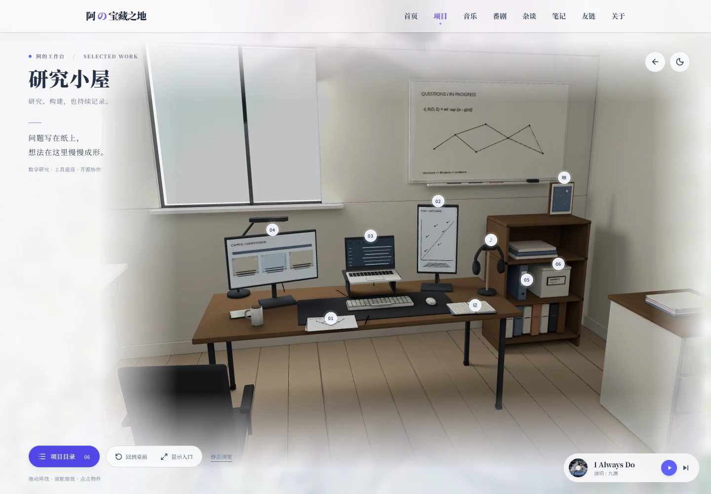
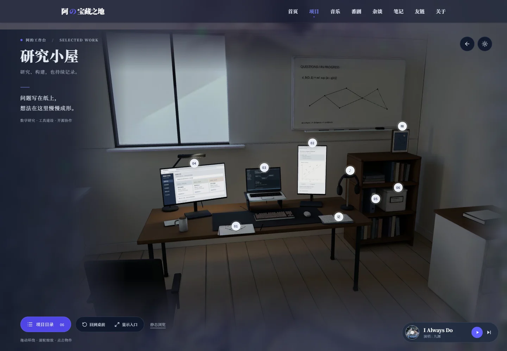
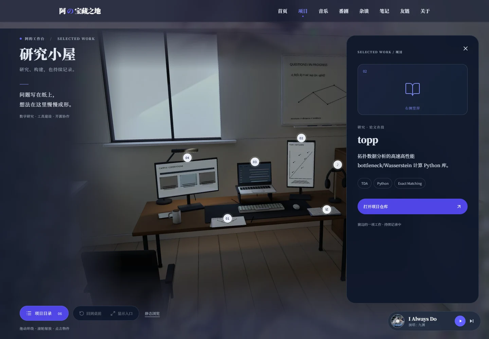
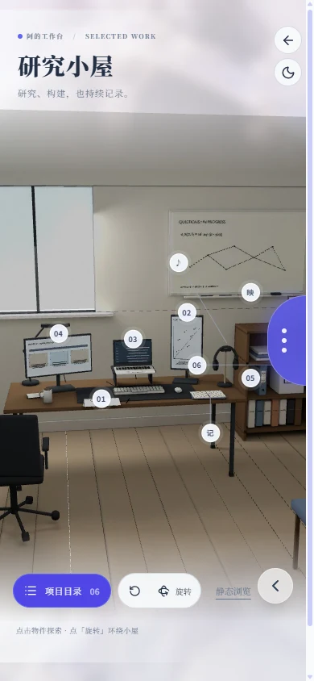
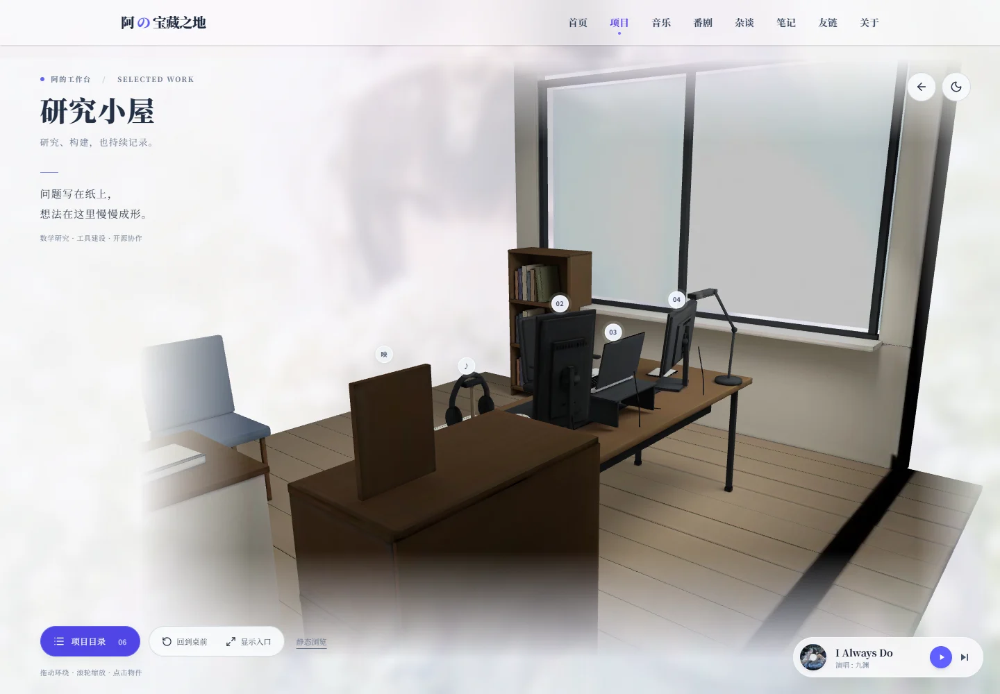
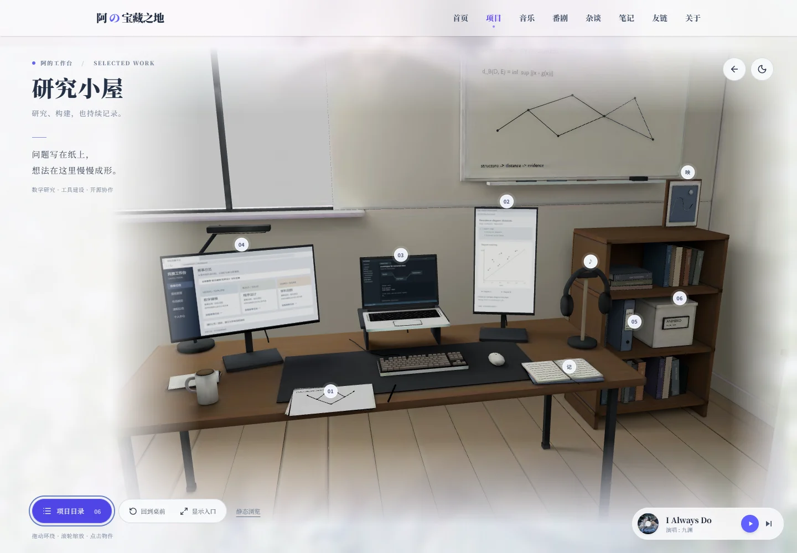
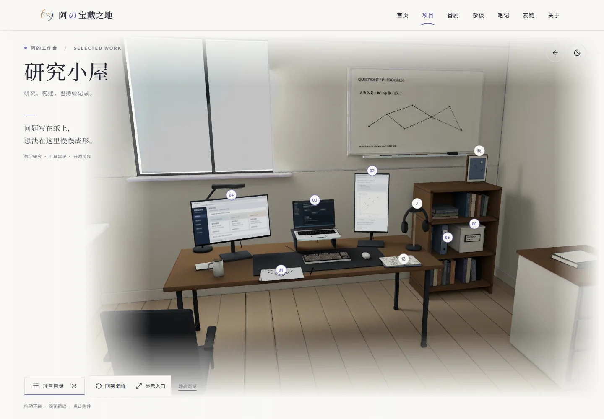
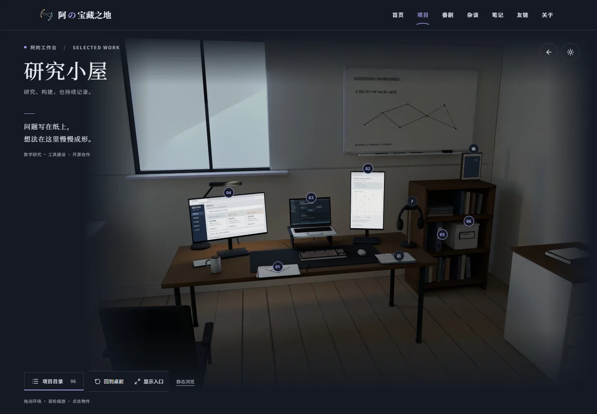
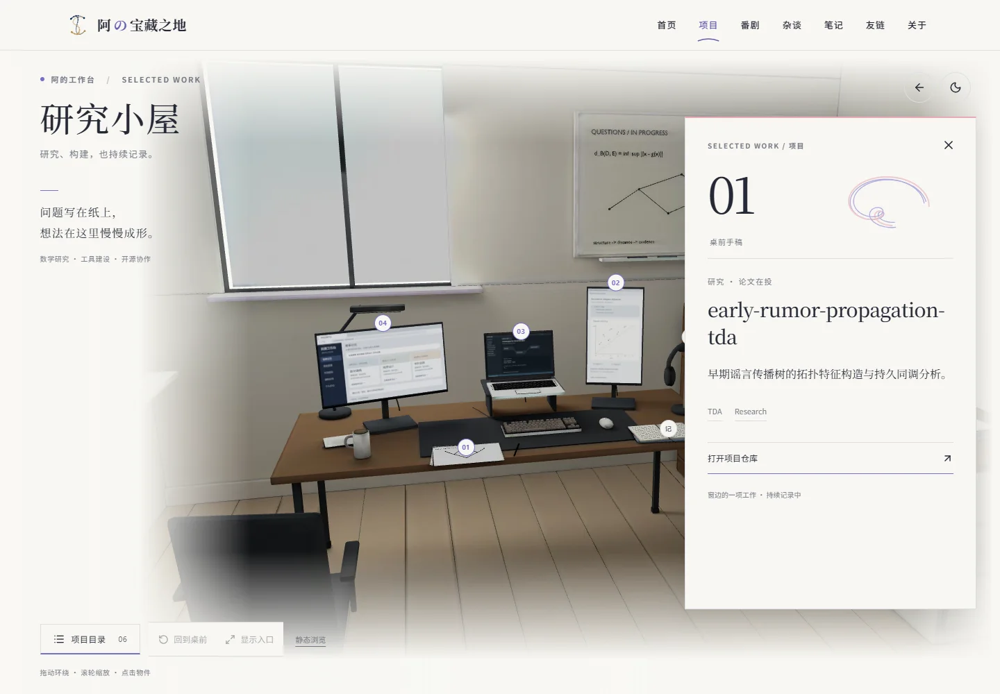
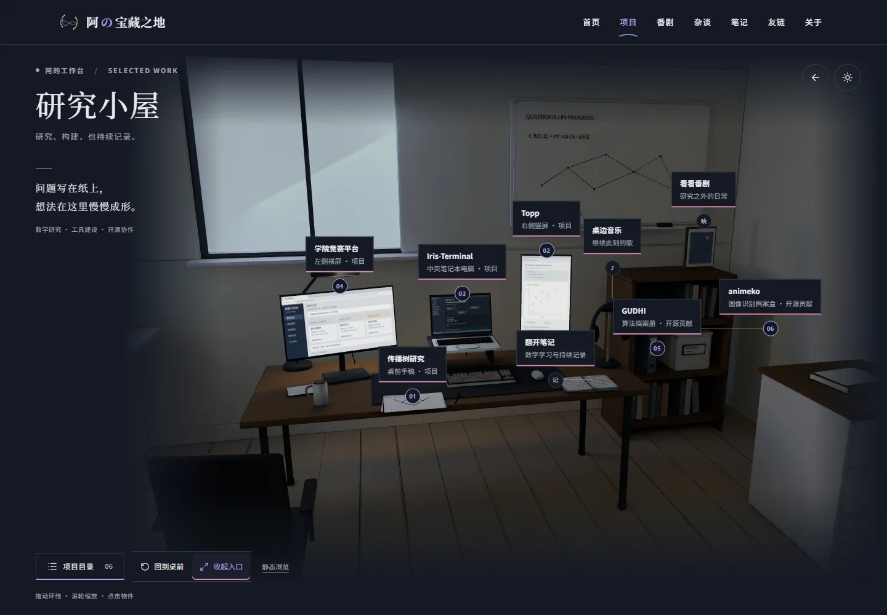

# 窗边研究小屋

## 首页实体空间修正（2026-11-24）

首页从第一帧起由同一场景里的实体窗墙、窗洞、山岸和反射水面渲染，不再在起步时从整屏贴图切换到三维。后墙落在原侧墙末端 `z=1.85`，保留原模型坐标、原地板和项目机位；18cm 窗洞与 12cm 窗台沿用原浅木照片作材质，窗框不随进度淡出。转身改为一段连续旋转，画布宽度不再随进度变化。实现细节及物理近似边界见[首页实体窗墙与反射水面](home-scene.md#首页实体窗墙与反射水面2026-11-24)。

几何测试覆盖整个往返路径中的对象稳定、窗墙深度写入、水面水平、岸线衔接及相机碰撞；相机测试检查旧转向分段处不再停顿。浏览器回归继续覆盖同一画布、原项目取景、详情、输入保护、历史恢复、减少动态与失败回退。

## 历史：恢复原首页与清空窗前（2026-11-24）

开场以 `c966422` 的浅木大窗首页为基线，恢复完整原室内照片、湖景取景、侧栏与音乐。撤销 #118 用自制超广角窗前取景替换首页的做法。项目页继续使用原宽／窄桌面机位、47° FOV 和 0.05/35 裁剪面；中段及自由查看的远裁剪设为 700，保留窗外远景。

共享场景只加载一套 `study.glb`，不加房子外景、连接房间或镜像工作台。蓝色阅读椅与落地灯合并在 `room` 网格中，只筛掉它们的三角形索引；在建立 BVH 前执行，桌面、原木地板、热点及模型节点身份保持不变。GLB 文件未重写，独立项目页路径仍使用完整原模型。

首页静止时，同一个 renderer 输出原合成器。任意非零滚动位置都停止整屏首页合成器，窗框／墙面按独立 alpha 层投影到后侧，窗外只绘制一份不透明摄影场景。远岸和水平水面共享边界，使用原谱场公式与水色；原图外的视野由特征配准的周边补图提供。上滑仅在原房间内后退与转身，下滑通过同一窗洞前进；URL 切换继续保留同一场景和相机。

验证入口：

```powershell
npm test
npm run lint
npm run build -- --webpack
python scripts/projects-preview.py --url http://localhost:3185 --connection-only --browser 'C:\Program Files\Google\Chrome\Application\chrome.exe' --output .sync/tmp-unified-world/restored-home-production
```

自动化除端点外，还检查 ±0.01、±0.03、±0.06、转身、穿窗和湖面等中间位置：同一画布保留，原整屏首页程序不再绘制，并保存实际截图。首页 GPU 与原公式逐通道对照，项目端点与同尺寸原独立 RoomScene 对照；几何测试检查移除椅灯、保留桌面、水平水面和远岸接缝。

本轮 Node 22.23.4 下 148 项测试、TypeScript 与 247 页生产构建通过，ESLint 0 错误／3 条既有警告。生产 Chrome 的 26 组连接检查通过，页面异常为 0。首页 1440×900 的原公式像素对照最大通道差为 1、平均差约 0.00009；项目 1430×900 的原独立画布对照差异为 0。报告及中段截图保存在 `.sync/tmp-unified-world/restored-home-production/`。本地音轨延长至 120 秒，防止完整路径检查尚未结束时夹具自然播完；播放状态和同一 audio 身份断言保持不变。

当前截图：[原首页](../images/unified-world/window.png)、[后退](../images/unified-world/backtrack.png)、[转身](../images/unified-world/turn.png)、[项目页](../images/unified-world/desk.png)、[穿窗初段](../images/unified-world/window-departure.png)、[湖面](../images/unified-world/lake.png)。

水体保留摄影倒影，周边与山体是有限深度近似，不能称为完整地形或真实反射模拟。音乐验证使用本地音轨，不代表外部服务验收。Safari、真实手机、人工视觉验收与生产发布均不包含在本轮自动检查中。

## 历史：原房间后侧直接落地窗与原项目取景（2026-11-24）

落地窗直接位于原 `study.glb` 地板的后侧边界 `z=2.4`，宽 4.44m、高 3.15m，下沿到地面。删除 #116 仍保留的近 6m 地面、灰色侧墙、天花和连接段。整个房间仍只有原模型和一套家具，后侧只补四条细窗框与窗外景观。

首页镜头贴近落地窗，家具位于身后；后退到桌前并转身，随后从同一个窗洞退到项目页原机位。相机轨迹可在任意位置反向，URL 切换保留同一画布与场景。首页采用窗前取景，山湖摄影素材、云、枝叶和谱场公式沿用原版；旧室内照片层关闭，窗框及地板由真实几何承载。

项目模型保持原坐标。宽桌面原机位 `(-0.62,1.9,2.72)`、窄桌面原机位 `(-0.75,2.3,4.8)`、目标 `(0.08,1.06,-0.5)`、47° FOV、0.05/35 裁剪面均恢复原值。共享画布使用原容器宽度，扣除滚动条，不再强制 `100vw`。原热点的背景与字体变量恢复；透视景观层不阻挡项目拾取和标签。

自动验证命令：

```powershell
npm test
npm run lint
npm run build -- --webpack
python scripts/projects-preview.py --url http://localhost:3185 --connection-only --browser 'C:\Program Files\Google\Chrome\Application\chrome.exe' --output .sync/tmp-unified-world/direct-window-production
```

原项目取景除了核对机位，还使用原独立 RoomScene 在同样桌面尺寸下实际渲染，与共享场景的项目端点做画布像素比较，报告为 `project-camera-comparison.json`。浏览器检查需要 Python Playwright/Pillow。几何测试确认地面没有新增连接空间、落地窗到地面、原模型未改位、只有一套物件，以及往返轨迹无碰撞。

本分支 Node 22.23.4 下 134 项测试、TypeScript 与 247 页生产构建通过，ESLint 0 错误、3 条既有警告。生产 Chrome 的 25 组连接检查通过，页面脚本异常为 0；1430×900 的原项目画布对照最大通道差与平均差均为 0。宽窄桌面机位、可逆往返、详情、音乐、历史／刷新／resize、减少动态与失败回退均已覆盖。

当前截图：[窗前首页](../images/unified-world/window.png)、[后退](../images/unified-world/backtrack.png)、[转身](../images/unified-world/turn.png)、[项目页](../images/unified-world/desk.png)、[原独立项目页对照](../images/unified-world/original-projects.png)、[回看落地窗](../images/unified-world/rear-view.png)。

音乐检查使用本地音轨，番剧请求固定失败回退，不作为外部服务验证；Safari 与真实手机未验收。截图用于核对实际机位与空间，外观仍需人工审阅，未执行生产发布。

以下为历史连接记录；#113 的房屋全景及 #115/#116 的额外房间或延伸空间均已撤销。

## 首页与项目页连接（2026-11-18）

以 `main@7ac92f2` 为基线，接入窗前／房间／湖景状态与既有素材显示切换。房间 GLB、默认镜头、原图片及材质沿用 main；不进行房间几何重建或同一三维空间内的连续镜头转场。

桌面使用 `5H` 原生轨道：首页窗前在 `2H`（进度 0），项目房间在 0（进度 -1），湖景状态在 `4H`（进度 +1）。滚动端点使用 replace 更新语义路由，普通链接保持正常导航；返回、前进、刷新及 resize 恢复归一化检查点。主动开启右下角「自由查看」后暂停轨道、允许缩放；结束或 Esc 先沿用原相机复位，再经返回状态回到窗前。详情打开时 Esc 优先关闭详情，返程可由新的滚动输入取消。

导航预览、论文窗口、项目详情、目录和自由查看期间暂停轨道滚动；播放器操作不推进轨道。页面共享原根级 MusicProvider/audio，场景仍分别加载与释放。模型失败时原静态图和六项目录保留。手机、平板继续使用 main 的点击导航及项目触控规则。桌面按与首页一致的设备判定启用，不再限制窗口尺寸或减少动态设置；减少动态仍保留原静态首页及相机减动规则。窄于 768px 的桌面预览也显式使用内部滚动容器，离开这两个页面后恢复原滚动样式。

针对本连接的复验入口：

```powershell
python scripts/projects-preview.py --connection-only --url http://127.0.0.1:3211 --browser <Chrome路径> --output .sync/tmp-main-project-scroll-fix/production
```

本轮仅接入窗前／房间／湖景状态、输入归属及返回恢复。原图片、模型、材质、默认构图不变；首页合成器只接状态显隐和既有纹理取景；湖景状态仅用已有山湖图切换为全屏、隐藏现有窗框和首页控件；返回窗前恢复原样。静态／减少动态同样复用原两张图，没有新增覆盖素材。该显示切换不代表同一三维房间中的连续镜头。

报告记录状态、路由与功能证据，不作为连续空间、人工视觉验收或生产发布证明。

原连接版本的验证记录：Node 22.23.5 下改动代码 ESLint、12 项首页/项目契约测试、TypeScript 与 247 页生产构建通过。Chrome 157 生产构建的 13 组连接检查通过，覆盖 600×600、800×600、1280×600、1440×900、减少动态桌面、详情、自由查看、音乐、历史、失败回退和手机分流，页面脚本异常为 0。报告位于 `.sync/tmp-main-project-scroll-fix/production/connection-report.json`。音乐使用浏览器本地 WAV/接口夹具，场景和素材未替换；远端音乐服务、Safari 与真实手机未验证。尚未部署。

本轮状态验证：Node 22.23.3 下 127 项测试、类型检查和 247 页生产构建通过；生产 Chrome 的 17 组状态／输入检查通过，页面脚本异常为 0。包括八种指定桌面尺寸、减少动态、三状态／反向滚动、可中断返程、六项目详情、Esc 优先级、播放器拖动与音频连续性、历史／刷新／resize、模型失败及手机分流。报告：`.sync/tmp-state-flow/production/connection-report.json`。图片、GLB、材质、房间渲染器和默认构图与 main 保持一致；未进行生产发布。

显示切换专项：1440×900 的实际 WebGL 输出与原窗前片元着色器使用同一纹理及 uniform 逐通道对照，差异为 0。记录：`.sync/tmp-state-flow/final/window-shader-comparison.json`。

> 2026-11-13：小屋与全站统一为固定浅色／窗光外观，主题按钮和夜间下载、解码、换贴图路径已删除。下文日夜对照与双贴图预算属于历史制作和验收记录，当前只预热自包含 GLB。历史资产与建模源保留。

`/projects` 将六个项目放进可环绕的研究工作间，延续首页「研究、构建，也持续记录」的表达。当前版本按真实尺度建模：74 cm 高、2.05 m 宽的胡桃木桌面，薄边框屏幕、键鼠、纸张和桌侧耳机架。左右副屏分别向中央内倾 15° / 17°，面板另有 6° / 5° 后仰；中央电脑的外壳、显示面和摄像头一起沿铰链后仰 12°。

照片只提供生活线索，空间布局重新设计：取消绿帘、厚地台和微缩比例，在后墙增加窗户与研究白板；左侧设阅读书架，右侧设资料柜与软木记录板，身后设阅读座椅和落地灯。家具背面完整，三面墙按观察方向淡出，环绕时可以看到各方向的内容。原始私人照片没有进入仓库或网页。

页面移除独立的大圆角舞台，以共享背景、宋体、靛蓝控件和半透明阅读层接入全站。初始视角从桌前自然俯看工作面；外围背景适度虚化，减少图案与文字对场景的干扰。
获奖案例、奖项层级与制作方法的原始证据仍在 [3D 研究文档](projects-3d-research.md)。本文记录实现结果，研究文档中的历史研究状态不代表当前实现状态。

## 内容与交互

| 物件       | 内容                        | 行为                         |
| ---------- | --------------------------- | ---------------------------- |
| 手稿       | early-rumor-propagation-tda | 轻抬纸张，传播树节点依次亮起 |
| 竖屏       | Topp                        | 持久图配对示意，选择时提亮   |
| 中央电脑   | Iris-Terminal               | 本地工作区示意，选择时提亮   |
| 横屏       | 学院竞赛平台                | 赛事信息示意，选择时提亮     |
| 算法档案册 | GUDHI 贡献                  | 档案册轻微抽出               |
| 识别档案盒 | animeko 贡献                | 档案盒轻微抽出               |
| 独立笔记本 | 笔记                        | 进入已有 `/blog` 路由        |
| 相框       | 番剧                        | 进入已有 `/anime` 路由       |
| 耳机       | 桌边音乐                    | 打开控制面板，复用全站播放器 |

六个项目的说明、仓库和论文状态从原页迁移，GUDHI/animeko 明确属于开源贡献。屏幕和纸上的图形是原创解释性示意，不是项目截图、实测数据或已发表成果。显示器包含薄边框、后壳、散热口、连接口和支架铰链；三块 LCD 分别使用学院竞赛后台、Iris 工作区与 Topp 配对笔记的清晰界面示意。

项目目录“音乐”和 3D 耳机热点都在本页打开共享播放器面板，不再跳转到退役的 `/music`。目录按钮支持键盘 Enter，关闭面板后焦点返回目录开关。首次打开才初始化歌单，等待时显示连接提示，空歌单/失败时可重试；加载后根 Provider 继续持有唯一 audio，切到笔记等页面时不中断播放。分批整改与本地浏览器验证范围见[架构审计](codebase-architecture-audit-2026-11-12.md)。

外接键盘按 19.05 mm 键距建立 87 键 ANSI 布局，包含错位字母行、功能区、独立方向区、6.25u 空格、不同宽度修饰键、键帽斜裙与浅凹顶面、F/J 定位条及字印。笔记本使用独立的低矮键盘、铰链、触控板和扬声器孔。

两侧与右后方共放置 36 本书：每本都有封皮、书脊、内缩纸页和学科标题，按书挡成组竖放，并搭配横放书堆、少量倾斜和前后错落。GUDHI 档案册另有封皮和纸芯；animeko 仍保留原有档案盒归属。书脊是自制学科标识，没有使用真实出版物封面。

桌面拖动环绕；启用首页连接时滚轮返回首页，「自由查看」中滚轮缩放，其他视口保持原缩放规则。相机有俯仰与距离限制，近侧墙面淡出。物件与 HTML 热点都能单次打开详情，详情开启时暂停场景操作，Esc/关闭恢复焦点。入口命中区域至少 44×44 CSS px，投影相邻时错开并用细线指回物件，遮挡检测隐藏不可见入口。main 的沉浸式布局隐藏了旧工具栏，本文下方涉及「回到桌前」「显示入口」等按钮的验收属于历史版本。

手机默认保留纵向页面滚动，主动点「旋转」才启用环绕及双指缩放。项目目录包含原生展开控件、说明与真实仓库链接，预渲染后即存在；模型失败、WebGL 不可用或用户选择静态浏览时仍可访问全部内容。

## 全站接入与资源生命周期

- 标题继承站内宋体，背景、导航、圆角半透明阅读面板和悬浮播放器延续现有样式。
- 外观固定使用 GLB 内嵌窗光贴图；音乐只使用 `MusicProvider`，没有第二套音频播放实例。
- 沿用桌面 `app-scroll-root` 与移动端文档滚动，不在 window 上接管滚轮。
- 3D 就绪时设置临时 `data-project-room-active`；Field 保留后景，前景粒子与交互波纹停止绘制，静态浏览或离开页面立即恢复。
- Three.js 与 GLTFLoader 在客户端边界加载，使用 three-mesh-bvh 建立拾取索引。静止时停止场景 RAF，页面后台暂停；卸载释放几何、材质、纹理、监听器和 WebGL renderer。
- React Strict Mode 会复用 canvas，只有 canvas 实际脱离文档后才强制释放 context，避免旧实例的异步 context-loss 事件杀死替代实例。
- GLB 请求有 20 秒超时，可切静态或重试；context loss 进入同一可读降级状态。

## 可编辑资产与重建

模型、材质、示意屏幕与小幅植物插画由本项目制作，没有复制获奖作品的模型、图片、声音或代码。资产遵循本仓库许可证。保留 [Blender 源文件](../../design/projects-room/study.blend)、[烘焙图集](../../design/projects-room/study-atlas.png)、[细节原图](../../design/projects-room/study-details.png)、[键位与图集坐标](../../design/projects-room/study-details.json) 与 [建模脚本](../../scripts/build-project-room.py)。

当前默认烘焙为 32 samples，可通过 `ROOM_BAKE_SAMPLES` 调整；细节文字不依赖增加采样数量来保持清晰。

工具版本：Blender **4.5.9 LTS**，Node **22.23.3**；Blender 来自官方便携发行包，并核对官方 SHA-256。依赖由本仓库 lockfile 安装。

```powershell
# 在仓库根目录；blender 指向本机 Blender 4.5 LTS 可执行文件。
node scripts/encode-project-room.mjs --surfaces
blender -b --python scripts/build-project-room.py
node scripts/encode-project-room.mjs
```

脚本生成真实尺度工作间、完整家具背面、九个交互物件及对应 `anchor_*`。统一 UV 后在 Cycles 中分别烘焙日间窗光与夜间台灯的直接光、间接光、表面色及屏幕自发光，离线降噪后导出 GLB 和夜间 JPG，随后用同一个场景渲染日间、夜间、详情及手机日夜构图；最后一条命令编码为 WebP。第一条命令以 SVG/Sharp 重建原创屏幕、键帽字印和书脊，不请求外部素材。每次重建后运行资产测试，保证 React 目录与模型命名没有漂移。

交互按组保留，日夜各用一张 4096² 图集：左上角保留经 OpenImageDenoise 离线降噪的 3072² 房间光照；右侧和底部保留高分辨率屏幕、键帽字印与书脊。印刷表面乘以烘焙的局部光照，LCD 保留自发光；小键帽合并同一键盘的光照采样，并为顶面、斜裙和侧面保留稳定色阶，避免亚像素 UV 岛形成脏色块；文字区域不经过降噪，以免被抹成色块。所有物件仍使用同一张图集和无光照材质，不增加运行时字体或屏幕绘制。GLB 内嵌日间贴图并声明 `KHR_materials_unlit`，夜间图由同一路由资源单独加载；Three.js 直接显示烘焙结果，避免重复照明。默认视角与预览图使用相同表面与近似相机参数。运行时没有实时阴影或后处理。无光照模型导出时省去不用的法线属性，Blender 源文件保留材质与建模法线。图集边长由 3072 增至 4096，GPU 纹理占用因此增加；下载体积、三角形与 draw call 预算继续由资产测试约束。

仅压缩源文件由 `preloadRoomAssets` 在标签页内复用；场景挂载后解析模型、解码贴图，并为各组建立局部坐标的静态 BVH。每次投影或点击只变换射线，保持物件微动后的命中与遮挡正确；挂载后的模型、贴图、BVH、ImageBitmap 和监听器随路由卸载释放。2026-11-12 已删除无调用者的 CPU 预解析/60 秒待用缓存；启动阶段不再承诺预先解析模型。历史加载测量见 [全站启动与导航](site-startup.md)。

资产测试将 **GLB 与夜间贴图之和**限制在 4 MiB 内，全部几何少于 100k 三角形、primitive 少于 80；这些是资源规模检查，不等于网络或帧率验收。

## 首版历史验证（PR #37）

日期：2026-09-27。Node 22.23.3 / Windows；浏览器为 Headless Chrome **154**，GPU 为 **Intel Arc / ANGLE Direct3D11**。手机项目表示同一机器上的窄屏仿真，不能替代真机结果。

| 检查                                | 结果                                                                      |
| ----------------------------------- | ------------------------------------------------------------------------- |
| 类型检查、改动文件 ESLint、Prettier | 通过                                                                      |
| Node 测试                           | 70 项通过，包含 GLB 契约及前后景独立暂停断言                              |
| 完整生产构建                        | 通过，245 个静态页面；保留原有 KaTeX 中文数学警告                         |
| 六个项目与详情                      | 全部可打开，仓库链接和贡献归属正确                                        |
| 键盘/减少动态                       | 焦点进入详情、Esc 返回入口；减少动态仍可操作                              |
| 环绕与 resize                       | 拖动到房间背后，近侧墙面隐藏；恢复桌前、桌面切换手机视口通过              |
| 手机布局                            | 390×844 下九个热点无重叠，无横向页面溢出；旋转开关恢复 pan-y              |
| 音乐                                | 耳机打开共享控制面板；页面只有一个 audio 实例                             |
| 模型请求失败                        | 阻断 GLB 后显示静态图与六项目录，解除阻断可重试                           |
| WebGL context loss                  | 模拟丢失后降级，重试恢复 3D                                               |
| 重复挂载                            | 连续三轮静态/3D 切换，每次卸载后无残留场景 canvas                         |
| Field 共存                          | 小屋中前景/交互层非透明像素均为 0，后景继续；进入笔记后前景恢复且场景卸载 |
| 桌面滚动                            | 进入笔记后文档 scrollY 仍为 0，使用原有内部滚动                           |

生产版本在 1440×1000、DPR 1、normal 模式下，通过持续微幅滚轮缩放触发渲染，预热 0.5 秒后采样 3 秒。以场景实际提交绘制后的 DOM 诊断更新采集间隔：109 次绘制，约 **36.2 fps**，间隔 P50 **29.5 ms**、P95 **36.3 ms**、最大 **39.8 ms**。静止 0.6 秒观察到 **0 次额外绘制**；默认视角为 **44,584 三角形 / 12 draw calls**。

**桌面 60 fps 目标尚未达到。** 此记录是一次本机生产版本采样，不是全设备性能保证；没有将窄屏仿真写成真实手机 30 fps 验收。真实移动端 Safari、其他 GPU、冷缓存网络传输与后台恢复仍需补充实机验证。静态入口始终可用。本地构建没有 Blob 凭据，构建脚本按既有规则跳过图片上传。

## 写实空间修订验证（PR #38）

日期：2026-09-27；Node 22.23.3 / Windows，生产构建，Headless Chrome 154 / Intel Arc ANGLE Direct3D11。新版资源为 GLB **3,037,792 bytes** + 夜间 JPG **520,411 bytes**，合计 **3,558,203 bytes（3.39 MiB）**；默认视角 **45,473 三角形 / 13 draw calls**，日间预览 **65,026 bytes**。

| 检查                         | 当前结果                                                                            |
| ---------------------------- | ----------------------------------------------------------------------------------- |
| ESLint、Prettier、TypeScript | 通过；完整生产构建含 245 个静态页面                                                 |
| Node 测试                    | 70 项通过；预算合计两种光照，断言 GLB 使用无光照材质                                |
| 六个物件入口与目录           | 六项详情、真实仓库链接、暂停场景、Esc 与逐项焦点恢复通过                            |
| 环绕                         | 已观察桌前、侧面、家具背面与侧后方区域；近侧墙面退出遮挡                            |
| 窄屏                         | 390×844 下九个入口无碰撞、无横向溢出；旋转时 none，退出恢复 pan-y                   |
| 加载失败                     | 浏览器内分别注入 GLB / 夜间贴图 fetch 拒绝，展开六项目录，卸载 canvas；恢复后可重试 |
| context loss / 重复挂载      | 模拟丢失后进入可读降级；三轮静态/3D 切换分别为 0/1 个场景 canvas                    |
| 音乐                         | 保持一个共享 audio 实例                                                             |

桌面 1440×1000、DPR 1、默认 normal 模式：持续微幅滚轮缩放，预热 0.5 秒后取约 3 秒样本。实际提交绘制 **177 次，59.3 fps**；帧间隔 P50 **16.7 ms**、P95 **17.5 ms**、最大 **33.7 ms**。静止 0.6 秒 **0 次额外绘制**。窄屏 390×844、DPR 1、主动旋转模式、同机同浏览器下，测得 **30.0 fps**，P50 **33.3 ms**、P95 **33.9 ms**。

当前桌面表现接近 60 fps，样本中仍有超过一帧预算的间隔。手机数值来自桌面窄屏仿真，不能替代真机验收；真实手机横竖屏、Safari、其他 GPU、冷缓存传输和完整显存回收仍需实机复核。触控横屏在代码中保留旋转开关，并在纵横构图切换时重置相机；本机仿真没有可靠改变 primary pointer 的 coarse 媒体查询，未把它写成真机通过。

## 物件细节修订验证

日期：2026-09-27。最终 GLB **2,491,332 bytes** + 夜间贴图 **844,512 bytes**，合计 **3,335,844 bytes（3.18 MiB）**；默认画面 **55,055 三角形 / 13 draw calls**。下载体积仍低于 4 MiB；4096² 日夜图集比上一版占用更多 GPU 纹理内存，不能以下载体积减少推断显存也减少。

- 修改脚本/测试 ESLint、Prettier、TypeScript 与生产构建通过（245 页）；7 项小屋相关测试通过，覆盖预算、三块屏幕的高清 UV、外壳光照 UV、87 键布局、资源预热和真实模型 BVH 命中。没有把历史的全站测试结果计入本轮。
- 生产浏览器核对日间、夜间、最近缩放、侧后方环绕与显示器背面；更新下方页面截图。六项目详情、仓库链接、Esc 关闭与焦点恢复全部通过。
- 两轮静态/3D 切换均从 0 个场景 canvas 恢复为 1 个；手机 390×844 无横向溢出，旋转时 `touch-action: none`，退出恢复 `pan-y`。浏览器错误列表为空。
- Windows / Headless Chrome 154 / DPR 1，默认 Field 模式，持续轻微缩放并观察实际绘制提交：桌面 1440×1000 样本 **51.7 fps**，P50 **17.9 ms**、P95 **35.3 ms**、最大 **52.2 ms**；桌面窄屏仿真 **30.0 fps**，P50 **33.3 ms**、P95 **34.3 ms**。两者静止 0.6 秒均无额外绘制。桌面样本未达到稳定 60 fps，窄屏结果不等于真实手机验收；也不与上一节 normal 模式样本直接比较。

## 交付画面

日间：



夜间：



项目详情：



手机：



侧后方环绕：



近景：



## 界面整理（#52）

依据本地 `frontend refactoring.md` 的 §2、§3.3、§8.1、§9，以及 `interaction research.md` 对中心视觉与外围控件的区分。后者是本地研究原稿，本次不上传。首页的人物、斜切侧栏和时间周期属于首页任务，不移植到项目页。

### 视觉规则

- 日间直接采用原方案 `#F8F7F3 / #252936 / #747985 / #7470C8 / #E8A8B5 / #DDDDE2`；夜间采用 `#141923 / #E9EAF0 / #A1A7B5 / #A4A0EE / #D68EA9 / #343A48`。移除项目页原有的 slate 灰色蒙层，配色限定在本页 CSS 模块。
- 研究小屋继续是主视觉，不增加场景外框。标题与长说明采用宋体／Newsreader 回退，操作与元信息使用原方案的 Inter／思源黑体回退；不请求外部字体。
- 工具栏使用细线、文字与可辨认的状态反馈，避免大面积实心强调色。热点保留编号、命中区域与避让逻辑，标签采用同一日夜表面与樱花粉细线。
- 项目档案按编号、物件、项目状态、标题、正文、技术信息、真实仓库链接分层。静态曲线复用既有 `sampleSpectralFamily` 的低阶采样，只在模块初始化时生成 SVG 路径，没有第二套 Canvas 或持续动画循环。
- 控件悬停 180ms、档案入场 300ms；减少动态效果仍可使用全部操作。手机保留文档滚动，平板粗指针布局单独预留桌面导航的 72px 空间。

### 隔离预览与复现

独立分支 `feat/projects-room-52`。本地预览不需要 Blob、Bangumi 或 GitHub Token；外部番剧预热不可用不影响小屋和项目档案。

```powershell
npm.cmd ci
npm.cmd run build
npm.cmd run start -- --hostname 127.0.0.1 --port 3152
```

打开 <http://127.0.0.1:3152/projects>。保持服务器运行，在具备可选 Python Playwright 的第二个终端执行：

```powershell
python -m venv .sync/tmp-projects-tools
.\.sync\tmp-projects-tools\Scripts\Activate.ps1
python -m pip install playwright
python -m playwright install chromium
npm.cmd run test:projects
# 可使用本机 Chromium；--case 可单独复现一个尺寸。
npm.cmd run test:projects -- --browser "C:\Program Files\Google\Chrome\Application\chrome.exe" --case 390x844
```

脚本仅将截图和 `report.json` 写入忽略目录 `.sync/tmp-projects-52-evidence/`；`--output` 可指定其他目录。音乐 API 与支持 Range 的 WAV 只在测试浏览器中拦截，运行真实根 Provider 与 HTMLAudioElement，不代表外部音乐服务验收。3D 模型、贴图、项目内容、热点、旋转、焦点返回和静态回退继续使用原实现。

### 桌面画面与本轮验证

2026-11-05，Node 22.23.3、Windows、Chrome 无头生产预览：

- ESLint 0 errors（4 条既有 warning）、Next 类型生成与 TypeScript、83 项现有测试、Prettier 和完整生产构建通过；构建生成 247 个页面，保留既有 KaTeX 中文警告和 GitHub 贡献接口超时回退。
- 1440×1000、960×800 日夜模式下，六项目均能由热点及目录打开；真实仓库链接、Escape／关闭与焦点返回、热点标签、拖动环绕与回到桌前均通过。
- 共享 ThemeProvider 切换、耳机打开音乐面板、真实单一 audio 的播放／暂停、静态／3D 切换、GLB 请求失败及 WebGL context loss 后降级／重试通过。正常浏览器路径未捕获 pageerror；故障检查主动制造资源错误。
- 顺带完成 Chromium 的 768×1024、390×844、320×568、844×390 日夜仿真；按本次用户收尾要求，手机不作为本轮视觉交付和继续打磨范围，也不代表实机验收。
- 模型、贴图、项目数据及 RoomScene 交互代码与 main 一致。没有运行外部图片上传、修改生产配置或合并 main。音乐使用本地 WAV 夹具，外部音乐服务、Safari 与真机未据此声明通过。

以下为最终生产构建的原始浏览器截图，仅压缩为 WebP；完整 PNG 和报告保留在本机 `.sync/tmp-projects-52-final/`。









人工视觉验收仍待进行。保持 Draft，不合并 main，不修改生产部署配置。
